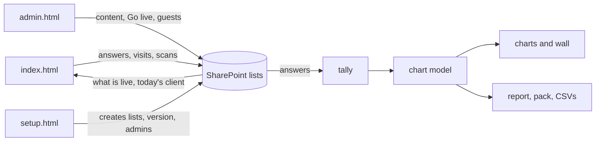

# Pursuit Managed Services

An interactive session app for Deloitte client visits. Participants answer short activities on iPads; a facilitator runs the day from an admin
page and shows the results live on a projector; leaders get a report of what the room said. It runs as three HTML files in a SharePoint document
folder and keeps everything in SharePoint lists: there is no server, nothing to install on the devices and nothing loaded from outside the tenant.

| Who | Uses | To |
|---|---|---|
| **Participant** | an iPad (or any browser), `index.html` | join by a link or a personal QR code, answer each activity, see their progress |
| **Facilitator** | a laptop, `admin.html` (PIN) | pick today's client and go live, manage guests and QR codes, watch results, project them, export them |
| **Admin** | `admin.html` | set up clients, then in Content each client's activities and its look (Brand Studio), side by side |
| **Site owner** | `setup.html` | create and check the SharePoint lists, add the first admin, run a self-test |

```text
 iPads ──── index.html ──┐                           ┌── PMSClients, PMSActivities, PMSActivityQuestions, PMSAnswerOptions
                         │   SharePoint REST, the    ├── PMSClientSessions, PMSAppSettings (what is live)
 Laptop ─── admin.html ──┼── browser's own sign-in ──┼── PMSParticipants, PMSParticipantAnswers, PMSVisitLog
                         │   (same site, no server)  ├── PMSGuestList, PMSGuestQRCodes, PMSAdminUsers
 Owner ──── setup.html ──┘                           └── PMSClientImages (pictures)
```

## Features

| Role | What it can do |
|---|---|
| Participant | A welcome in the client's look and words; an Activities hub (one activity at a time, or all open); one question per screen, with Next and Back; a graded question says right or wrong at once, offers one Retry, and reveals the answer after a second wrong pick; progress is saved as each answer is given and a reload picks up where it was; optional sound and confetti; screens that move by the kind of question (the answers come in from both sides; off with the device's reduced motion or the client's switch); works with the keyboard and a screen reader, in portrait and landscape, from a phone to a desktop. |
| Facilitator | **Today**: pick a client and date, see what is not ready, Go live (verified), choose staff sign-in or guests with personal QR codes, sequential or open activities, End and Reopen, the participant link and its QR. **Guests and QR**: paste names, generate single-use codes, print a sheet of cards. **Results**: every session, newest first (and the newest iPad first), with each person's progress, Restart (under its row) or Remove a visit, **Delete session** (all of a session's data, permanently, after a warning; never the live one), the live charts, the **Live display** and its full-screen **wall** for the projector (no names on it). |
| Admin | **Clients**: names, slugs, archive, a check-in QR for shared iPads; a row's **Brand** opens that client's look in Content. **Content** is one client's workspace: a client header (its logo, the client picker, Live now) and two views, **Activities** and **Brand**, each kept as it was left while the other shows. **Activities**: the client's activities and questions (a question is edited where it is, in its own row), copy from another client, duplicate, reorder, picture tiles, a preview. **Brand** (Brand Studio lives in Content, beside the client's activities): colours checked for contrast, a logo, a hero and a background, cropped and compressed in the browser, previewed on real participant screens at real device sizes; an **Animations** switch per client (also on Today); "Preview an activity in this look..." once it is saved. |
| Site owner | **Setup**: shows exactly what the site lacks, creates only that (never deletes or renames), checks every list strictly, marks the site ready, adds admins, seeds two sample clients, and a self-test of the site in 11 steps. |
| Leaders | **Leader report (PDF)**: at a glance on page 1, then each activity on its own pages, every question as a chart, the counting rules on the last page. **Summary pack (PDF and PowerPoint, 16:9)** from the Live display, with speaker notes. **Summary by activity (CSV)** and **All answers (CSV)**. |

### Question types

| Type | The participant | Counted as | Charted as |
|---|---|---|---|
| Single choice (`single-select`) | picks one answer | graded when one answer is marked correct (first pick right = right first time), else a poll | bars that add up to 100%; the correct answer in dark green with a tick and "Correct"; the top choice in blue |
| Multiple choice (`multi-select`) | ticks any number | never graded | bars, each share on its own (they add up to more than 100%) |
| True or false (`true-false`) | picks one | graded when one is marked correct | one split bar |
| Confidence scale (`confidence-continuum`) | picks a place on a scale | the place's value | a column per step, the average as a line, three bands |
| Ranking (`ranked-voting`) | orders every answer | support score 0 to 100 (100 = everyone ranked it first) | bars of support, with places |
| Written answer (`open-text-feedback`) | writes up to 1,000 characters | not graded | the words that came up most, and the comments |

Every number on a chart is worked out in one place, so the screen, the wall, the PDF, the PowerPoint and the CSV agree. Scores use each person's
**first** answer only.

## Technology

| Part | What | Version (`package.json`) |
|---|---|---|
| UI | Svelte with TypeScript | `svelte` ^5.57.2, `typescript` ^5.9.3 |
| Build | Vite, with `vite-plugin-singlefile` (each page one HTML file) | `vite` ^8.3.4, `vite-plugin-singlefile` ^2.3.3 |
| Styles | Tailwind CSS 4 and design tokens; Open Sans embedded in every page | `tailwindcss` ^4.3.3 |
| Routing | `svelte-spa-router` (hash routes) | ^5.1.1 |
| Exports | jsPDF, PptxGenJS (admin page only, loaded on first use) | `jspdf` ^4.2.1, `pptxgenjs` ^4.0.1 |
| Other | lean-qr (QR codes), canvas-confetti | `lean-qr` ^2.7.4, `canvas-confetti` 1.9.4 |
| Runtime | Three static pages in one SharePoint folder; same-origin SharePoint REST with the user's sign-in; settings in `pms-config.txt` beside them | |
| Local stand-in | Express over JSON files (`server/`), for development and tests only | `express` ^5.2.1 |
| Tests | Node's test runner; Playwright in Chromium, WebKit and Firefox; axe-core; pdf.js to read back PDFs; a local copy of the PCOE site | `@playwright/test` ^1.64.0, `@axe-core/playwright` 4.13.0, `pdfjs-dist` 5.4.624 |

Node 22.12 or later. `docs/project-map.json` lists every library with its version and role, read from `package.json`.

## How it fits together



A page reads its settings file, then which session is live (one request), then the client, the session and its activities together (one more): two
rounds before the first screen. Each answer is saved in the background as it is given, one request per save; the facilitator's screens look for news
every 10 to 15 seconds, the Live display every 12. More: [docs/DATA-FLOW.md](docs/DATA-FLOW.md).

| Module (`migration/src/lib/`) | What it holds |
|---|---|
| `data/` | the data layer: `dataService.js`, the door, over its parts (`core.js` holds its state and is the only code that talks to SharePoint) |
| `schema/` | the lists and columns, named once |
| `settings/` | how a page starts and finds its settings |
| `participant/` | the boot sequence, the visit, the pager's rules, saving answers |
| `admin/` | the admin screens' rules and data |
| `results/` | the tally, the chart model, the palette, names, takeaways |
| `exports/` | the leader report and the summary pack |
| `brand/` | a client's look, Brand Studio's pictures |
| `effects/` | sound and confetti |
| `motion/` | the screens' motion: the plan, the tokens, the one door |
| `setup/` | Setup's plan, Create, admins, sample clients |
| `common/` | the product name, focus, kiosk mode, polling |

Each folder, file and dependency: [docs/MODULES.md](docs/MODULES.md) (generated from the code).

## SharePoint at a glance

Fifteen lists and one picture library, schema version 6 (Prompt 21 added who may do what: `PMSUsers`, `PMSRoleAssignments`, `PMSAuditLog`; the admin page's People tab, for a Super admin, manages them; its Phase 3 gave a session a start time, a title, its order in the day, a period and when it was planned, so that a client may have several sessions a day, planned on the client's page and started by a Producer on Today). Every column is described in [SHAREPOINT-LISTS.md](SHAREPOINT-LISTS.md); setting up, the
settings file and what SharePoint does are in [docs/SHAREPOINT.md](docs/SHAREPOINT.md).

| List | Holds |
|---|---|
| PMSClients | each client: name, slug, look |
| PMSClientSessions | each client and day: the session people join |
| PMSActivities, PMSActivityQuestions, PMSAnswerOptions | the content, per client |
| PMSParticipants | each visit (one person on one device in one session) |
| PMSParticipantAnswers | each visit's answers, in one item |
| PMSGuestList, PMSGuestQRCodes | named guests and their single-use codes |
| PMSVisitLog | one row per browser tab: how staff are named in Results |
| PMSAppSettings | which session and client are live; the lists' version |
| PMSAdminUsers | facilitators' names and PIN hashes |
| PMSClientImages (library) | the clients' pictures |

**Permissions:** participant accounts write the session, visit, code, visit-log and answer lists and only read the rest; they must have **no access to
PMSAdminUsers**. Facilitators edit the content lists. A site owner runs Setup.

## Quick start

Clone the repository and open its folder. It needs Node 22.12 or newer (`.nvmrc` says 22). On a computer the project was just moved to, install the
packages with `npm ci` (never copy `node_modules` from another computer) and check everything with `npm run doctor`:

```bash
npm ci
```

```bash
npm run doctor
```

Try it locally, with a dummy database, in one command:

```bash
npm run dev
```

This starts the local server (the stand-in for SharePoint) and the three pages: participant http://localhost:5173, admin http://localhost:5175/admin.html,
Setup http://localhost:5176/setup.html, and prints the address for an iPad. The dummy data is a copy of `server/data` made into `.local-data/` (ignored by git),
so trying the app never changes a tracked file; `npm run dev -- --reset` starts again from the seed. Pages reload as you edit.

Make the files to upload to SharePoint, from this folder as it is now:

```bash
npm run build
```

That puts `index.html`, `admin.html`, `setup.html` and `pms-config.txt` in `build-svelte/upload/` (`npm run build -- --zip` also makes `upload.zip`).

The seed data's admin PIN is the demo PIN 1234, on the local server only (`server/data/adminusers.json` holds its hash). To try the shipped pages
against a stand-in of the real site instead (they need `https`), make a package and serve it:

```bash
npm run package:release
```

```bash
npm run local:site -- --open
```

Tests:

```bash
npm run check:svelte
```

```bash
npm test
```

```bash
npm run test:migration
```

Deploying the official, checksummed package (from a clean commit): `npm run package:release` makes `build-svelte/package/pms-<commit>/` with the pages, `pms-config.txt`, checksums and a `RUNBOOK.md` with
every step for the site. Upload to a test folder first. See [docs/SHAREPOINT.md](docs/SHAREPOINT.md#deploying-a-package).

### Commands

| Command | What it does |
|---|---|
| `npm ci` | Installs the packages exactly as the lock file says. Use it on every new computer; never copy `node_modules` between computers. |
| `npm run doctor` | Checks this computer (Node version, Vite install, git, free ports) and prints the fix for anything wrong. Changes nothing. |
| `npm run dev` | Everything for local work: the server plus the participant (5173), admin (5175) and Setup (5176) pages, on a dummy database in `.local-data/`. |
| `npm run dev -- --reset` | Same, after throwing the dummy data away and copying the seed again. |
| `npm run dev -- --only admin` | Same, with one page only (`participant`, `admin` or `setup`). Add `--open` to open the browser. |
| `npm run dev:api` | The local server alone, restarting when its files change. The single pages are `npm run dev:svelte`, `dev:svelte:admin` and `dev:svelte:setup`. |
| `npm run build` | Builds this folder as it is now and puts the four files to upload in `build-svelte/upload/`. `-- --zip` also makes `build-svelte/upload.zip`. |
| `npm run package:release` | The official package with checksums and `RUNBOOK.md`, from a clean commit, in `build-svelte/package/`. |
| `npm run local:site -- --open` | Serves a built package as a stand-in of the real SharePoint site (needs `package:release` first). |
| `npm run check:svelte`, `npm test` | The fast checks to run after every change. |

Working on another computer after changing code by hand: `npm ci`, `npm run doctor`, `npm run dev` to look at it, `npm run build` to get the files to upload.

## Repository layout

```text
migration/            the app: HTML shells, Vite and Playwright configs, tsconfig
  src/                entries (main.ts, admin-main.ts, setup-main.ts) and the three apps
    lib/              the modules, in folders (see above)
    admin/ charts/    admin screens; the hand-drawn Results charts
    routes/ pager/    participant screens; one question per screen
    components/       participant building blocks
    setup/ dev/       Setup's pieces; the styleguide (dev only)
    styles/ assets/   tokens, fonts, palette; inlined fonts and sample pictures
server/               the local stand-in for SharePoint (Express + JSON, data/ is seed data)
scripts/              node tests, the mocked SharePoint, oracle, baselines, generators, packager
  migration-tests/    the Playwright specs
  local-site/         the local PCOE site and screenshot harness
public/assets/        the local server's pictures, and the brand files
docs/                 the documents (history/ is the record)
CLAUDE.md, AGENTS.md  for coding agents
QA-TESTING.md         what only a real site, iPad, projector or printer can show
```

## Quality gates

| Gate | Proves | Time |
|---|---|---|
| `npm run check:svelte` | types and Svelte diagnostics clean | 6 s |
| `npm test` | 1,300+ node tests: both adapters, request baselines, budgets, counting, exports, schema, documents | 20 s |
| `npm run test:report:mutations` | the report tests catch 64 deliberate breakages | 22 s |
| `npm run oracle -- --seeds 500` | 500 random sessions recounted independently: 0 differences | 6 s |
| `npm run test:migration` | every screen in real browsers, accessibility (axe), devices, request counts | about 45 min |
| `npm run test:local-site` | the local site answers as the real one, Setup's self-test 11 of 11 | 3 s |

What each proves, and how to run one: [docs/TESTING.md](docs/TESTING.md). **What is proven on the real site:** the lists, Setup, Go live, guest and
staff visits, the Results charts on a Windows laptop and an iPad, and the self-test (PCOE, 14 to 16 Oct 2026). Not yet: the newest exports opened in
PowerPoint and Excel, printing, the projector and the open items at the top of [QA-TESTING.md](QA-TESTING.md).

## Wish list

Proposals, not features: nothing below exists yet. Size: S (days), M (a week or two), L (more). ◆ needs a decision from the owner.

**Content and authoring**
- Import activities from a spreadsheet (CSV or Excel), with a preview before anything is saved. M
- Session templates: a set of activities to start a client from. M
- Follow-up questions and an activity's purpose in the content (the dataset has purposes the app has no place for). M ◆
- A "reveal" line after "Guess the brand" (needs a column: schema version 5). M ◆
- A ranking version of "Straight talk". S ◆
- Whether Setup's "Seed sample clients" uses VJR's dataset instead of the older pack. S ◆

**Participant experience**
- Multi-language content and screens. L ◆
- An offline queue for flaky iPad Wi-Fi beyond today's in-tab retry. M
- Retry and Home nearer the answers on an iPad in portrait. S
- A client's logo on Welcome when it also has a hero. S ◆
- A lighter scrim for clients with a light background. S ◆
- A motion profile per activity, chosen in Content (needs a column: schema version 5). M ◆
- A motion "personality" per client (calmer, livelier) beside the Animations switch. S ◆

**Facilitation and live**
- A pace panel: who is on which question, and who is stuck. M
- A read-only leadership link to a session's results. M ◆
- Results' "finished" when a question is added mid-session (today everyone becomes "in progress"). S ◆

**Results and exports**
- The blues of the chart palette (decision D3). S ◆
- A smaller admin page: jsPDF, PptxGenJS and their parts are about 240 KB of its 563 KB gzip (UX review F-07). M

**Admin and governance**
- SharePoint groups only, instead of the PIN. M ◆
- Per-client brand packs and logo licensing terms. S ◆
- Retention and archiving of old sessions and answers. M ◆

**Data and platform**
- Power Automate or Teams messages (a session went live, a report is ready). M ◆
- Split the data layer into smaller modules (REST, batch, paging). M
- One visit-log row per tab without a refused duplicate create on reload. S

**Accessibility and devices**
- Run the browser suite in Firefox on Windows (it will not start there today). S
- Real-device checks as a routine: iPad Safari, the projector, printing. S

**Operations**
- The legacy stylesheets' unused rules removed (checked screen by screen). S
- A CI run of the gates on every push. M ◆

## Troubleshooting

| Problem | Cause | Fix |
|---|---|---|
| `npm run dev` or `npm run build` says Node is too old, or Vite fails on `crypto.hash` | Node older than 22.12. | Install Node 22 (`winget install OpenJS.NodeJS.LTS`, or `nvm install 22`), open a new window, run `npm run doctor`. |
| `ERR_MODULE_NOT_FOUND`, or Vite cannot find a native file | `node_modules` was copied from another computer or the install was cut short. | Delete `node_modules`, run `npm ci`. |
| `npm run dev` says a port is in use | An earlier `npm run dev` is still open. | Close it (Ctrl+C), or set `PORT`, `VITE_PORT`, `VITE_ADMIN_PORT` or `VITE_SETUP_PORT`. |
| "This page cannot start", `PMS-CFG-001` | No `pms-config.txt` beside the pages. | Upload it (RUNBOOK.md step 2). |
| `PMS-CFG-002` with `page 200` | A web page came back for the settings file: the sign-in page, or "File Not Found" (a `.json` name). | Sign in; the file must be `pms-config.txt`; open its address to check. |
| `PMS-LST-010` | The site is not marked ready. | Setup: Show the plan, Create, Mark the site as ready. |
| `PMS-LST-011` / `012` | The lists are older / newer than the pages. | Run Setup / upload the newer pages. |
| The admin page says the account may not open it | The account cannot read PMSAdminUsers. | Use a facilitator account. |
| "Your sign-in has expired" | The SharePoint session ended. | Reload and sign in; unsaved answers are kept. |
| Admin or Setup: "Your SharePoint sign-in needs refreshing. Reload this page to carry on." | SharePoint stopped accepting the tab's sign-in (often after the tab sat idle, the laptop slept or the network changed) and the page could not renew it. | Press **Reload** (save unsaved work first if the banner warns). If it comes back after the same time every day, a tenant policy ends sessions: [docs/SHAREPOINT.md](docs/SHAREPOINT.md#sessions-tokens-and-the-403). Send **Details** (its SPRequestGuid) to IT. |
| "Your account cannot read PMSClients. Ask the site owner for Contribute access to the PMS lists." (or "change", or another list) | The account is signed in, and that list refuses it. | A site owner gives the account Contribute on the PMS lists; nothing is wrong with the page. |
| Participants still see the old client | Their page looks every 20 s (60 s on a question). | Wait, or reload. After a Brand Studio save, reload open pages. |
| Two iPads overwrite each other | They share one sign-in in staff mode. | Use guests with personal QR codes. |
| "Answers could not be read" on Results | One answer item was edited by hand and is not valid JSON. | Fix or delete that item in PMSParticipantAnswers. |
| Printed QR codes do not work | The files moved to another folder. | Print the codes again from the new folder. |

More in [docs/SHAREPOINT.md](docs/SHAREPOINT.md) and the package's RUNBOOK.md.

## Security and privacy

- **What is stored:** content, sessions, each visit's answers, guests' names, staff sign-in names and SharePoint user ids, a visit log, and the
  facilitators' PIN hashes, all in the site's lists. Nothing is stored in the browser between page loads except unsaved answers, this tab's
  visit keys and the sound choice.
- **Who sees names:** facilitators, on the admin page. The wall display and the Live display's files carry none. Anyone SharePoint lets read the lists
  can read them directly: permissions are the real boundary.
- **The PIN** only gates the admin page's screens. `PMSAdminUsers` must be unreadable to participant accounts.
- **No external calls:** the pages talk only to their own SharePoint site. Fonts, libraries and pictures are inside the pages or the site.
- Lock the iPads on the day (Guided Access or a kiosk profile) so no address can be typed.

## Licence and notices

The repository is private (`"private": true`) and carries no licence file: it is for internal Deloitte use. The open-source libraries in the pages are
listed with their licences in `THIRD-PARTY-NOTICES.txt` of each release package (`npm run build:notices`); Open Sans is under the Apache License 2.0
(its text is beside the inlined fonts, in `migration/src/assets/fonts/`). Deloitte's brand files and logos in `public/assets/` are Deloitte's, under its brand terms; client logos are supplied for this internal
app only and must not be redrawn or reused; the dummy pictures of the local site are never committed.

## Contributing

Read [CLAUDE.md](CLAUDE.md) first: the commands, where things are, the rules that must not break, and how to make a common change. Work on a branch,
never on `main`; write the failing test first; run `npm run check:svelte` and `npm test` before every commit.
