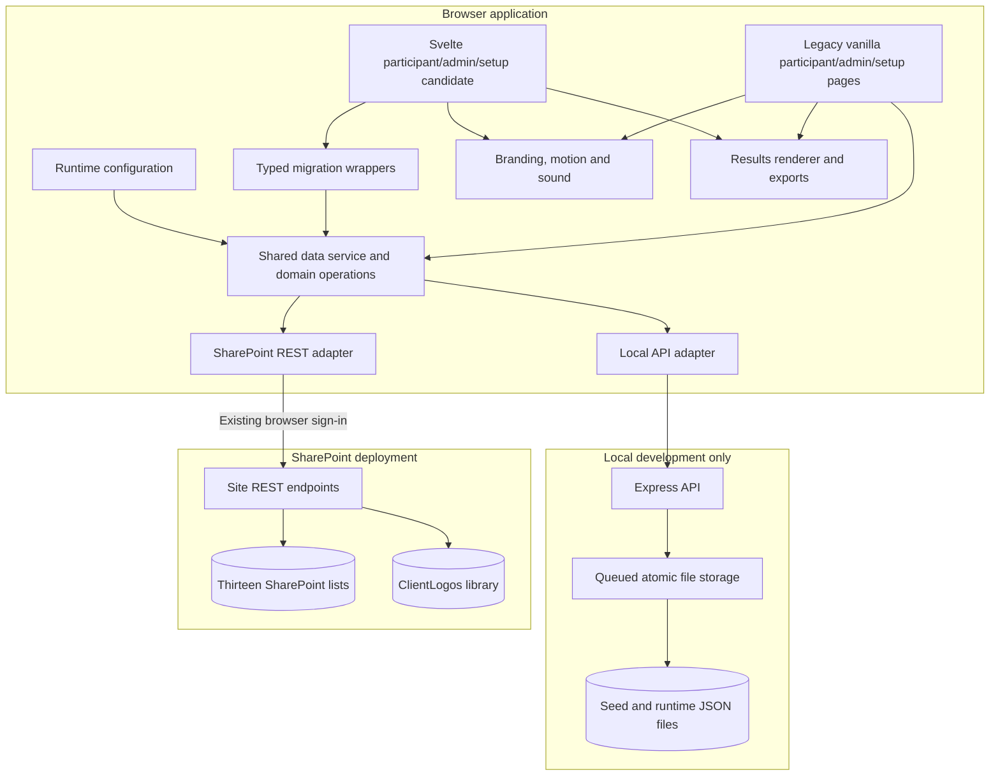
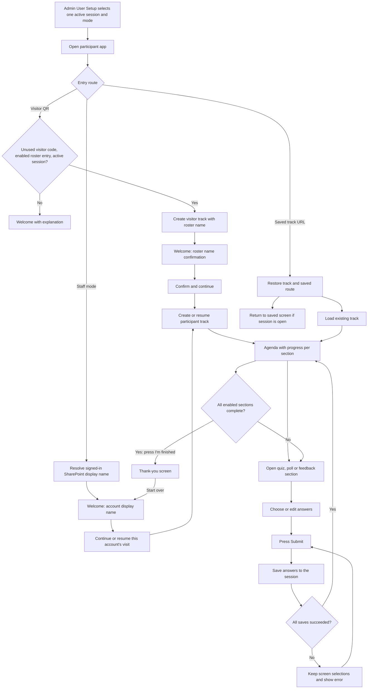
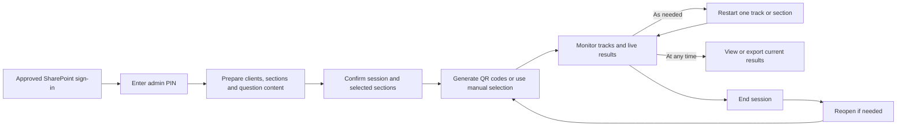
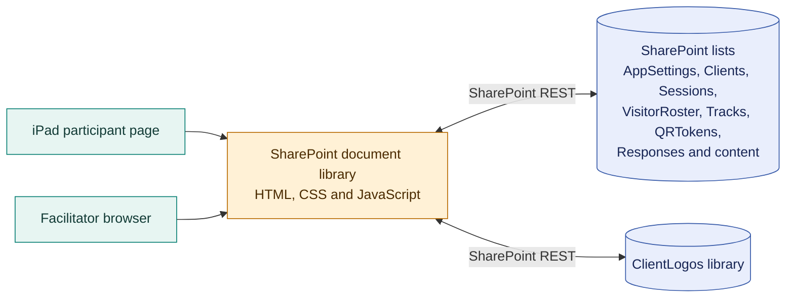
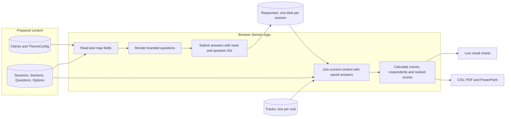
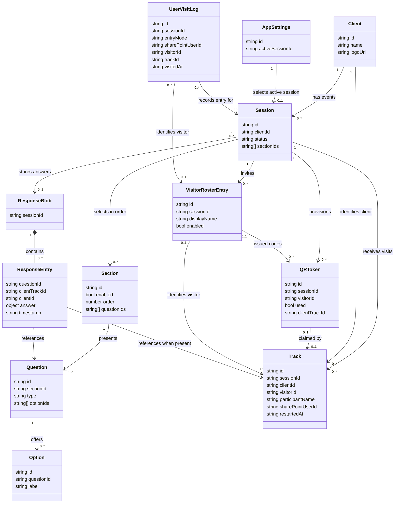
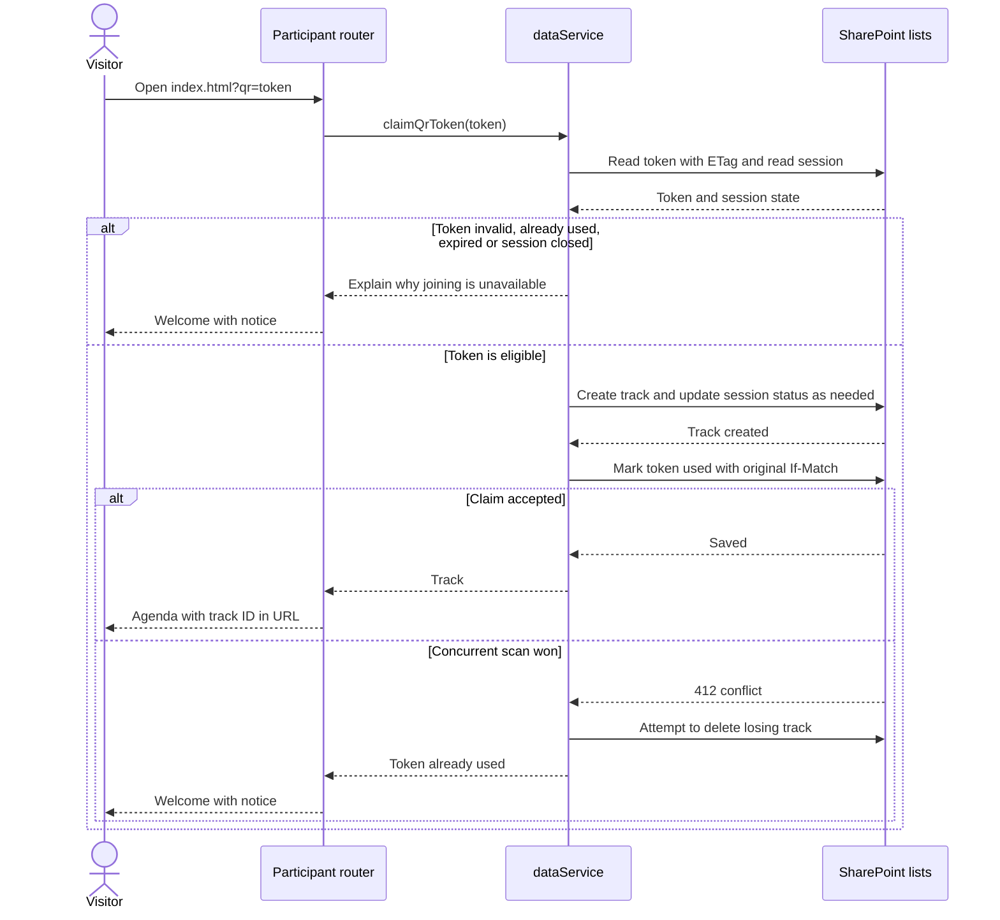
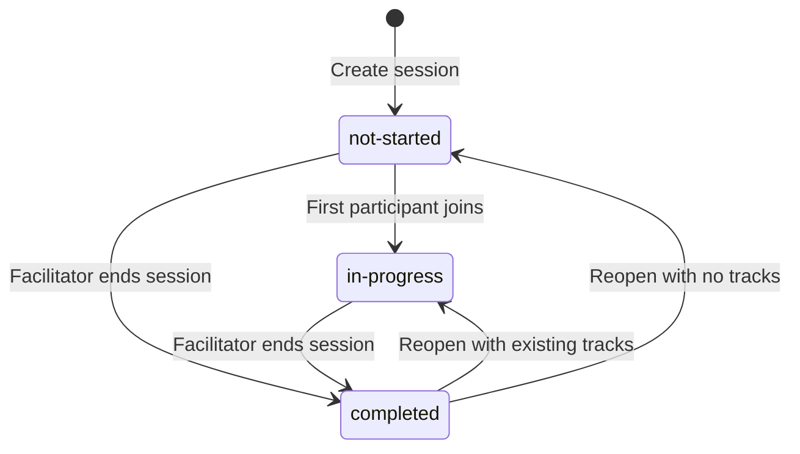
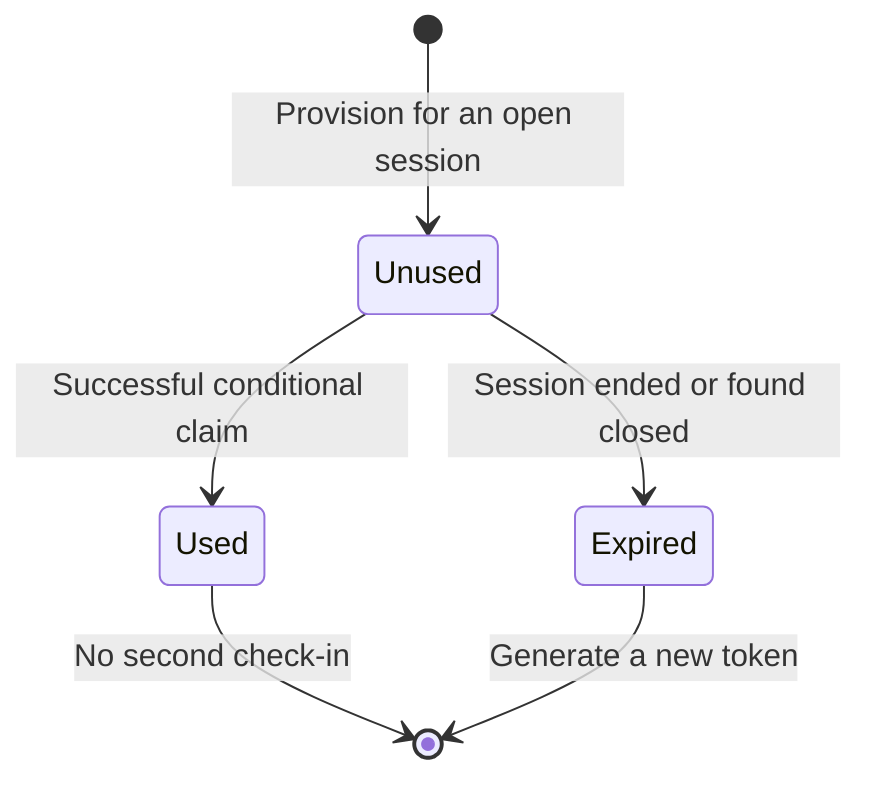
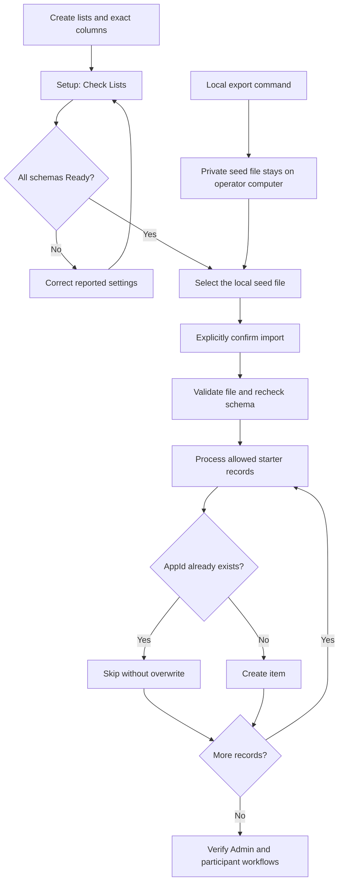

# Pursuits CEC

> **This README describes the old site and the legacy app.** The legacy app left this branch in Phase 10c-1 and is kept only in the local tag `legacy-final`; the old site keeps running the files already uploaded there, and nothing in this repository changes them. A rewrite of it was planned and is skipped for now (VJR, 14 Oct 2026): only what had become false is corrected below, and links to legacy files lead nowhere. To put the app on the new site, read **Deploy** below. For the app as it is, read [AGENTS.md](AGENTS.md) and `CLEAN-BREAK-10C1.md` (in git history at `7347c72`).

Pursuits CEC is a client-facing, interactive presentation and feedback experience for iPad Safari. It includes a participant experience, a facilitator/admin experience, live session results, QR-code check-in, and exports for CSV, PDF, and PowerPoint.

The application supports **local development** through Express/JSON and **SharePoint-only deployment** through same-origin SharePoint REST. Deployed pages use the browser's existing SharePoint sign-in; no production Node.js server, Azure hosting, SPFx, or certificate is needed. See [SHAREPOINT-DEPLOYMENT.md](SHAREPOINT-DEPLOYMENT.md) for upload, schema checks, and starter-data import.

## Deploy

The app goes to the new site, `https://internal.global.deloitteonline.com/sites/PCOE`, folder `Shared Documents/PMS`, with lists named `PMS...` and no prefix
(SHAREPOINT-LISTS.md). The pages have no address built into them. `npm run package:release`, on a clean committed tree, makes the release package in
`build-svelte/package/pms-<commit>/` (git-ignored, with a zip beside it): the three pages, `pms-config.txt`, `RUNBOOK.md`, `RELEASE-NOTES.md`, the notices and
`SHA256SUMS.txt`. **Follow the package's `RUNBOOK.md`**: fifteen steps, from checking the checksums to Results, with what to send back under each. What this
release is and what is not proven is [RELEASE-10F.md](RELEASE-10F.md). Nothing has run on a real SharePoint site yet.

## Reading Guide

| Audience | Start here |
| --- | --- |
| Participants, facilitators and UI/UX designers | [Application flow](#application-flow-diagram), [screen map](#screen-map-and-interaction-contract), [typical user flow](#typical-user-flow) |
| Developers and architects | [Architecture](#architecture), [data flow](#data-flow), [domain model](#uml-domain-model), [sequence diagrams](#uml-sequence-diagrams), [Svelte migration plan](MIGRATION-PLAN.md) |
| SharePoint site owners and deployment operators | [SharePoint deployment](#sharepoint-deployment), [security](#security-and-permissions), [troubleshooting](#troubleshooting) |
| Testers and event operators | [Verification commands](#build-and-verification-commands), [event readiness](#event-readiness-and-recovery) |

The Svelte 5 implementation is a parallel migration candidate tracked in [MIGRATION-PLAN.md](MIGRATION-PLAN.md). It has its own participant, admin, and setup pages, build pipeline, and browser tests, but is not the approved production release. Until Phase 10c-1 `npm run build` built the legacy application into `build/`; that build has left this branch, and the Svelte pages are now the only app on it. What follows in this sentence was written before that: use the candidate only for owner-approved staging until parity, security, and tenant/device gates are accepted.

The diagrams describe the implemented architecture, not a proposed Azure or SPFx solution. Mermaid-enabled Markdown viewers render the fenced diagrams; other viewers show their source. UML class diagrams here model data concepts, not JavaScript classes.

### At a glance

- **Purpose:** collect participant answers during a facilitated client session and display combined results.
- **Three entry pages:** participant, facilitator/admin, and a setup utility for initial SharePoint schema checks/import.
- **Two frontend implementations:** the current production baseline is vanilla JavaScript; a Svelte 5/TypeScript candidate is maintained separately under `migration/`.
- **Two runtime modes:** local Express/JSON for development; authenticated SharePoint REST for deployment.
- **One data boundary:** screens call dataService functions; they do not know which backend is active.
- **Two different gates:** SharePoint sign-in grants data access; the retained PIN only gates admin navigation.
- **Admin-controlled entry:** User Setup selects one site-wide active session and either SharePoint-account greeting or roster/visitor-QR mode; participants never choose a client.
- **Visit history:** the participant page records an idempotent initial-entry event when permitted; this is operational analytics, not compliance audit evidence.
- **Standalone page contract:** both builds target three self-contained HTML pages; neither requires a production Node.js service or external CDN. The Svelte candidate is not yet approved for cutover.
- **Not implemented:** anonymous SharePoint participation, offline synchronization, server-side PIN authorization, or per-participant list-data isolation.

## Technology Stack

### Approved production baseline: legacy client

- HTML5 for page shells and screen templates
- CSS3, including custom properties for client branding, responsive layouts, kiosk styling, motion, and safe-area support
- Vanilla JavaScript using native ES modules; no application framework or local build step during source development
- Hash-based routing in `public/js/app.js`
- Chart.js `^4.5.1` for live result charts
- jsPDF `^4.2.1` for PDF result exports
- PptxGenJS `^4.0.1` for editable PowerPoint result exports
- lean-qr `^2.7.4` for QR-code generation
- Browser Fetch API for HTTP communication
- Safari/iPad kiosk behavior and Add to Home Screen support

### Parallel migration candidate: Svelte client

- Svelte `^5.57.2` with TypeScript `^5.9.3` and strict migration compiler settings
- `svelte-spa-router` `^5.1.1` for hash-based screen routing
- Tailwind CSS `^4.3.3` through `@tailwindcss/vite` `^4.3.3`, alongside scoped application styles
- Vite `^8.3.4`, `@sveltejs/vite-plugin-svelte` `^7.3.1`, and `vite-plugin-singlefile` `^2.3.3`
- Reuses `public/js/dataService.js` through typed wrappers; it does not add an API server, SharePoint list, column, or alternate response store
- Kept under `migration/`; source preview and standalone candidate are separate from the production legacy build

### Shared and local runtime dependencies

- Chart.js `^4.5.1` for result charts, jsPDF `^4.2.1` for PDF, PptxGenJS `^4.0.1` for PowerPoint, and lean-qr `^2.7.4` for QR rendering
- Node.js `>=22.12` and npm for development, build, and test commands
- Express `^5.2.1` and cors `^2.8.6` for the unauthenticated local/demo API only
- JSON files in `server/data/` as the local datastore; queued atomic writes are owned by `server/store.js`
- ETag and `If-Match` optimistic concurrency in the shared data service, including conflict-safe response merges and one-time QR claims

### Local backend

- `server/index.js` serves the source frontend and local REST API; it is not part of SharePoint hosting
- Local JSON is for development and controlled demos, not a production or multi-instance datastore

### Standalone deployment build

- (Removed in Phase 10c-1: `npm run build`, the legacy esbuild and Cheerio bundle that wrote `build/index.html`, `build/admin.html` and `build/setup.html`. A `build/` folder still on a machine is a leftover.)
- `npm run build:svelte:release` runs three Vite single-file builds and assembles `build-svelte/release/index.html`, `admin.html`, and `setup.html`.
- Generated pages use embedded static assets and the current document-library URL. They still call SharePoint REST for live data; they are not offline copies of the data.
- Both builds exclude private seed exports, participant records, and the local server. No external CDN is required at runtime.
- `deployment.config.json` holds production/staging document-folder names for test/deployment guidance. `scripts/deployment-config.js` uses `CEC_DOCUMENT_FOLDER` to select the local migration test-server mount; the release HTML does not hard-code either folder. This setting does not change the SharePoint site/list URL in `public/config.js`.

### Development and verification

- npm for dependency installation and scripts
- Node.js built-in test runner for local-session, SharePoint-adapter, and both standalone-package tests
- Playwright `^1.64.0` with Chromium for the built Svelte workflow suite; fixtures intercept data requests and do not contact the tenant
- `svelte-check` `^4.7.6` for Svelte/TypeScript and accessibility diagnostics
- Custom data validation script for entity references and enum values
- Legacy source development has no build step. The separate Svelte candidate uses Vite in source-preview mode.
- TypeScript checking applies to the Svelte migration sources; legacy JavaScript is not type-checked. No linter or formatter is configured.

## Architecture



[public/js/dataService.js](public/js/dataService.js) is the backend boundary for both frontends. Its public functions return ordinary domain objects with string IDs in both modes. The legacy source app loads HTML fragments from the local static server and caches pristine templates in memory. Each standalone build embeds its scripts, styles, templates, and supported static assets into the three HTML pages. Live SharePoint list data is still fetched at runtime. The migration wrappers add TypeScript shapes; they are not a second backend implementation or runtime schema validator.

### Component responsibilities

| Component | Responsibility | Does not own |
| --- | --- | --- |
| [public/config.js](public/config.js) | For the legacy pages only: select the backend from the page origin and configure the site/library. The Svelte pages do not read it (Phase 10b): they find their site and lists as they start, from `pms-config.txt` beside them (SHAREPOINT-DEPLOYMENT.md, "Which site and which lists") | Credentials or participant progress |
| [public/js/app.js](public/js/app.js) | Hash routing, in-memory session context, URL-based resume and track polling | Persistent storage |
| [public/js/screens/_shared.js](public/js/screens/_shared.js) | Template loading, saved-answer helpers and derived progress | Direct list access |
| [public/js/dataService.js](public/js/dataService.js) | CRUD, record joins, QR lifecycle, response writes, REST mapping, digests and conflict handling | Screen markup |
| [public/js/screens/admin/auth.js](public/js/screens/admin/auth.js) | Compare the entered PIN hash with admin records | SharePoint authorization |
| [public/js/resultsRenderer.js](public/js/resultsRenderer.js) | Render result charts | Saving answers or calculating independent persisted totals |
| [public/js/resultsExport.js](public/js/resultsExport.js) | Generate CSV, PDF and PowerPoint exports | A separate results database |
| [public/js/sharepointSetup.js](public/js/sharepointSetup.js) | Schema-check and explicit import interactions | Automatic provisioning or permission changes |
| [migration/src/lib](migration/src/lib) | Typed wrappers and migration navigation/session state over shared legacy data services | A second REST adapter or production authorization system |
| [server/api.js](server/api.js) and [server/store.js](server/store.js) | Local API, per-file serialization and atomic writes | Deployed SharePoint requests |

### Architecture decisions

| Decision | Benefit | Trade-off |
| --- | --- | --- |
| Native ES modules and static assets | No frontend framework; local source mode runs without bundling | The standalone package must inline dependencies and preserve document-library-relative URLs |
| Parallel Svelte 5 migration candidate | Adds component-based UI and TypeScript wrappers while reusing the established data boundary | Not production-approved; feature parity, owner security disposition, authenticated tenant checks, and iPad Safari QA remain |
| Same-origin SharePoint REST | Fits approved HTML/JavaScript hosting without a separate server | Every device requires an approved authenticated SharePoint session |
| Three-file standalone release | Only `index.html`, `admin.html`, and `setup.html` need uploading; no asset folders or CDN paths | Rebuild after client code, styles, templates, or embedded assets change |
| Explicit field mapping at the data boundary | Screens use the same objects locally and on SharePoint | Column internal names/types must match the adapter |
| Ordered IDs stored as JSON text | Preserves selection/order without SharePoint Lookup dependencies | References are enforced by application logic, not database foreign keys |
| One response blob per session | Simple joins and per-track answer replacement | Shared-write contention, text limits and no per-answer permission boundary |
| Native ETags plus unique AppId | Detects conflicting writes and duplicate creation races | Does not create transactions across lists or across a whole section submission |
| Existing PIN retained | Preserves facilitator workflow | It is not an access-control mechanism |

## SharePoint Request and Performance Model

The standalone build removes separate requests for scripts, styles, templates, and bundled static media. It does not remove SharePoint data requests: participant progress, branding, activity content, and answers remain live list data and use the signed-in browser's SharePoint session.

- Known-client branding reads the client record directly, avoiding an unnecessary theme read on each participant route.
- Quiz content, saved answers, and the screen template load concurrently. Section content joins questions and options with one read per list, rather than fetching each question's options separately.
- Quiz and feedback forms show `Saving...`, disable answer editing while the request is pending, and navigate only after the save succeeds. A failure restores the controls and keeps the answers available to retry.
- A module submission sends its answers in one logical operation. SharePoint still reads the session's Responses item and performs an ETag-protected merge; conflicts are retried so one participant does not silently overwrite another participant's answers. After success, a one-time in-memory snapshot scoped to that session and track lets Agenda compute this track's progress without immediately rereading the Responses item; section state is still refreshed from SharePoint.
- Agenda progress is not cached: SharePoint mode refreshes every 10 seconds, while local mode refreshes every 3 seconds. Each agenda refresh reads the session, its sections, and the session response item.
- The participant Track watcher also checks every 10 seconds in SharePoint mode and every 3 seconds locally. It still checks immediately when the page returns to the foreground or connectivity comes back; a SharePoint-side restart/removal can otherwise take about 10 seconds plus request latency to appear.
- The Responses list stores one JSON blob per session. This keeps reads and result aggregation simple, but concurrent participant writes share one item and can contend. A substantially larger event may need a per-answer storage model or a server-side write API rather than further client-side bundling.
- **Since Phase 4 the Svelte participant page (`migration/`) no longer does this.** It keeps each participant's answers in a Responses item of their own (AppId = their track id) and writes every answer with one request, so participants never contend; the session blob described in this README is what the legacy pages still use. The Svelte admin and Master screens read both. See [MIGRATION-PLAN.md](MIGRATION-PLAN.md), "Phase 4", and [PROVISIONING.md](PROVISIONING.md), "Columns added".
- Admin views also poll for changes while visible. Close unused admin tabs during performance testing to avoid adding background SharePoint reads.

These measures reduce avoidable requests while preserving live content, progress, and conflict safety. For diagnosis, measure the Network timing of `/_api/` calls separately from time spent rendering the page. See [QA-TESTING.md](QA-TESTING.md) for device and concurrent-client checks.

## Application Flow Diagram

Read this as the participant's journey. The facilitator prepares content and an open session first. In SharePoint mode, both participant and facilitator browsers must already have approved site access.



Selecting an answer does not itself save it. Submit persists the section's answers before navigating. SharePoint merges a module's answer batch into the session's single Responses item in one ETag-protected write; local mode uses the existing per-answer API sequentially. A local partial failure can leave earlier answers saved, so the screen remains available for retry. Progress is derived from saved answers, not from which screens were visited.

### Facilitator flow



Results do not require the session to be ended first. Reopening does not revive old QR codes. Restart affects the selected track's saved answers, not the other participants. User Setup controls one site-wide active session. Visitor QR codes map to opaque roster IDs, are single-use, and can be disabled/replaced by the facilitator.

### What the main words mean

- **Participant track**: the progress record for one iPad in one session. It lets a participant reload the page and continue where they stopped; access is governed by SharePoint permissions.
- **Active session**: the one session selected in Admin → User Setup for new participant entry; changing it makes old-session join/QR/resume entry unavailable through the application.
- **Staff mode**: greet the account signed into SharePoint and associate its user ID with a track when the staff member continues.
- **Client-visit mode**: greet the name in the facilitator-managed roster after its one-time QR is claimed; the token does not itself grant SharePoint access.
- **User visit log**: one idempotent application-entry record per browser-tab session for operational history; not an authoritative SharePoint audit record.
- **Session**: the shared event being run by the facilitator. Answers from all participant iPads contribute to its live results.
- **One-time QR code**: a check-in code for one client. Once used, it cannot start another participant track.
- **Admin experience**: the facilitator's control area for preparing content, opening a session, monitoring progress, restarting a participant, and exporting results.
- **AppId**: the application's string identifier; different from SharePoint's numeric item `ID`.
- **ETag**: an item's version label. A write includes the version it read so SharePoint can reject stale changes.
- **Request digest**: SharePoint's short-lived write-validation token; it does not grant extra permissions.
- **Schema versus records**: columns define the structure; importing starter records fills that structure with content.

## Screen Map and Interaction Contract

Routes below are fragments appended to the participant page URL. They must not remove the document-library path.

| Screen or panel | User task | Completion and recovery |
| --- | --- | --- |
| Welcome, `#/welcome` | Staff sees their signed-in account name, or an invited visitor confirms their QR-assigned roster name | No client selector; missing/used/disabled/out-of-session codes explain the issue; visit-log failure is non-blocking |
| Agenda, `#/agenda` | Choose an enabled section and inspect progress | A section completes when its questions have saved answers for this track; I'm finished appears after all enabled sections complete |
| Quiz/poll, `#/quiz/<sectionId>` | Answer all section questions, then Submit | Existing answers are prefilled; Back does not submit current edits; a failed save keeps selections available |
| Open-text feedback | Write a response and Submit | An all-open-text section uses the feedback renderer through the quiz route |
| Thank you, `#/thank-you` | Finish this visit or Start over | Reaching this screen does not end the shared session; Start over releases the current track without deleting answers |
| Master results, `#/master-results/<sessionId>` | Display combined results and export | Session-level display without a participant track; polls for updates. (Legacy app. In the Svelte app it is the admin page's **Live display**, and this address is only a notice that links to it.) |
| Admin (Svelte): Today | Pick a client and a date, Go live, read the readiness check, switch client, set staff or guest identification and the activity flow, End or Reopen the session, share the participant link | Go live is `activateClient` plus a read-back of AppSettings ("Verified"); switching away from a client with participants asks first; this replaces User Setup's session selector in the Svelte admin (the legacy admin keeps User Setup) |
| Admin: Sections and Content | Enable sections; maintain questions/options; preview | Preview does not save participant answers; changes can affect live sessions |
| Admin: Clients | Add and edit clients (slug, event title, subtitle, welcome line), archive and restore, upload a logo, generate QR | One token per new QR check-in; a client referenced by session data cannot simply be removed |
| Admin: Results (the legacy admin calls it Sessions) | Inspect tracks, restart, inspect results; End/Reopen are on Today in the Svelte admin | Restart is explicit and scoped to one track; closing a session is a separate action |
| Admin: Guests and QR (the legacy admin's User Setup) | Maintain the live session's visitor roster, generate/revoke QR codes, inspect recent entries; the session and staff/visitor mode are chosen on Today | The participant UI is scoped to this selection; SharePoint list permissions remain the real authorization boundary |
| Setup utility | Check columns; explicitly import missing starter records | Import stays disabled until every list schema passes and a local file is selected |

Design constraints: retain large touch targets, visible loading/error states, clear Submit confirmation via navigation, and distinct empty states. Progress and results are eventually refreshed by polling, not pushed by WebSockets. Test Safari kiosk behavior, orientation, reconnect, and multi-device use using [QA-TESTING.md](QA-TESTING.md).

## Technical Deployment Flow

For production, SharePoint hosts the static pages and lists hold the data. The signed-in browser calls SharePoint REST with the user's existing permissions. PIN navigation is retained, but SharePoint sign-in and list permissions are the security boundary.



Locally, the backend is `server/index.js` and the data is stored in `server/data/*.json`. On the configured Deloitte SharePoint origin, `public/config.js` selects direct REST access for the legacy pages; the Svelte pages treat any `https` address that is not this computer as SharePoint and read their settings from `pms-config.txt` in their own folder (Phase 10b). For the existing legacy production deployment, `build/` is uploaded to `p_cec_01`; follow [SHAREPOINT-DEPLOYMENT.md](SHAREPOINT-DEPLOYMENT.md). Never upload the private export produced by `npm run export:sharepoint` itself. Run `npm run test:sharepoint` for mocked REST tests; `npm test` also runs the local session tests.

For Svelte migration staging, [deployment.config.json](deployment.config.json) records `p_cec_01` as production and `p_cec_02` as staging without baking either folder into the app. Run `npm run test:migration`, then upload only `build-svelte/release/index.html`, `admin.html`, and `setup.html` to the owner-approved `Shared Documents/p_cec_02` folder. Both folders use the same SharePoint lists and site-wide active-session setting; saving User Setup in staging can immediately change the session offered by production. Do not test live session switching/visitor QR setup during an active production event. Use isolated SharePoint lists/site or an approved maintenance window with synthetic records.

The library stores files; JavaScript executes in the browser, not on the SharePoint server. The deployment diagram shows logical access, not a Node process running inside SharePoint. The active-session setting controls the normal UI and app operations, but it is not tenant-level data isolation: a participant with broad list read permissions may still call SharePoint REST directly. Use SharePoint permissions or a redesigned security boundary if participants must be technically prevented from reading other clients' list data.

### Runtime selection

| Page origin | Selected mode | Runtime dependency |
| --- | --- | --- |
| `https://americas.internal.deloitteonline.com` | Direct REST at `/sites/CreativeExpCOE/_api/` | Existing browser sign-in and approved list permissions |
| Localhost or another origin with the default configuration | Local API at `/api` | Running Express server |

Both legacy entry pages load [public/config.js](public/config.js) before their module scripts (the Svelte pages do not: see [SHAREPOINT-DEPLOYMENT.md](SHAREPOINT-DEPLOYMENT.md), "Which site and which lists"). The SharePoint adapter requires HTTPS and the same origin as the configured site. Loading the files from an unrelated static host does not automatically grant SharePoint access. Do not replace the working internal site URL with a guessed tenant hostname.

## Data Flow



### Storage map

| SharePoint list | Local data source | Role and key relationships |
| --- | --- | --- |
| Clients | [server/data/clients.json](server/data/clients.json) | Client name, logo and colors; referenced by sessions/tracks/tokens |
| Sessions | [server/data/sessions.json](server/data/sessions.json) | Event for a client, ordered section IDs, status and end timestamp |
| Sections | [server/data/sections.json](server/data/sections.json) | Enabled flag, presentation order, industry tags and ordered question IDs |
| Questions | [server/data/questions.json](server/data/questions.json) | Section reference, type, prompt and ordered option IDs |
| Options | [server/data/options.json](server/data/options.json) | Question reference, label, value and correctness |
| Tracks | [server/data/tracks.json](server/data/tracks.json) | Visit identity, session/client references, resume and restart metadata |
| QRTokens | [server/data/qrtokens.json](server/data/qrtokens.json) | Single-use check-in linked to a session/client and eventually a track |
| Responses | [server/data/responses.json](server/data/responses.json) | One item's `ResponsesJson` array per session; `AppId` equals session ID |
| AdminUsers | [server/data/adminusers.json](server/data/adminusers.json) | PIN hashes and facilitator names; `PinHash` maps to the app's `pin` property |
| ThemeConfig | [server/data/theme.json](server/data/theme.json) | Single theme record with `AppId` equal to `default` |
| AppSettings | [server/data/appsettings.json](server/data/appsettings.json) | Singleton selecting the admin-controlled active participant session |
| VisitorRoster | [server/data/visitorroster.json](server/data/visitorroster.json) | Per-session invited names and enablement state; QR tokens reference opaque roster IDs |
| UserVisitLogs | [server/data/uservisitlogs.json](server/data/uservisitlogs.json) | Idempotent app-entry events; operational analytics, not an audit/security log |

These are two alternative data stores, not synchronized replicas. Local edits do not propagate to SharePoint. Importing seeds is an explicit, one-way, missing-record-only operation.

### Field mapping rules

- Application `id` maps to `AppId`. SharePoint's numeric `Id` locates the actual item for MERGE/DELETE; it is not exposed as the domain identity.
- `date`, `type`, `value`, `pin`, and `responses` map to `SessionDate`, `QuestionType`, `OptionValue`, `PinHash`, and `ResponsesJson` respectively.
- Ordered ID arrays, industry tags and response arrays are serialized as plain JSON text. Invalid JSON fails visibly rather than silently dropping answers.
- `SectionIds`, `QuestionIds`, `OptionIds`, `IndustryTags` and `ResponsesJson` must be multiline plain text with append-only disabled.
- Every list requires indexed, unique `AppId`; configure it as required. Renaming a display label does not change a column's internal name.
- Queries use explicit field mappings and follow pagination. No automatic SharePoint lookup relationship or cascade delete is implied.

### Answer and result semantics

| Question type | Saved answer |
| --- | --- |
| `single-select`, `true-false`, `confidence-continuum` | One option ID |
| `multi-select` | Array of selected option IDs |
| `ranked-voting` | Array of option IDs in preferred order |
| `open-text-feedback` | Trimmed text |

An answer also carries `questionId`, `clientId`, `clientTrackId` and a timestamp. For the same track/question, a new submission replaces the earlier answer. Ownership falls back to client ID for older records; anonymous answers append. Different tracks for the same client remain independent.

Result totals are derived on read, not stored in a separate list. Normal option percentages use the number of answers to that question as the denominator, so multi-select percentages may add up to more than 100%. Ranked voting assigns descending Borda points and calculates shares of total awarded points. Text feedback is preserved as text rather than an option count.

## UML Domain Model

This conceptual class diagram explains relationships. `ResponseEntry` is nested inside a response blob, not a separate SharePoint list. Ordered arrays express application relationships; SharePoint does not enforce these as foreign keys. Sections can be selected by multiple sessions. AdminUsers, ThemeConfig, and detailed visit-log metadata are omitted for readability.



## UML Sequence Diagrams

### Submit a module on SharePoint

The diagram shows a module submission merging into an existing response item. A first submission creates the item; a unique-AppId collision triggers a reread/merge. The response batch is one write to one SharePoint item, but there is no transaction spanning multiple lists.

```mermaid
sequenceDiagram
   actor Visitor as Participant
   participant Screen as Quiz or feedback screen
   participant Data as dataService
   participant SP as SharePoint REST
   Visitor->>Screen: Press Submit
   Screen->>Data: saveResponses(session, answer batch, track)
   Data->>SP: GET Responses item by AppId
   SP-->>Data: ResponsesJson, numeric Id and ETag
   Data->>Data: Replace this track's answers or append new answers; retain other tracks
   opt Write digest absent or expired
      Data->>SP: POST contextinfo
      SP-->>Data: Digest and expiry
   end
   Data->>SP: POST item with MERGE, If-Match and digest
   alt Current ETag matches
      SP-->>Data: 204 saved
   else Another device changed the item
      SP-->>Data: 412 conflict
      loop Bounded retry, up to five mutation attempts total
         Data->>SP: Reread latest item and ETag
         SP-->>Data: Latest answers
         Data->>Data: Reapply this answer batch
         Data->>SP: Conditional MERGE
         SP-->>Data: Saved or conflict
      end
   end
   alt Save eventually succeeds
      Data-->>Screen: Saved response
      Screen-->>Visitor: Return to Agenda after all saves
   else Retry exhausted or another error
      Data-->>Screen: Error
      Screen-->>Visitor: Keep selections and offer retry
   end
```

### Claim a QR code

Unlike a normal merge, a QR claim must retain the original token ETag. Automatically rereading and retrying that claim could allow a second participant to reuse a code.



This coordinates several list operations, not a distributed transaction. Cleanup is best-effort. A lost network response after a committed claim is ambiguous: do not assume a repeated scan is safe. Check existing tracks in Admin or Select Client / Resume; a facilitator may need to issue a new code.

## UML State Diagrams

### Shared session lifecycle



Session status and participant progress are different. A participant can reach Thank you while others are still answering. Ending a session changes its status and expires unused codes; it should not be treated as an authorization lock against direct SharePoint writes.

### QR token lifecycle



`Expired` is represented by `used = true` plus `expiredAt`; `Used` records `usedAt` and the claimed track. Reopening a session does not reset either state.

### Resume and restart

- The router stores current context in memory and keeps `clientTrackId` in the URL fragment as `?t=<trackId>`.
- Reload restores the saved route and persisted answers when the track/session is valid. Unsaved control edits are not durable.
- The shell polls the current track approximately every three seconds and when the page becomes visible.
- Restart removes only the selected track's answers, optionally filtered to one section's questions, then stamps restart metadata.
- The participant detects the new timestamp and navigates to that section or Agenda. These writes are separate operations; failures can leave a partial restart requiring operator review.

## Reliability and Limits

| Concern | Current behavior | Operational implication |
| --- | --- | --- |
| Concurrent responses | Read, merge, conditional write; bounded retry on 409/412 | Other tracks' answers are retained when retries succeed; persistent conflicts surface as errors |
| Duplicate item creation | Unique indexed AppId | Must be configured in SharePoint; client-side checks alone cannot guarantee uniqueness |
| Local concurrency | Per-file queue and temporary-file rename | Suitable for one local process, not a multi-instance production database |
| Throttling | 429 retry with Retry-After; limited read retries for 503/504 | Retry budget is finite; reduce polling/load if throttling persists |
| Expired write digest | Refresh and retry for a recognized digest-related 403 | A genuine permission denial is not fixed by retrying |
| Sign-in expiry | Sign-in HTML/non-JSON response produces an actionable error | Reauthenticate in SharePoint, then reload the app |
| Network loss | Request timeout and UI retry; no offline answer queue | Do not close the answer screen before confirming a successful save |
| Response size | Encoded text above the adapter's 60,000-character guard is rejected | Use modest sessions and short feedback; larger events need a redesigned response schema |
| Large lists | Pagination, indexed identity and selected relationship filters | Pagination does not bypass SharePoint list-view thresholds or long query limits |
| Multi-record operations | No cross-list or whole-section transaction | Partial imports/submissions/restarts may need retry and verification |
| Live content changes | Results join current content and answer IDs | Avoid editing/deleting questions during an event; exports are snapshots, not immutable history |
| All-open-text sections | Dedicated feedback renderer uses the first open-text question | Configure one question per feedback-only section; multiple questions would leave section progress incomplete |

## Security and Permissions

SharePoint authentication and list permissions are the actual security boundary. The app never elevates the signed-in user's rights and contains no client secret, certificate, or app-only access token.

| Actor or asset | Access considerations |
| --- | --- |
| Participant browser | Approved SharePoint sign-in; read AppSettings and the active session's client/content/theme/roster; track/token/response operations; add-only UserVisitLogs access |
| Facilitator browser | Approved content/session/roster/settings CRUD, UserVisitLogs read access, AdminUsers read access for PIN comparison, and logo-library write access if uploading |
| Setup operator | Schema read access and add permissions for imported starter records; setup does not grant permissions |
| AdminUsers | Contains hashes that are readable by any identity granted list read access; hashes are not secret-safe substitutes for authorization |
| Shared Responses item | A user allowed to edit it can affect other answers outside the app; no per-participant data isolation |
| QR and track URLs | Check-in/resume identifiers, not substitutes for SharePoint sign-in; distribute only to intended participants |
| Exports and private seed | May contain feedback/client content or PIN hashes; handle under organizational policy, not as public assets |

Have the site owner approve narrowly scoped permissions. Do not grant general site visitors broad edit access just to make the UI work. The local Express API is unauthenticated and must remain a controlled development/demo service.

SharePoint logo uploads accept PNG, JPEG, GIF and WebP up to 1 MB with type/signature checks. SVG upload is disabled because the browser adapter cannot impose safe serving headers on the library. Existing trusted static logos are a separate asset path.

## Project Layout and Extension Points

| Location | Contents and change guidance |
| --- | --- |
| [public](public) | Authoritative static application source; edit here, not in generated output |
| [public/screens](public/screens) | HTML fragments for participant and admin views |
| [public/js/screens](public/js/screens) | Participant modules exporting `async render(container, context)` with optional cleanup |
| [public/js/screens/admin](public/js/screens/admin) | Panels exporting `async mount(container, ctx)` and returning a `destroy()` handle |
| [public/css](public/css) | Participant, admin and visual-effect styles |
| [public/js/branding.js](public/js/branding.js), [public/js/sfx.js](public/js/sfx.js), [public/js/vfx.js](public/js/vfx.js) | Shared theme, sound and motion helpers |
| [public/assets](public/assets) and [public/vendor](public/vendor) | Static media and locally copied browser dependencies |
| [server](server) | Development server and local datastore |
| [scripts](scripts) | Build, dependency copying, data validation, private seed export and automated tests |
| [build](build) | Three generated legacy standalone HTML pages; overwritten by `npm run build` |
| [migration](migration) | Parallel Svelte/TypeScript source, Vite configs, and strict migration tsconfig |
| [build-svelte](build-svelte) | Generated standalone Svelte candidate pages; overwritten by the Svelte release build and gitignored |
| [deployment.config.json](deployment.config.json) | Production and staging document-folder names for deployment guidance and the local browser harness only |

Use the existing screen context and `navigate(path)` instead of changing the hash directly. Wrap admin event handlers with `guarded()` from [public/js/screens/admin/ui.js](public/js/screens/admin/ui.js) so errors become visible toasts. Route all new backend needs through dataService and all local datastore writes through store. Release polling timers and chart instances when leaving a screen.

When adding a field or question type, assess both adapters, column provisioning, seed validation, question controls, result aggregation/rendering, exports and tests. Do not assume adding a SharePoint column alone exposes a new app feature. Keep response shapes independent of the chosen chart library.

## Prerequisites

Install the following on the development machine:

1. Node.js `>=22.12` (as declared in `package.json`).
2. npm, included with Node.js.
3. A modern browser. Chrome, Edge, or Safari can be used for local development; iPad Safari is the target participant environment.
4. Optional: an iPad and a second browser/device on the same Wi-Fi network for a realistic QR and multi-client test.

Verify Node.js and npm:

```bash
node --version
npm --version
```

## Step-by-Step Local Setup

Run these commands from the repository root:

1. Install dependencies:

   ```bash
   npm install
   ```

   `npm install` runs no script of this package. (Until Phase 10c-1 a `postinstall` script copied browser libraries into `public/vendor/` for the legacy pages.)

2. Validate the seeded data:

   ```bash
   npm run validate:data
   ```

3. Start the local server, which is the API and the uploaded pictures and serves **no page** (the legacy pages it used to serve at `http://localhost:3000` left in Phase 10c-1):

   ```bash
   npm run dev
   ```

4. In another terminal for each page you want, start it from Vite and open the address in the table below.

The local server watches server files and restarts when they change. It prints the address of its API. For an iPad on the same network, use the Network address Vite prints for the page.

The pages, each started in its own terminal beside `npm run dev`:

| Command | Default URL | Page |
| --- | --- | --- |
| `npm run dev:svelte` | `http://localhost:5173` | Svelte participant/results |
| `npm run dev:svelte:admin` | `http://localhost:5175/admin.html` | Svelte admin |
| `npm run dev:svelte:setup` | `http://localhost:5176/setup.html` | Svelte setup |

The Vite configs proxy `/api` and `/assets` to `http://localhost:3000` by default. Set `CEC_DEV_API_TARGET` to point them at another local API. These source previews are not SharePoint-hosted production pages.

Example startup output:

```text
pursuits-cec API running
  api:   http://localhost:3000/api
  LAN:   http://192.168.x.x:3000/api
  data:  .../server/data
  pages: none are served here. Run npm run dev:svelte (participant), dev:svelte:admin and dev:svelte:setup.
```

## Running the Application

### Development mode

```bash
npm run dev
```

This uses Node's watch mode and is the normal local development command.

### Production-like local mode

```bash
npm start
```

This starts the same local Express server without file watching.

### Use another port

Port 3000 is the default. On Windows PowerShell:

```powershell
$env:PORT=3001; npm run dev
```

On macOS/Linux:

```bash
PORT=3001 npm run dev
```

The API is then at `http://localhost:3001/api`; start the Vite pages with `CEC_DEV_API_TARGET=http://localhost:3001` so that they send their requests there.

### Use a scratch data directory

Tests and demos create tracks, QR tokens, and responses. To protect the committed seed data, run the server against a separate directory.

PowerShell:

```powershell
$env:DATA_DIR="$PWD\.local-data"; npm run dev
```

macOS/Linux:

```bash
DATA_DIR="$PWD/.local-data" npm run dev
```

The scratch directory must contain the expected JSON files if you want to start with seeded content. For a QA run, copy `server/data/` into the scratch directory before starting the server.

## Typical User Flow

### Participant flow

1. Open the participant URL.
2. Scan a client QR code, or use **Select Client** as the manual fallback in either mode.
3. The application creates or resumes a client track for the active session.
4. Complete enabled sections from the Agenda.
5. Press Submit to save each section's answers and return to Agenda.
6. When all enabled sections are complete, press **I'm finished** to reach Thank you.

The active track ID is carried in the URL hash. A browser reload can therefore resume the track without using browser local storage.

### Facilitator flow

1. Open the admin page from the same deployed folder as the participant page.
2. Enter the configured PIN. Local hashes are in [server/data/adminusers.json](server/data/adminusers.json); hosted hashes are in the AdminUsers list.
3. Use **Sections** to enable or disable presentation modules.
4. Use **Content** to manage questions and answer options.
5. Use **Clients** to manage branding and generate one-time QR codes.
6. Use **Sessions** to monitor tracks, restart a participant module, end/reopen a session, and open live results.
7. Use the Master Results screen for a display view and export results when needed.

The PIN screen is retained in both modes as a navigation gate, not a security boundary. On SharePoint, the browser must already be signed in and list permissions control actual access.

## Important Local URLs

| URL | Purpose |
| --- | --- |
| `/` or `/index.html` | Participant application |
| `/admin.html` | Facilitator/admin application |
| `/#/welcome` | Participant welcome route |
| `/#/master-results/<sessionId>` | Live results for a specific session |
| `/api/health` | API health check |
| `/api/host` | LAN addresses reported by the server for QR setup |

Check the server locally:

```text
http://localhost:3000/api/health
```

## Data and API Notes

The local JSON files are read on every request, so hand edits are visible without restarting the server. They are committed seed data: avoid accidentally committing answers from a local demonstration. The storage map above shows the corresponding SharePoint lists.

| Local endpoint family | Role |
| --- | --- |
| `/api/<list>` and `/api/<list>/<id>` | Generic list CRUD, filtering and conditional updates |
| `/api/responses/<sessionId>` | Read/save answers or remove a selected track's answers |
| `/api/theme` | Read/update the shared theme |
| `/api/uploads/logo` | Store a local client logo |
| `/api/host` and `/api/health` | LAN URL discovery and server health |

These endpoints exist only on Express. SharePoint hosts list calls under the configured site's `/_api/web/...` and obtains write digests from `/_api/contextinfo`; it does not expose the Express routes. Full local endpoint behavior is documented in [ARCHITECTURE.md](ARCHITECTURE.md).

Do not add production secrets to the JSON files. The local server has no real authentication and is intended for localhost, demos, and controlled LAN testing only.

## Build and Verification Commands

| Command | Purpose | When to run |
| --- | --- | --- |
| `npm install` | Install dependencies and copy browser libraries through postinstall | First checkout or dependency changes |
| `npm run dev` | Start Express with watch mode | Local development |
| `npm start` | Start Express without watch mode | Controlled local demos |
| `npm test` | Local scratch-server session tests and mocked SharePoint adapter tests | After changing dataService, sessions, tracks, responses, QR or server behavior |
| `npm run test:sharepoint` | Focused mocked REST regression tests | After changing SharePoint mapping, concurrency, import or request behavior |
| `npm run validate:data` | Validate seed IDs, references and enums | After hand-editing local seed JSON |
| `npm run export:sharepoint` | Generate private starter-data export | Initial import or deliberate addition of missing records |
| `npm run dev:svelte` / `dev:svelte:admin` / `dev:svelte:setup` | Start the parallel Vite source previews | Svelte candidate development; requires the local API |
| `npm run check:svelte` | Run Svelte/TypeScript and accessibility diagnostics | After migration source changes |
| `npm run build:svelte:release` | Build and assemble the three standalone Svelte candidate pages | For an approved staging candidate |
| `npm run test:build:svelte:release` | Verify the already-built three-file Svelte package | After `npm run build:svelte:release` |
| `npm run test:migration` | Build candidate and run Playwright workflows against built pages with synthetic API fixtures | Before staging; does not contact SharePoint |

(The legacy build and its test, `npm run build` and `npm run test:build`, left this branch in Phase 10c-1. The rest of this paragraph describes that build as it was.) The legacy build emitted exactly `build/index.html`, `build/admin.html`, and `build/setup.html`, with no subfolders. Each page embeds its required JavaScript, CSS, templates, export libraries, and supported static media. Edit [public/config.js](public/config.js) before rebuilding if the approved SharePoint site/runtime configuration changes. The build does not provision lists, upload anything, include private seed data or the local server, or migrate data. Local mode requires Express. The configured SharePoint deployment does **not** require a running Node process. A README-only change needs neither a rebuild nor a SharePoint upload.

The Svelte release build emits exactly `build-svelte/release/index.html`, `admin.html`, and `setup.html`. These files are folder-relative and can be uploaded to an approved document folder without recompiling for its folder name, its site or its lists: since Phase 10b a fourth, small file beside them, `pms-config.txt`, says which lists that copy uses, and without it the pages stop and say so. [deployment.config.json](deployment.config.json) identifies `p_cec_01` as production and `p_cec_02` as migration staging; `CEC_DOCUMENT_FOLDER` overrides only the local Playwright static-server mount. It does not change the approved SharePoint site/list URL in `public/config.js` or isolate data. Both SharePoint folders use the same lists. The Svelte candidate is staging-only until the migration plan's release gates and owner approval are complete.

No linter or formatter is configured, and TypeScript does not emit a separate JavaScript build; `npm run check:svelte` provides migration diagnostics. Automated SharePoint tests use mocked responses; they cannot prove actual tenant column settings, user permissions, Safari behavior or event-scale concurrency. Treat a failed test as something to investigate, not as permission to overwrite live data.

SharePoint publishing is a manual, owner-approved file upload; no automatic deployment pipeline is configured. The dependency audit and residual candidate findings are tracked in [MIGRATION-PLAN.md](MIGRATION-PLAN.md); passing local tests do not constitute a security exception or release approval.

For UI changes, follow the manual checks in [QA-TESTING.md](QA-TESTING.md), especially kiosk behavior, QR lifecycle, simultaneous clients, offline behavior, resume after reload, and admin workflows.

## Localhost and LAN Limitations

- `localhost` is available only on the machine running Node.js. An iPad must use the LAN URL printed by the server.
- The host machine and iPad must be on the same network, and the operating-system firewall must allow the selected port.
- The local API has no production authentication or authorization.
- JSON files are suitable for local development and demos, not multi-instance production hosting.
- QR codes are one-time tokens tied to a session. Generate a new code when a session is reopened; previously used or expired codes are not revived.
- The app is not offline-first. Screens that need server data retry and display a reconnect state when the API is unavailable.

## SharePoint Deployment

The approved deployment is static HTML/JavaScript plus same-origin SharePoint REST. No SPFx package, Azure subscription, Graph application registration, certificate, or separately hosted API is required. Node/npm are development tools for preparing the upload, not production hosting requirements.

### Svelte migration staging (not production)

[deployment.config.json](deployment.config.json) records the current production folder (`p_cec_01`) and the intended staging folder (`p_cec_02`). This configuration is used by deployment guidance and the local Playwright test server; neither folder name is compiled into the generated HTML. It does not alter the approved site URL or SharePoint list mapping in [public/config.js](public/config.js).

1. Obtain site-owner approval to create/use `Shared Documents/p_cec_02`; a document folder is not a security or data-isolation boundary.
2. Run `npm run test:migration` to rebuild the Svelte candidate and execute its browser tests, or `npm run build:svelte:release` for a build-only operation.
3. Upload only `build-svelte/release/index.html`, `admin.html`, and `setup.html` into `Shared Documents/p_cec_02`. Do not replace the production files under `p_cec_01`.
4. Test using approved identities and explicitly designated synthetic client/session records. The candidate connects to the same SharePoint lists as production; Setup import can write starter records and should not be used on live business data as a smoke test.
5. Treat authenticated permissions, ETag/concurrency behavior, QR scans on real devices, physical iPad Safari, and latency as separate tenant/device acceptance gates. A passing local mock suite is not tenant certification.

The current migration status, test evidence, dependency findings, and remaining cutover gates are maintained in [MIGRATION-PLAN.md](MIGRATION-PLAN.md).

### Hosted entry points

| Page | Deployed URL |
| --- | --- |
| Participant | [Open participant app](https://americas.internal.deloitteonline.com/sites/CreativeExpCOE/Shared%20Documents/p_cec_01/index.html) |
| Facilitator | [Open admin app](https://americas.internal.deloitteonline.com/sites/CreativeExpCOE/Shared%20Documents/p_cec_01/admin.html) |
| Initial setup | [Open setup utility](https://americas.internal.deloitteonline.com/sites/CreativeExpCOE/Shared%20Documents/p_cec_01/setup.html) |

Use the actual HTML page URL, not a sharing link, library preview page, or site homepage. Preserve the full folder and `index.html` path when generating QR links. A QR URL adds `?qr=<tokenId>` before any fragment; a resumed visit instead carries a track in a fragment such as `#/agenda?t=<trackId>`.

### First-time setup and import

The complete column-by-column click sequence is in [PROVISIONING.md](PROVISIONING.md); the complete upload walkthrough is in [SHAREPOINT-DEPLOYMENT.md](SHAREPOINT-DEPLOYMENT.md). Use this checklist to understand the order and what each step changes.

1. Sign in to the target site and confirm the organization permits these HTML/JavaScript pages to execute. If the page downloads or is blocked, stop and involve the site owner; a different filename is not a permission fix.
2. In **Site contents**, create the thirteen named lists in [PROVISIONING.md](PROVISIONING.md) and every required column. Set `AppId` to **Single line of text**, **Required**, **Indexed**, and **Enforce unique values = Yes** on each list. Preserve all existing list titles and columns; the user-sensing flow adds three lists and a few optional columns.
3. Configure JSON columns as **Multiple lines of text**, **Plain text**, with **Append Changes to Existing Text = No**. Create columns with the exact internal names in the provisioning guide; spaces/renamed display labels are not equivalent.
4. If logo uploads are needed, create **ClientLogos** as a document library in Site contents. A folder named ClientLogos inside Documents is not a library.
5. Have the site owner approve the required list/library permissions for the actual participant, facilitator and setup identities. A successful read under your own account does not prove another device can write.
6. On the development machine, run `npm install`, `npm run validate:data`, then `npm run export:sharepoint`. The export is written to `.local/sharepoint-seed.json` and contains PIN hashes. Keep it private; do not upload or commit it.
7. Run the verification commands appropriate to your changes, then `npm run build:svelte:release`, which writes the three pages to `build-svelte/release/`. (This step used to say `npm run build` and to replace the three files in `Shared Documents/p_cec_01`. That was the legacy build, which has left this branch; the old site keeps the files already uploaded there, and they are not to be replaced with the new pages. Where the new pages go is the new site's own guide, in Phase 10c-3.)
8. Open the hosted setup page and click **Check Lists**. Correct every reported schema issue in List settings and check again. This reads metadata; it does not create columns or verify write permissions.
9. Once all lists are Ready, choose the private seed file from your computer. Explicitly confirm **Import Missing Records**. Wait for completion; if an operation fails, correct the cause and rerun. Existing AppIds are skipped, not overwritten.
10. Open Admin with the existing PIN, verify branding/content/session dates, and complete a participant journey using the actual event identity/device. Remove or restrict the setup page and its script from the hosted folder after initialization, as governance permits.



The export includes clients, sections, questions, options, sessions, admin users and theme. It excludes tracks, responses and QR tokens; exported sessions are reset to `not-started` with no end timestamp. Existing session dates are preserved. Import rebases starter logo asset paths for this hosted folder, but skipped records retain their existing values. It is neither a full backup nor a migration of participant history.

### Routine release and data changes

| Change | Required action |
| --- | --- |
| Client JavaScript, HTML, CSS, assets or runtime configuration | Test locally, build, upload updated static files, then reload on test devices |
| Vendored library version | Install/copy dependencies before rebuilding and uploading |
| SharePoint content or column settings only | Update the lists; rerun schema checks if needed; no static build required |
| New field used by the app | Coordinate schema provisioning with adapter/client release; test both runtime modes |
| Documentation only | Review/validate documentation; no app upload |

Schedule uploads outside active sessions because replacing multiple static files is not atomic. Retain the last approved static release. Clear stale browser content with a reload and inspect requested script/config URLs before assuming a data problem. Reuploading files does not reset list data; rerunning seed import does not update existing records. Check that a full-folder upload has not unintentionally republished the setup utility.

For rollback, restore the previous approved static files only after confirming compatibility with the current list schema. Do not erase or reseed production lists to roll back a UI release. Agree a list backup/versioning and retention procedure with the site owner; the starter export and results export are not complete recovery backups.

## Event Readiness and Recovery

Complete [QA-TESTING.md](QA-TESTING.md) under the actual event accounts, not just a site-owner account. Working page links are a useful first check, not acceptance evidence for the entire workflow.

1. **Before the event:** confirm readable content, correct client branding/session date, enabled sections with valid questions/options, one question per feedback-only section, and approved list access.
2. **Check-in:** test manual join and fresh QR join on an iPad; verify a second scan is rejected and the URL preserves the deployed folder.
3. **Persistence:** submit answers, reload, resume, revisit a section and update an answer. Confirm unsaved edits are not represented as completed progress.
4. **Concurrency:** submit from two different tracks simultaneously and confirm both tracks' answers survive; restart only one track and verify the other is unaffected.
5. **Results:** compare chart totals and exports with known test answers; test PDF/PowerPoint downloads and presentation on the target device.
6. **Lifecycle:** end and reopen a test session; confirm old codes remain unusable and existing tracks can resume once the session is open.
7. **Recovery:** test reconnect/sign-in expiry without clearing live data; inspect Admin tracks before issuing replacement QR codes after uncertain joins.
8. **Closeout:** export approved results, end the intended session, and follow the organization's retention policy for participant feedback, exports, test tracks and backups.

For support, capture the page URL with token/track identifiers redacted where appropriate, action, time, browser/device, HTTP status, and visible error message. Inspect browser Network for `/_api/` calls in hosted mode. Never attach PIN hashes, cookies, authorization headers, or the private seed file to an incident report.

## Troubleshooting

| Symptom | Likely cause | Next check |
| --- | --- | --- |
| Hosted app calls `/api` or shows `GET /adminusers failed (404)` | Old/missing config or mismatched origin; local API selected | Verify uploaded config and HTML, reload, and confirm calls target the configured site's `/_api/` |
| Setup reports missing AppId | App identifier column is absent; numeric ID is not a substitute | Create required unique indexed Single line of text AppId on that list |
| AppId exists but setup still reports missing columns | Only the identity column was provisioned | Create every mapped column listed in the provisioning guide |
| QuestionIds / IndustryTags must be plain multiline text | Wrong type, rich text, append-only, or wrong column edited | Open the exact column named in the error; inspect its internal name in the settings URL and save the correct settings |
| Display name looks right but column is missing | Renaming a column preserved a different internal name | Ask the site owner to provision the correct internal name; preserve existing data before changing schema |
| All lists Ready, but import/save gets 403 | Schema read succeeded but write rights were not established | Verify list permissions for the signed-in user; distinguish permission denial from expired digest |
| HTML/sign-in response, 401 or unexpected non-JSON | Sign-in expired or page/site mismatch | Open the configured site, sign in, then reload the application |
| SharePoint list 404 | Wrong site, list title or unavailable list | Open Site contents at the configured site and verify the exact list title |
| Blank client/content selector | Lists are empty, or expected records were skipped/absent | Complete explicit starter import and inspect records; merely creating columns supplies no content |
| Import succeeds but an old record remains unchanged | Existing AppId was deliberately skipped | Update through Admin or a reviewed list edit; import is not an overwrite/update utility |
| Logo upload fails | ClientLogos is a folder instead of a library, permissions, or unsupported image | Check actual document library, write access, image signature/type and 1 MB limit |
| QR points to the site root or a missing page | Base URL lost the deployed HTML path | Generate from the current Admin page and verify the full participant URL |
| QR already used after an interrupted join | Claim may have committed before connection loss | Inspect tracks; use manual Resume or explicitly issue a new code |
| Persistent 412 / 429 | Concurrent updates exhausted retries or SharePoint throttled requests | Retain current selections, retry after recovery, and investigate concurrent load |
| Supported text size exceeded | Session response blob reached the adapter guard | Preserve/export existing results and move new collection to a new session |
| Existing track cannot resume | Session ended, track missing or connection issue | Check session/track in Admin; reopening does not restore deleted tracks |

Do not fix these symptoms by changing SharePoint's numeric IDs, deleting live response blobs, disabling uniqueness, broadly granting edit access, or uploading the private seed to a library.

## Further Documentation

- [ARCHITECTURE.md](ARCHITECTURE.md): data flow, entities, API, screens, QR lifecycle, results, branding, motion, and sound
- [SHAREPOINT-LISTS.md](SHAREPOINT-LISTS.md): every list and column of the new site, and the permissions (generated from the schema file)
- [PROVISIONING.md](PROVISIONING.md): the OLD site's list names and columns, kept as a record
- [RELEASE-10F.md](RELEASE-10F.md): the release for the new site, and the package's RUNBOOK.md
- [SHAREPOINT-DEPLOYMENT.md](SHAREPOINT-DEPLOYMENT.md): current SharePoint-only deployment walkthrough; older separate-server proposal is explicitly archived
- [QA-TESTING.md](QA-TESTING.md): end-to-end manual test checklist
- [AGENTS.md](AGENTS.md): repository conventions and command guidance for contributors