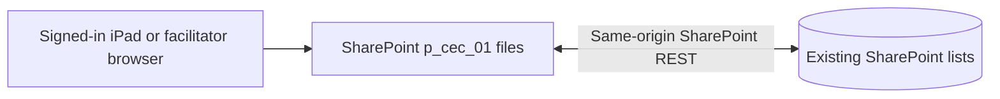

# Pursuits CEC: SharePoint Online Deployment Guide

> **For a new site, start with [Preparing a new site](#preparing-a-new-site) just below (Phase 10c-3): Setup makes the lists.** The rest of this guide describes the old site (`CreativeExpCOE`, the folders `p_cec_01` and `p_cec_02`, and lists with their old names) and is replaced in Phase 10e. **Since Phase 10c-2a the new build uses twelve lists, not thirteen** (`ThemeConfig` is not checked, read or written, and Check Lists has twelve rows), and Setup has no step that assigns activities. The legacy pages it also covers left this branch in Phase 10c-1 and are kept only in the local tag `legacy-final`; the old site keeps running the files already uploaded there, and nothing in this repository changes them. Only the commands that would now fail are corrected here.

## Preparing a new site

> **The new site (Phase 10f):** `https://internal.global.deloitteonline.com/sites/PCOE`, folder `Shared Documents/PMS`, lists `PMS...` with no prefix. Make the
> release package with `npm run package:release` and follow its **RUNBOOK.md**: it is this section as fifteen numbered steps, with the real addresses, the exact
> `pms-config.txt`, the permissions and what to send back. It was rehearsed on the mocked SharePoint with the package's own pages ([RELEASE-10F.md](RELEASE-10F.md)).

**In plain words.** The new build keeps its data in twelve SharePoint lists and one picture library, named in [SHAREPOINT-LISTS.md](SHAREPOINT-LISTS.md).
Setup makes them for you, checks them, and adds the first admin. It only ever adds: it never deletes, renames or changes the type of anything on the site.
None of this has run on the real tenant yet (QA-TESTING.md items 118 to 132): the first run on the new site is also its test.

**What you need.** A SharePoint site you own (or the help of its owner: making lists needs **Manage Lists**, which a site owner has), the three built pages
(`index.html`, `admin.html`, `setup.html`, from `npm run build:svelte:release` or a release package) and, beside them, `pms-config.txt` naming this copy's lists
(`"listPrefix": ""` for lists with no prefix: see [Which site and which lists](#which-site-and-which-lists-pms-configtxt)). Upload the four files to one folder of
a document library on the site, sign in to the site in your browser, and open `setup.html` from that folder. Setup's page is in steps, in order:

1. **This copy of the app.** What the pages are using and where each value came from. If it says the copy has not been set up, put `pms-config.txt` right first.
2. **Lists.**
   - **Show the plan.** Reads the site (one read of its lists, one of each existing list's columns) and lists, in words, what is still needed: the lists and the
     picture library to create, the columns with their types, indexes and uniqueness, and the settings (attachments and content approval off on the lists Setup
     makes). It also lists anything it found and **will not touch**, each with its fix (a column of the wrong type, rich text, a date shown as date only, a column
     whose internal name is not the one the app looks for, a required column the app does not fill in). The internal names and definitions are under "Technical
     details". It ends with one line: "Nothing to create" or "N lists, N columns, N settings to create". It changes nothing.
   - **Create.** Carries out exactly that plan: the lists first, then the columns, then the indexes and uniqueness, then the lists' settings, a few lists at a time.
     It reads back every column it makes and stops at once, saying which and what SharePoint made, if SharePoint made something else; it never guesses or
     renames. Tick "Turn off version history on PMSParticipants, PMSParticipantAnswers, PMSGuestQRCodes and PMSVisitLog" only if your organisation's policy
     allows it (it is unticked, and applies only to lists Setup makes). If Create stops (no permission, a refusal, a lost connection), it says what was made
     before it stopped: fix the cause, press **Show the plan** again, then **Create**: it carries on from there.
   - **Check Lists** checks every list and column, read-only, and **Mark the site as ready** writes the version of the lists (the PMSAppSettings item `default`,
     `SchemaVersion` 2), the last thing Setup writes, and only when the check finds nothing wrong and the picture library is there. It runs by itself after a clean
     Create. Until then the participant and admin pages stop with `PMS-LST-010` and send people to Setup.
3. **Admins.** Add the first admin: a name and a PIN of 6 to 12 digits, typed twice. The PIN is stored only as the hash the admin page compares, and is never
   shown; the list shows names only. (A seed file's admins are not imported, so the demo PIN 1234 does not reach a new site.)
4. **Sample clients (optional).** Kroger and Domino's with sample activities, to try the app.
5. **SharePoint self-test (optional, test site only).**

Then open `admin.html`, unlock with the admin's PIN, and go live on **Today**. **Moving content made on another copy** (the seed-file import) is at the end of
Setup and a new site does not need it.

**On a site whose lists were built by hand** (VJR is building them from the checklist now), the same steps apply: **Show the plan** reports what is missing and
what is wrong, **Create** adds only what is missing (it changes no column of yours except to add an index or uniqueness the plan names, and gives no settings to
a list it did not make), and the site is marked ready only when the check is clean. Fix by hand what it will not touch, then press **Show the plan** again.

**If Create is refused** ("Your account cannot create lists on this site..."), either ask a site owner to open Setup and press Create, or build the lists by hand
from [SHAREPOINT-LISTS.md](SHAREPOINT-LISTS.md), the fallback: every list, column, type, index and setting is there, generated from the schema file. Then press
**Check Lists** and **Mark the site as ready**. Do not make the PMSAppSettings item by hand: Setup writes it.


## Current deployment: SharePoint only

This guide supersedes the earlier server-backed proposal archived below. The approved
design runs HTML/JavaScript in the `p_cec_01` document-library folder and calls SharePoint
REST directly using the browser's existing sign-in. No Azure hosting, SPFx package,
app registration, certificate, Microsoft Graph or production Node.js server is needed.

The folder names are not application code, and since Phase 10b they are not a setting either: a page works out where it is
from its own address. [deployment.config.json](deployment.config.json) names the production and staging folders **for the
tests only** (the local test server and the browser tests read it; no build and no page does, so editing it changes nothing
that is uploaded). A different document folder does not, by itself, isolate or copy application data: SharePoint lists belong
to the site, not to the folder. What separates one copy of the app from another is the **list prefix** in that copy's
settings: see [Which site and which lists: `pms-config.txt`](#which-site-and-which-lists-pms-configtxt) below. The legacy
pages in `p_cec_01` know nothing of this and always use the lists with no prefix.



### 1. Prepare the existing lists

Keep all existing lists and columns. The user-sensing feature adds AppSettings,
VisitorRoster, and UserVisitLogs, plus optional visitor identity/mode columns on
Sessions, Tracks, and QRTokens. Follow [PROVISIONING.md](PROVISIONING.md) for the exact column names
and types; creating only a list name does not create its required columns.

For EACH list, including Responses and ThemeConfig:

1. Open the list, then List Settings (in classic SharePoint, the List ribbon).
2. Under Columns, open or create `AppId` as **Single line of text**.
3. Set **Require that this column contains information = Yes**.
4. Set **Enforce unique values = Yes**. SharePoint will require an index; accept it.
5. If duplicate or blank AppId values already exist, back up and correct those records
  before enabling uniqueness. Do not delete real answers to get past this check.
6. Verify every JSON column is **Multiple lines of text, Plain text**, with append-only
  changes disabled. JSON fields must not be rich text or Lookup columns.

The code supplies built-in Title when creating items. Keep your columns' internal names
exactly as documented. Avoid additional required custom columns.

Create a **document library** named `ClientLogos` if you want logo upload. The thirteen lists
support participant identification, session content and visit history. SharePoint mode accepts PNG, JPEG, GIF
and WebP uploads under 1 MB, with type/signature checks; SVG upload is disabled because
this app cannot enforce sandbox headers on a SharePoint-served upload.

### 2. Prepare files on your computer

Run from the project folder:

```powershell
npm install
npm run validate:data
npm run export:sharepoint
npm run build:svelte:release
```

`export:sharepoint` generates `.local/sharepoint-seed.json`. This private file contains
starter clients, content, sessions, theme and the existing admin PIN hashes. It excludes
participant responses, tracks and QR tokens. Imported sessions start as `not-started`;
their existing dates and content selections are retained. Review these before the event.

**Do not upload this JSON file, server/data, certificates, or the server folder to
SharePoint.** The private export is gitignored and is not copied into the built pages.
Delete the private export from your computer when it is no longer needed.

**The legacy pages** (already uploaded to `p_cec_01`; they can no longer be built from this branch, see the note at the top) had their site in `public/config.js`:

```text
https://americas.internal.deloitteonline.com/sites/CreativeExpCOE
```

Use this URL, not a guessed `sharepoint.com` hostname: your same-origin REST check
confirmed this address. On this origin the legacy pages use SharePoint; on localhost or a LAN
development address they use the local Express API. It is embedded in each legacy HTML file. Changing it meant editing
that file and rebuilding, which is now done only from the tag `legacy-final` (`git worktree add ../pms-legacy legacy-final`,
then that copy's own `npm install` and `npm run build`). Do not edit generated files or put secrets in the configuration.

**The Svelte pages** (`build-svelte/release/`) do not read public/config.js at all since Phase 10b, and have no site inside
them: any `https` address that is not this computer is SharePoint, and the site is the one the page is opened from. Their
settings are the next section's.

### 3. Replace the deployed static files

For migration testing, first create/obtain owner approval for `Shared Documents/p_cec_02`.
Build the Svelte candidate with `npm run test:migration` (build plus local browser tests)
or `npm run build:svelte:release` (build only). Upload only the three files from
`build-svelte/release/` (`index.html`, `admin.html`, `setup.html`) into that staging folder.
Do not replace the `p_cec_01` production files. The HTML files are folder-relative and
do not need a staging URL compiled into them. **Since Phase 10b they also need a fourth, small file beside
them, `pms-config.txt`, which says which lists this copy uses** (see "Which site and which lists" below):
without it the pages stop with "This page cannot start". `CEC_DOCUMENT_FOLDER` can override the
configured staging folder for local browser tests; it does not change the production
SharePoint site/list configuration.

Only use explicitly designated synthetic records and approved accounts when testing
the staged files. Setup can write starter records to the existing live lists; never
import the local seed export merely to test the UI. Tenant permission, QR concurrency,
and iPad Safari checks still require owner-approved staging access.

Important: a separate document folder is not, by itself, a separate data environment. A copy whose
`pms-config.txt` says `"listPrefix": ""` (and every legacy page, always) uses the same `AppSettings`,
`VisitorRoster`, `UserVisitLogs`, sessions and tokens as `p_cec_01`: pressing Go live there changes the
single active session and can affect participants using the production folder immediately. Do not
exercise active-session switching or visitor QR setup against a live `p_cec_01` event from such a copy.
A copy with a prefix of its own (`"listPrefix": "PMS3"`) uses its own lists, once they exist
(`PMS3AppSettings` and the rest; creating them is Phase 10c, by hand until then), and Setup's first panel
shows which lists a copy really uses. That separation has been shown on the mocked site only.

**The legacy production deployment is no longer made from this branch.** What follows described uploading the legacy
build to `Shared Documents/p_cec_01`; the legacy build left in Phase 10c-1, and the files already in `p_cec_01` stay as they
are. It is kept for whoever rebuilds the legacy pages from the tag `legacy-final`. The legacy build contained exactly three
self-contained files and no subfolders:

- `index.html`: participant app and master results.
- `admin.html`: facilitator/admin tools, previews, QR generation and exports.
- `setup.html`: list checks and private seed import. The Svelte release's Setup page also names every
  missing column with its type, seeds the two sample clients,
  and runs a self-test of the Responses list (test site only); see [PROVISIONING.md](PROVISIONING.md),
  "Validate the schema".

Scripts, styles, screen templates, libraries, starter logos and audio are embedded.
Do not nest another build folder inside p_cec_01. Upload the three files together and
reload open tabs; keep their names unchanged so links and QR codes keep working.
After verifying the new pages, old app-only `js`, `css`, `vendor`, `screens` and `assets`
folders plus the old `config.js` and `manifest.webmanifest` are no longer needed by
this build. Do not delete lists, ClientLogos, or files used by other applications.
Externally hosted client logos still use their existing URLs; new logo uploads still
go to ClientLogos. Node.js is only used on your computer for building/testing.
(`npm run test:build`, which verified the legacy packaging, left with the legacy build. The new pages' packaging is held by `npm run test:bundle`.)

### 4. Check and import through your signed-in browser

1. Sign in to the SharePoint site with your approved facilitator account.
2. Open [the setup page](https://americas.internal.deloitteonline.com/sites/CreativeExpCOE/Shared%20Documents/p_cec_01/setup.html).
3. Click **Check Lists**. This reads schema only; it does not change any list.
4. Correct any reported columns/uniqueness problems in List Settings, then check again.
5. When every row says Ready (twelve since Phase 10c-2a), select the private `.local/sharepoint-seed.json` file
  from your computer using **Private seed file**.
6. Click **Import Missing Records** and confirm. This is the first step that writes data
  to SharePoint. It skips existing AppId values and never overwrites existing content.
7. If the import stops, successful records remain. Fix the reported issue and retry;
  the retry skips those records. A schema check alone does not prove write permission.
8. Open Admin and use the same PIN as in your local application. If an AdminUsers row
  already existed, its PinHash is intentionally not replaced by the import.
  **The seed's PIN is the demo PIN, 1234. Replace it before an event** (Phase 9a review, SEC-2): no screen changes a
  PIN, so put the SHA-256 of the new PIN (64 lower-case hex characters) into `AdminUsers.PinHash` by hand.
  On a Mac: `printf '%s' 'NEW-PIN' | shasum -a 256`. In PowerShell:
  `[BitConverter]::ToString([Security.Cryptography.SHA256]::Create().ComputeHash([Text.Encoding]::UTF8.GetBytes('NEW-PIN'))).Replace('-','').ToLower()`.
  The hash is unsalted and every row of AdminUsers is sent to the browser that opens Admin, so a short PIN can be
  found from its hash: make AdminUsers unreadable to the accounts the participant devices use. If AdminUsers is empty,
  every PIN is answered "Incorrect PIN.".
9. In the Svelte admin, open **Today**, choose the client and date, check the readiness list, and press **Go live**; then choose staff or guest identification under Controls and, for guests, add names and a single-use QR code for each on **Guests and QR**. (In the legacy admin this is **User Setup**: choose the active session, choose staff or client-visit mode, and save. In client-visit mode, add roster names and generate a separate single-use QR code for each visitor.) Do not import visitor lists or visit history from the seed file.

The private file is read locally by your browser; only the individual list records are
sent to SharePoint. The setup page does not bypass SharePoint permissions. Remove
setup.html from the uploaded folder after setup, or restrict its access to setup
operators using your organization's approved controls.

### 5. Test before the event

For migration staging, use the approved `p_cec_02` URL and synthetic SharePoint records.
Keep production pages and `p_cec_01` links unchanged until explicit cutover approval.

- Open admin.html and index.html under p_cec_01. Hard-refresh old browser tabs.
- Verify content, branding, PIN sign-in, and one saved answer.
- On two signed-in iPads, answer simultaneously and confirm both answers in live results.
- Scan one QR code simultaneously: only one device should join. Reopening the existing
  track should resume it. Generated links must retain `p_cec_01/index.html`.
- **Print QR codes from the folder participants will use, and never rename the three files.** A code, and the
  participant link on Today, carry the folder and the file name of the admin page that made them: a code printed
  from the staging folder opens the staging page, and codes printed before the files are moved stop working.
- **Staff mode needs one sign-in per person.** In staff mode ("How people are identified" on Today) a device that
  opens the plain link is offered the visit its ACCOUNT already has today. If two iPads are signed in as the same
  account, the second person's main button opens the first person's visit and the two overwrite each other's
  answers (Phase 9a review, DI-1). iPads that share one sign-in must run in guest mode, with a personal QR code each. Since
  Phase 9b Today says so, in a warning beside "How people are identified" and in the readiness list (it never blocks Go live);
  the code that finds an account's earlier visit was deliberately not changed.
- **Remove a visit nobody used.** In Results a visit that says "Not started" has **Remove...** (a visit made while testing, or by
  a guest whose first scan was cut off). It asks first, re-reads the visit's answers, and refuses if any have arrived; it is not
  offered on an ended session. A guest's QR code stays used: issue a replacement code (Guests and QR) if they need to start again.
  A page that still holds the removed visit says "This visit is no longer on record." and what to do next.
- **Sample content.** The two sample clients (Kroger, Domino's) say "Sample content: confirm with the client team before real
  use" on the Clients list and the Content tab until someone presses **Mark as confirmed**, which records who and when inside
  that client's `ThemeJson` (no new column). The leader report's cover carries a line until then. Kroger has no logo until a real one
  is uploaded in Brand Studio; on a site seeded before Phase 9b the old drawn logo's address counts as no logo.
- Restart one participant and confirm the other's answers remain.
- Confirm live-results links stay inside p_cec_01, and test results exports.
- Test a PNG logo upload if ClientLogos exists; verify the result renders on both devices.
- Disconnect/reconnect Wi-Fi and test an expired SharePoint sign-in session.
- Apply the relevant [QA checklist](QA-TESTING.md), using the SharePoint URLs instead of
  a local server. These real-tenant/iPad checks cannot be proven by mocked REST tests.

### Using the release package

A release package is the exact set of files to upload to a test site, with checksums, so that what is deployed is what was tested. It is made from a clean, committed tree
and is never committed itself (`build-svelte/` is git-ignored). Phase 9c made `pms-8fe2daa` this way; its `RELEASE-NOTES.md` has the sizes, checksums, gate results and what is open.
**`pms-8fe2daa` is superseded:** Phase 10b changed how the three Svelte pages start, so their bytes and checksums are different and the next package replaces it. The pages of
`pms-8fe2daa` have the production site inside them and no notion of a list prefix; do not upload them beside a `pms-config.txt` and expect it to be read.

1. **The folder.** Since Phase 10f, `npm run package:release` does all of this, on a clean committed tree and in a fresh checkout of the commit: the three pages,
   `pms-config.txt` for the new site, the notices, `RELEASE-NOTES.md`, `RUNBOOK.md` and `SHA256SUMS.txt` in `build-svelte/package/pms-<7-character commit hash>/`, the zip
   beside it, and the checks of step 2 (in the folder and in a fresh unzip). (Phase 9c did it by hand: `npm run build:svelte:release`, `npm run build:notices`, the pages
   copied byte for byte, `shasum -a 256` run inside the folder, and the folder zipped.)
2. **The check.** Unzip into an empty folder and run `shasum -a 256 -c SHA256SUMS.txt` (Windows: `Get-FileHash -Algorithm SHA256`). Upload only the three pages, together, with these names, to the staging
   folder first; `THIRD-PARTY-NOTICES.txt` is an extra file beside them, a proposal for whoever owns licence compliance to confirm, and it changes none of the pages.
3. **The settings file.** Add `pms-config.txt` to the folder (see "Which site and which lists" above): for `p_cec_03`, a copy of [pms-config.example.txt](pms-config.example.txt).
   It is a fourth, small file beside the three pages, and the only one that differs between two deployments of the same package. It is not in `SHA256SUMS.txt` unless the package ships one.
4. **Values built in, optionally.** The same pages work on any site and with any prefix, so a build per site is no longer needed. To lock a value into the pages all the same (a site
   that will not allow the extra file), set it on the command that runs `npm run build:svelte:release`:

   | Variable | Setting | Example |
   |---|---|---|
   | `PMS_LIST_PREFIX` | `listPrefix` | `PMS3`. For no prefix, on purpose, two quotation marks: `PMS_LIST_PREFIX='""'`. A variable that is merely blank builds nothing in. |
   | `PMS_SITE_URL` | `siteUrl` | `https://<host>/sites/<site>/<sub-site>` (https, no trailing slash, no query) |
   | `PMS_LOGO_LIBRARY` | `logoLibrary` | `Client Pictures` |
   | `PMS_BATCH` | `batch` | `false` |
   | `PMS_SUPPORT_NAME`, `PMS_SUPPORT_CONTACT` | `support` | a name; an email address or `https` link |
   | `PMS_LABEL` | `label` | `Test, folder 3` |

   Each is held to the rule of its setting, and a value a page would refuse stops the build before anything is deleted, in words that name the variable. They reach a page as one
   constant the bundler writes in (no file's text is searched and replaced). **A settings file beside the pages still wins, setting by setting**: what is built in is what a page falls
   back to, never an override. With no variable set the pages have nothing built in. A page built with a `PMS_SITE_URL` works only inside that site (`PMS-CFG-004` anywhere else).
   Make new checksums for any build that has values in it.
5. **Checksums and line endings.** A build in a working copy whose HTML shells have Windows line ends (this Mac's) differs from a build of a fresh clone only by a few carriage-return bytes in those shells
   (18, 14 and 14). The checksums in a package are of the files in that package.

### Which site and which lists: `pms-config.txt`

*Phase 10b. Everything in this section was built and tested against the mocked SharePoint REST and the local server. The first
run on the real site (14 Oct 2026) answered one question and showed that the file needed another name (next paragraph). What
has not been seen there: what a page's request gets for `pms-config.txt` (a success status and its text), what the site answers
for a missing one, and what a signed-out browser gets are in QA-TESTING.md, items 88 to 93 and 138.*

**The file is `pms-config.txt`, not `.json` (Phase 10g).** The first real site (`/sites/PCOE`, a classic SharePoint) will not
serve `.json` files from a document library: `Shared Documents/PMS/pms-config.json` was in the folder, and opening its address
showed SharePoint's own "Sorry, something went wrong: File Not Found" page, which a page's request receives with a success
status, so `setup.html` stopped with `PMS-CFG-002`. The same file renamed `pms-config.txt` is served as its text. So the file is
called `pms-config.txt` and its content is still JSON, with the same settings and rules. There is one name: a page asks for
`pms-config.txt` and for nothing else, and a `pms-config.json` left in the folder is never asked for and never read.
**A folder that has the earlier upload** (`pms-50ae628`): replace `index.html`, `admin.html` and `setup.html` with the new
ones, keep the `pms-config.txt` that is there (or replace it with the package's), and delete `pms-config.json`. To check a
folder, open `<folder address>/pms-config.txt` in a browser: it must show the text of the file, not a page.

One set of built pages can be uploaded anywhere. Each page (`index.html`, `admin.html`, `setup.html`) finds out which site
and which lists are its own before it asks for anything else:

1. **`pms-config.txt`, in the same folder as the pages.** A small text file you can edit in SharePoint, no build needed.
   The page asks for it once, on every load, never from a cache, with a limit of 8 seconds.
2. **Values built into the pages** (`PMS_` variables on the build, below), for each setting the file leaves out.
3. **The page's own address**, for the site only: `https://<host>/sites/<site>/...` or `/teams/<site>/...` is that site;
   anything else is the host's root site.
4. Nothing else. There is no default list prefix. A page that cannot tell which lists are its own **stops and says so**; it
   never guesses.

The smallest file that works, and the one for the first deployment (`Shared Documents/p_cec_03`), is in
[pms-config.example.txt](pms-config.example.txt):

```json
{
  "configVersion": 1,
  "listPrefix": "",
  "label": "p_cec_03"
}
```

| Setting | What it is | If you leave it out |
|---|---|---|
| `configVersion` | The shape of this file. Must be `1`. | `1` |
| `listPrefix` | What is in front of every list's title (since Phase 10c-2b the titles are `PMSClients`, `PMSClientSessions` and the rest, [SHAREPOINT-LISTS.md](SHAREPOINT-LISTS.md)): `Test` means `TestPMSClients`, `TestPMSClientSessions` and so on. A letter followed by up to 15 letters or digits, or `""`. | **The page stops** (unless the build put one in). |
| `lists` | The title of one list when it does not follow the prefix, by the list's key: `{ "qrtokens": "GuestCodes" }`. The keys are `clients`, `sessions`, `sections`, `questions`, `options`, `tracks`, `qrtokens`, `appsettings`, `visitorroster`, `uservisitlogs`, `adminusers`, `responses`, `theme`. | every list follows the prefix |
| `logoLibrary` | The title of the picture library. | `<listPrefix>PMSClientImages` |
| `siteUrl` | The SharePoint site, when the page's address would not give it (a sub-site). `https`, no trailing slash, and the page must be inside it. | worked out from the page's address |
| `batch` | `false` when the site refuses grouped reads (`$batch`). | `true` |
| `support` | `{ "name": "...", "contact": "..." }`: who to ask, shown with a problem. The contact is an email address, an `https` link or up to 80 characters of text. | "Whoever published the app" |
| `label` | A short name for this copy (up to 40 characters), shown in the admin bar and on Setup, so that two folders on one site can be told apart. | none |

A key that is not in this table is refused by name (a typo such as `listPrefx` stops the page; it is never ignored), and so
is a value that breaks its rule, or two lists that would end under one title. It is plain JSON: no comments, no trailing comma.

**To use the lists that have no prefix (production's), say so on purpose: `"listPrefix": ""`.** That is what a Svelte copy
in `p_cec_01` would need. It is never assumed: if "no prefix" were the default, copying three HTML files into a new folder
would give a working app on production's lists.

**The folder is not a setting, on purpose.** The participant link and every QR code are made from the address the admin
page is open at, so they always point into the folder that made them; and a prefix taken from the folder's name would switch
lists whenever the files were moved or copied, without anyone deciding to. What separates two copies is the prefix, which
someone chose. Two folders with the same prefix (a copied folder with a copied file) share their lists: the `label`, and
Setup's first panel, are how to see that.

**What you see when something is wrong.** The participant and admin pages show one short screen, "This page cannot start",
with **Try again** and a line such as `Details: PMS-CFG-001`. Open `setup.html` in the same folder: its first panel, "This
copy of the app", says the same thing in full, with who to ask, and everything else on Setup is switched off until it is put
right, so that nothing is read from or written to the wrong lists.

| Code | What happened | What to do |
|---|---|---|
| `PMS-CFG-001` | Nothing names this copy's lists: there is no `pms-config.txt` beside the pages (or it has no `listPrefix`) and none is built in. | Put the file in the folder, or build the prefix in. |
| `PMS-CFG-002` | The settings file is there, or may be, and could not be used. The details say why: `unreachable` (no connection, or no answer in 8 seconds), `status 503` (the site's answer), `page 200` (a web page came back in the file's place, usually the sign-in page, or an error page such as "File Not Found" when the site will not hand out this kind of file), `json 200` (not valid JSON), and for `page` and `json` the details carry the HTTP status that came back, or `invalid <setting>` (Setup spells out the rule that setting broke). | Check the connection and the sign-in, or correct the file, then Try again. **A file that cannot be read is never treated as "no file"**: only a plain "not found" (HTTP 404) is. |
| `PMS-CFG-003` | A part of a page asked for data before the page knew its settings. A fault in the app, never a setting. | Reload; if it comes back, send the details to the developer. |
| `PMS-CFG-004` | The settings name a different site than the one the page was opened from. | Open it from its own site, or take `siteUrl` out of the file (the page finds its site by itself). |

**What Setup shows when all is well.** "This copy of the app" lists what the pages are really using and where each value came
from (the file, the build, the page's address, or a default): opened from, site, lists, picture library, grouped reads,
support, label, build. Below it, "Where the lists are" has one row for each list with the title this copy asks by; press
**Read where the lists are** and SharePoint's own answer is filled in beside each (its address and its id), and one list is
asked for a second time by that address. All of it only reads. On the first visit to a new site, send a picture of both to
the developer.

The lists themselves are not created by any of this. Until Phase 10c-3, a copy with a new prefix needs its twelve lists (thirteen before Phase 10c-2a) and
its picture library made by hand under the prefixed titles ([SHAREPOINT-LISTS.md](SHAREPOINT-LISTS.md), with the prefix in front of each
title, and the AppSettings item with its `SchemaVersion`), and **Check Lists** will say which are missing.

### Permissions and limits

Every iPad must have an approved authenticated SharePoint session. The PIN remains a
navigation gate, not an authorization boundary. SharePoint permissions control access.
What the Svelte participant page does, list by list (measured against the mocked REST in the Phase 9a review;
the effective permissions on the tenant have not been checked):

| List | The participant page reads | The participant page writes |
|---|---|---|
| AppSettings | the one item | nothing |
| Clients, Sections, Questions, Options | today's client and its activities (Options includes which answer is correct: answers are marked on the device) | nothing |
| Sessions | the live session | `Status` to `in-progress`, once, by the session's first participant. Tried, not required: without edit rights people still get in (since Phase 9a; the legacy pages require it) |
| Tracks | its own visit; in staff mode every visit of the live session (to find the account's earlier one); on a QR scan, the visits written for that one code | adds its own visit, edits it (the resume stamp), and deletes a visit written for a QR code that did not get the code (its own, when another device won; an earlier cut-off try's, when it wins) |
| QRTokens | the one code that was scanned | edits that code (the claim) |
| VisitorRoster | the one guest the code names | nothing |
| Responses | its own item | adds and edits its own item |
| UserVisitLogs | the list's item type | adds one row per tab |
| ClientLogos (library) | the client's pictures | nothing |
| AdminUsers | nothing | nothing |

Permissions are per list, not per session or per person, so an account with those rights can do the same to ANY
item by calling SharePoint directly: read every client's activities and answer keys, read every session's visits,
answers, comments and unused codes, change or delete anyone's answers or visit, mark a code used, and end a session
(if it may edit Sessions). The app does not prevent this and cannot. Where that matters, lock the devices so that no
address can be typed (Guided Access or a managed kiosk), and keep AdminUsers out of the participant accounts' reach.

**The preview address (decided in Phase 9b, SEC-1).** `index.html?preview=<clientId>` has no PIN. Since Phase 9b it shows a client's
Welcome, activities, questions and options in that client's look, and **no longer marks the right answer** (the facilitator's Content
preview, behind the admin PIN, still does). It still shows another client's questions to anyone who can type an address, and a client's
id is guessable (`c-<slug>`); the app does not hide that, and the SharePoint addresses of the lists show the same material with the
answer key. **Lock the iPads on the day so that no address can be typed:** Guided Access on a single iPad (Settings, Accessibility,
Guided Access, then triple-click the side button on the page), or a managed kiosk profile (single-app mode) from the device
management team for a fleet. Both also close the direct SharePoint addresses for people holding an iPad.
Facilitators need User Setup/roster/session writes and visit-log read access.
Do not grant participants roster write or visit-log read/delete rights. Ask the site owner
to approve scoped permissions; do not grant all site visitors broad edit access. The current shared
Responses item means a user allowed to edit it can affect other answers outside the
app. The active-session setting is a UI/workflow boundary, not per-participant list
security; it does not restrict direct REST access granted by SharePoint permissions.

Browser state cannot replace list security. Anyone allowed to read AdminUsers can read
its PIN hashes. No admin authentication redesign was introduced.

ETags and bounded retries protect concurrent updates; AppId uniqueness protects
simultaneous item creation. One response blob per session is suitable only for modest
events: writes above 60,000 characters stop with an error rather than truncating answers.
Use short open-text answers and new sessions; large deployments need a different schema.
Queries follow pagination, but large lists still require indexed filters and SharePoint
threshold planning. An uncertain Wi-Fi timeout after a QR claim may consume the code;
inspect Admin → Sessions for the created visitor track and use its track URL to resume,
or have the facilitator issue a replacement visitor code.

### Troubleshooting

| Symptom | Next check |
|---|---|
| Requests still go to `/api` | The legacy pages (built from the tag `legacy-final` only): verify `public/config.js` there, rebuild, replace all three HTML files, and reload old tabs. The Svelte pages only do this on plain `http` or on this computer (`localhost`); on an `https` site they never fall back to `/api`. |
| "This page cannot start" with `Details: PMS-CFG-00N` (since Phase 10b) | The page could not tell which site and lists are its own, and stopped. Open `setup.html` in the same folder: its first panel says what is wrong and who to ask. The four codes are in "Which site and which lists" above. |
| Setup's first panel shows the wrong lists (another copy's prefix, or none) | The `pms-config.txt` in this folder was copied from another copy, or a value is built in. The panel says where each value came from. Correct the file and reload; nothing has been written by Setup's panel itself. |
| 401 or HTML sign-in response | Open SharePoint, sign in, then reload the application. |
| 403 Access denied | Ask the site owner for the specific list action permission. |
| 404 for a list/field | Check exact list titles and column internal names. |
| Unique-value error | Check AppId values; never map them to SharePoint's numeric ID. |
| No clients or PIN never matches | Import starter records or verify existing list content. |
| A logo points at `/assets/...` | Bundled starter assets are resolved inline. For other logos, upload a raster logo through Admin to ClientLogos. |
| Repeated 412 or 429 | Retry after contention/throttling settles; reduce simultaneous polling/load. |
| "This page is not set up for https://..." (Phase 9a to 9c only) | Pages older than Phase 10b said this when opened at an address other than the one in public/config.js. The Svelte pages no longer say it: any `https` address is SharePoint, and a page with no settings says "This page cannot start" (`PMS-CFG-001`) instead. |
| "Your sign-in has expired. Reload this page to sign in again." | Reload and sign in. Answers not yet saved are kept in that tab and are sent after the reload. |
| Setup says "Please check by eye" under Check Lists (since Phase 9b) | Warnings, never problems: every row can still say Ready. Each line says what the list's column is and what PROVISIONING.md expects ("Check: Sections.Enabled is Single line of text, expected Yes/No."). Open that list's settings and look; fix it if it is wrong, and ignore it if SharePoint's own description disagrees with the line (tell the developer). A column you create called `Order` is named `Order0` inside SharePoint, and the app writes the field named `Order`. |
| The self-test's "Probe (read-only)" rows (since Phase 9b) | They only report. The first says which of `Used eq 'false'`, `eq 0` and `eq false` the site accepts: the app sends `eq 'false'`, and if that is refused, End session, Go live and disabling a guest will fail on this site. The second says the longest `$filter` the site answered (the app's longest read is under 1,900 characters: since Phase 10h every read names its columns). The third (since Phase 10h) says, list by list, which columns the site leaves out of an item read that does not name its columns (the real site left `ClientId` out, so the app names its columns in every read; nothing depends on the answer). |
| Results, the Live display or the leader report says "N participant(s)' answers could not be read and are not counted: ..." (since Phase 9b) | One item in the Responses list is damaged (a hand edit, or a rich-text column): its `ResponsesJson` is not a JSON list. The rest of the session is shown and counted as usual; that visit says "Answers unreadable" on Results and cannot be restarted from there, and its person is named (or shown by visit id, the item's AppId) in the notice and, in bold, on the cover of the leader report. Correct the text in that item (a list of answers, or `[]`), or delete the item, in the Responses list, then reload the screen. A damaged item for the session's id is the older shared item: the notice says so. The participant whose own item is damaged sees "We can’t open your saved answers" and cannot continue until it is mended. |

## Archived proposal: do not use for the SharePoint-only deployment

<details>
<summary>Historical separate-server design, superseded by the steps above</summary>

## 0. Resolve one architecture question before writing any code

The original Phase 9 brief says "use app-only authentication (client ID/certificate),
matching the 'iPad authenticates as the Deloitte ID' model" — and separately implies
dataService.js might talk to SharePoint's REST/Graph endpoints directly, with the Express
server gone. **Those two things can't both be true.** A certificate (or client secret) used
for app-only auth must never reach a browser — every iPad's Safari would then be carrying
credentials that let anyone view-source their way into full read/write access to every list.
There's no safe way to do certificate-based app-only auth from client-side JavaScript.

**Recommendation: keep the server tier.** It's the smaller, safer change, and it's what
"the iPad authenticates as the Deloitte ID" actually describes — one shared service
identity making every call, which only makes sense if something other than the iPad itself
holds that identity's credential:

```
iPad (Safari)  ── same /api/* calls as today ──▶  server  ── Graph, app-only, cert ──▶  SharePoint lists
```

- `public/js/dataService.js` needs **no changes** to its public API, and probably none to
  its adapter either — it already only knows about `/api/*` over HTTP+JSON. At most,
  `configure({ baseUrl })` points at wherever the server ends up running.
- `server/store.js` and `server/api.js` are what actually get rewritten: same routes,
  same ETag/`If-Match` contract, same JSON shapes back to the browser — but backed by
  Microsoft Graph calls instead of `server/data/*.json`.
- This also means the deployment topology doesn't change: you still run one small Node
  process the iPads reach over the venue's Wi-Fi, exactly as `npm run dev` does today. It
  just also needs outbound HTTPS to `graph.microsoft.com` now, and a certificate on disk
  (or in a secrets manager) instead of a `data/` folder.

If there's a specific reason this deployment needs to be serverless (SharePoint-hosted
static files, no Node process at all), that means delegated auth instead — a real signed-in
account via MSAL.js, not app-only — which is a materially different and riskier design for a
walk-up kiosk (token refresh, session expiry, and a shared login living in Safari on iPads
in a public room). Don't reach for it unless something is forcing your hand; it isn't implied
by anything in ARCHITECTURE.md.

Everything below assumes the recommendation.

## 1. What "SharePoint access" needs to include

Before starting, get these from whoever administers the Deloitte (or client) tenant this
will run in — most of this is not self-serve for a delivery consultant, so it's worth
requesting early rather than discovering the gap mid-migration:

- A SharePoint Online **site** to hold the 10 lists + a document library for logos (existing
  site or a new one).
- Someone who can **register an app in Microsoft Entra ID** (or do it yourself, if you have
  that role) for app-only, certificate-based auth.
- A **SharePoint Administrator or Global Administrator** to approve the `Sites.Selected`
  grant (step 3 below) — this is a specific, narrow ask you can hand someone even if they
  won't give you broader admin rights.
- Wherever the server will actually run: a machine at the venue reachable by the iPads over
  Wi-Fi (as today), or an Azure App Service / VM the iPads reach over the internet instead.
  Either way it needs outbound HTTPS to `login.microsoftonline.com` and `graph.microsoft.com`.
- If you're provisioning the lists yourself: site collection admin rights on that site.

## 2. Register the Azure AD (Entra ID) app

In the [Microsoft Entra admin center](https://entra.microsoft.com) → **App registrations** →
**New registration**:

1. Name it something identifiable (`pursuits-cec-<client>`). Single tenant is almost
   certainly right for a client-specific engagement tool.
2. Note the **Application (client) ID** and **Directory (tenant) ID** from the Overview page
   — the code migration needs both.
3. **Certificates & secrets** → **Certificates** → upload a public cert. Generate the
   key pair yourself if nobody hands you one:
   ```sh
   openssl req -x509 -newkey rsa:2048 -keyout pursuits-cec.key -out pursuits-cec.crt \
     -days 730 -nodes -subj "/CN=pursuits-cec"
   openssl pkcs12 -export -out pursuits-cec.pfx -inkey pursuits-cec.key -in pursuits-cec.crt
   ```
   Upload `pursuits-cec.crt` here; keep `pursuits-cec.key` (and the thumbprint shown after
   upload) for the server's config. Put a reminder somewhere real for the 730-day expiry —
   an app-only cert that lapses mid-event is a bad way to find out.
4. **API permissions** → **Add a permission** → **Microsoft Graph** → **Application
   permissions** → add **`Sites.Selected`**. Click **Grant admin consent** if you have
   Global Administrator; if not, this is the point to hand off to whoever does.

## 3. Grant that app access to the one SharePoint site

`Sites.Selected` grants nothing by itself — it just makes the app *eligible* for
per-site grants. A SharePoint Administrator or Global Administrator then runs, once:

```
POST https://graph.microsoft.com/v1.0/sites/{siteId}/permissions
{
  "roles": ["write"],
  "grantedToIdentities": {
    "application": { "id": "{the app's client ID}", "displayName": "pursuits-cec" }
  }
}
```

(via Graph Explorer, `Invoke-MgGraphRequest`, or the `New-MgSitePermission` cmdlet, signed
in as that admin). `{siteId}` comes from `GET /sites/{hostname}:/sites/{site-path}`. This is
the one step in the whole migration that *only* an admin can do — everything else here can
be delegated to Claude Code or done by you directly.

## 4. Provision the lists

Follow **PROVISIONING.md** — either by hand in the SharePoint UI, or with the PnP PowerShell
skeleton at the bottom of that file (fill in the site URL, tenant ID, client ID, cert path
from steps 2–3 and run it). Either way, do this before the code migration in step 6, so that
migration can be tested against real (even if empty) lists instead of written blind.

## 5. Fix the config contract

Before handing off the code migration, decide the environment variable names the server
will read (so the person/session doing step 6 doesn't have to guess, and so secrets never
get hardcoded into a file that might get committed):

| Variable | Value |
|---|---|
| `SP_TENANT_ID` | Directory (tenant) ID from step 2 |
| `SP_CLIENT_ID` | Application (client) ID from step 2 |
| `SP_CERT_PATH` | Path to the private key / `.pfx` from step 2 |
| `SP_CERT_PASSWORD` | Only if the `.pfx` is password-protected |
| `SP_SITE_URL` | e.g. `https://<tenant>.sharepoint.com/sites/pursuits-cec` |

`server/store.js` already reads `DATA_DIR` from the environment for the same reason
(a scratch copy for `npm test` and QA) — these follow the same pattern.

The SharePoint adapter is now implemented as an opt-in mode. Leave `SP_SITE_URL` unset
for local JSON-file development. Set the variables in `.env.example` on the backend
host to activate SharePoint mode. `SP_SITE_URL` should be the canonical SharePoint
hostname accepted by Microsoft Graph (normally `https://<tenant>.sharepoint.com/sites/...`),
not necessarily the internal vanity URL people use to open the site in a browser.

The adapter keeps the existing `/api/*` routes and the existing PIN-based admin panel.
It maps the application IDs to `AppId`, converts the documented JSON-text columns, uses
SharePoint item ETags for writes, retries transient Graph throttling, and uploads logos
to the `ClientLogos` library. The certificate and all Graph tokens remain on the backend.

Start the backend in SharePoint mode from PowerShell after setting the variables:

```powershell
$env:SP_SITE_URL = 'https://your-tenant.sharepoint.com/sites/CreativeExpCOE'
$env:SP_TENANT_ID = '<directory-tenant-id>'
$env:SP_CLIENT_ID = '<application-client-id>'
$env:SP_CERT_PATH = 'C:\secure\pursuits-cec\certificate.pem'
$env:SP_CERT_PASSWORD = '<only-if-needed>'
$env:SP_LOGO_LIBRARY = 'ClientLogos'
npm start
```

Do not commit these values or the private certificate. The SharePoint app registration
must have Microsoft Graph application permission `Sites.Selected`, and a SharePoint or
Global Administrator must grant that application access to the CreativeExpCOE site.

## 6. Run the code migration

This is the part worth a deeper-reasoning model and a real tenant to test against — do it
once steps 2–4 are done, not before. A tightened version of the original Phase 9 prompt,
scoped to what section 0 above settled:

```
Model: claude-opus-5
Why: rewriting server/store.js and server/api.js's internals to call Microsoft Graph
instead of reading JSON files, while keeping every /api/* route, ETag/If-Match semantics,
and JSON response shape byte-for-byte identical, is exactly the kind of fiddly,
easy-to-subtly-break work worth Opus's deeper reasoning — and it can now be tested against
the real lists provisioned in PROVISIONING.md instead of written blind.

SharePoint Online lists now exist per PROVISIONING.md, at $SP_SITE_URL, and an Entra ID
app registered for app-only auth (SP_TENANT_ID / SP_CLIENT_ID / SP_CERT_PATH /
SP_CERT_PASSWORD env vars, Sites.Selected granted on this site — see
SHAREPOINT-DEPLOYMENT.md). Migrate the backend from local JSON files to these SharePoint
lists WITHOUT changing dataService.js's public API or the /api/* HTTP contract — only
server/store.js and server/api.js's internals change, plus new dependencies.

1. Add @azure/msal-node (app-only, certificate-based token acquisition against
   SP_TENANT_ID/SP_CLIENT_ID/SP_CERT_PATH) and a thin Graph client. Cache the token and
   refresh it before expiry; don't fetch a new one per request.
2. Rewrite server/store.js's read/update functions to target the Graph
   /sites/{site-id}/lists/{list}/items endpoints instead of server/data/*.json, mapping
   each logical list name to its SharePoint list per PROVISIONING.md's column names
   (AppId, QuestionType, OptionValue, etc. — not the JSON field names verbatim).
   getItem-by-AppId becomes an OData $filter on the indexed AppId column; list-with-field-
   filters (used for ?field=value in api.js) the same. Preserve the per-file write
   serialization store.js does today (Graph doesn't need it for correctness the way the
   local JSON writer does, since SharePoint's own ETag/If-Match on each item is now doing
   that job, but the exported function signatures should stay the same as store.js's
   current read/update so api.js barely changes).
3. Keep server/api.js's routes, status codes, and error shapes identical. Map its ETag /
   If-Match handling onto SharePoint's own item ETags rather than reimplementing the
   sha1-of-JSON scheme — SharePoint items already carry a real ETag on GET and honor
   If-Match on PATCH/DELETE, so this should get simpler, not more complex, in api.js.
   Add retry-with-backoff on Graph 429 (throttling) so a burst of iPad answers degrades to
   "slow" rather than an error the client-side "unreachable" handling wasn't built for.
4. Rewrite the /api/uploads/logo handler to upload into the ClientLogos document library
   (PROVISIONING.md, "Logo uploads") instead of public/assets/images/clients/, keeping the
   same type/size/signature validation and the same { url } response shape. Check SharePoint's
   own SVG-serving behavior for the sandboxing CSP server/index.js applies today — call this
   out explicitly rather than assuming SharePoint handles it the same way.
5. Arrays (sectionIds, questionIds, optionIds, industryTags, the responses blob) are stored
   as JSON text per PROVISIONING.md — parse/serialize them at the store.js boundary so
   everything above it keeps seeing plain arrays/objects, exactly as it does today.
6. Don't touch anything under public/ except configure()'s default if the server's
   deployment URL changes. Don't touch scripts/test-sessions.js's expectations; running it
   against the SharePoint-backed server (with DATA_DIR-equivalent pointed at scratch list
   items, or against a disposable test site) is a good first sanity check before the manual
   QA-TESTING.md pass.
```

## 7. Move the seed data over

`server/data/*.json` has the real seed content (the Kroger client, the four sections, the
trivia placeholders still needing real questions — see questions.json). Once the lists exist
and the code migration can write to them, a short one-off script (POST each JSON file's
records through the new API, in dependency order: Clients → Sessions → Sections → Questions
→ Options → the rest) moves it over. This is a good task to fold into the same Claude Code
session as step 6, once the adapter can actually write.

## 8. Re-run QA — QA-TESTING.md, plus this

Run the full existing checklist against the deployed system, not just section 2 ("two
simultaneous clients") — the concurrency behavior it tests is exactly what SharePoint's real
network latency and throttling will stress in ways `localhost` never did. Add:

- Two iPads answering the same question at the same moment, several times in a row — confirm
  412-conflict retries on the responses blob actually converge instead of ever silently
  dropping an answer.
- Throttle or rate-limit artificially if you can (or just fire a burst of requests) and
  confirm a Graph 429 surfaces to the iPad as the existing "Can't reach the server,
  reconnecting…" retry UI, not a raw error screen.
- Confirm the AdminUsers list's PIN hashes are not readable by anyone with ordinary access to
  the SharePoint site (see PROVISIONING.md → Permissions) — this is new exposure that didn't
  exist when it was a server-side JSON file nobody could browse to.
- Confirm the cert's expiry date is written down somewhere a human will see it before day 730.

## What changes, what doesn't

| Unchanged | Changed |
|---|---|
| Every screen under `public/screens/`, `public/js/screens/` | `server/store.js`, `server/api.js` internals |
| `dataService.js`'s exported functions and their contract | New server dependency (`@azure/msal-node` or similar) |
| The `/api/*` URL shapes and status codes | New env vars (`SP_TENANT_ID`, `SP_CLIENT_ID`, `SP_CERT_PATH`, `SP_SITE_URL`, …) |
| Branding, motion/sound, kiosk lockdown | Where logos live (a document library, not `public/assets/`) |
| The Master screen's polling + tally math | Deployment prerequisites (Entra app, Sites.Selected grant, a cert to rotate) |
| `scripts/test-sessions.js`'s expectations (should still pass) | AdminUsers now needs its own tighter SharePoint permissions |

</details>
