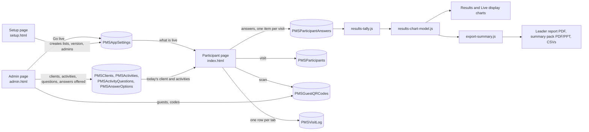
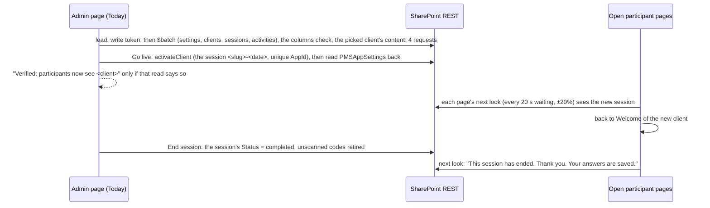
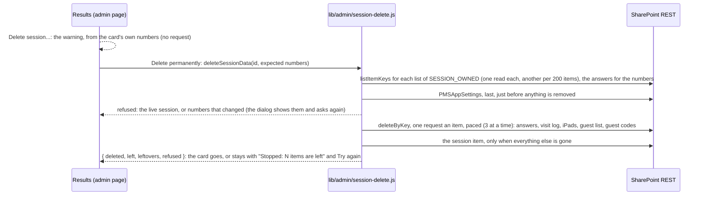

# Data flow

How data moves, from a tap on an iPad to an item in a SharePoint list, to a chart, to a file a leader opens. The lists are in
[SHAREPOINT.md](SHAREPOINT.md); the code of each step is named in [MODULES.md](MODULES.md). Request counts are the ones the tests pin
(`scripts/test-participant-waits.js`, `scripts/test-participant-storage.js`, `scripts/test-admin-today.js`, `scripts/test-live-display.js`).

## The whole picture



Every arrow into a list is a REST request from the browser, with the person's own sign-in, through `lib/data/dataService.js` (the data layer's door; behind it
`lib/data/core.js` is the only module that fetches, beside the settings reader). On the local server the same calls go to `server/` instead, which keeps the same records in JSON files.

## A page starts

```mermaid
sequenceDiagram
  participant P as Page
  participant F as Its folder
  participant S as SharePoint REST
  P->>P: support.ts: a recent browser? (else the notice)
  P->>F: GET pms-config.txt (8 s, no cache)
  F-->>P: settings (404 = none; anything else wrong = stop, PMS-CFG-002)
  P->>P: start.ts: which site and lists are mine? (else stop, PMS-CFG-001/004)
  P->>S: round 1: PMSAppSettings item default (and who is signed in)
  Note over P,S: SchemaVersion read here: missing/older/newer stops the page (PMS-LST-010/011/012)
  P->>S: round 2, one $batch: the client, the session, its activities, the session's visits
  P->>P: first screen (Welcome, or "not live", or the ended notice)
  P->>S: after it: the visit log row, the resume stamp, the write token and list types (fetched ahead)
  P->>S: and the questions and options of every enabled activity, held for the page's life
```

**The client's Animations switch** comes with the client in round 2 (ThemeJson `motion`, Phase 15): no request of its own. An open page applies a change at
its next boot (a reload, or the boot that a restart or a change of what is live makes). Admin writes it on the client as it is at that moment (read with its
ETag, written with If-Match). The motion level a device settles on is kept for the tab's session only (`pms.motion`).

**Two rounds and 6 requests to the first screen** on the staff link (8 at most, plus the settings file), in `lib/participant/boot.js`. Nothing is kept
between page loads: browser storage holds only answers not yet saved (`cec-answers:<track>`), this tab's visit-log keys and the sound choice.

## A participant answers

```mermaid
sequenceDiagram
  participant Q as Question screen (pager)
  participant D as participantData.ts / answer-store.js
  participant S as PMSParticipantAnswers
  Q->>D: recordAnswer (a graded question at its FIRST pick)
  D-->>Q: returns at once (Next never waits)
  D->>S: save in the background: ONE request, the whole answer list, blind (no read, no If-Match)
  Note over D,S: one request in flight per device; answers given meanwhile ride on the next
  Q->>D: flushActivity (the activity's last step)
  D->>S: waits for every save; retries with backoff, at least as long as Retry-After asks
  D-->>Q: done, or SaveFailedError after 3 tries (nothing lost: the screen offers Retry)
```

- **One item per visit** (`AppId` = the visit's id). The first save creates it; a create that meets an existing item reads it, merges and updates.
- **A first answer is never rewritten**: `correct` means the first try was right; a wrong first try with tries left is an open question.
- Unsaved answers are mirrored to `sessionStorage`, so a reload finishes saving them. A written answer is 1,000 characters at most; a whole record
  60,000.
- **A first QR scan** is 8 requests (9 for a session's first device): the code and the settings beside the write token; one `$batch` of the session,
  client, activities and the guest; the new visit beside the activities' content; then the claim, ONE write with `If-Match` on the code's version,
  so only one device can win. The loser removes the visit it wrote.

### The confidence check, Before and After

Prompt 20. When the live session's `ConfidenceCheck` is Yes and the client has a check (an activity of `Kind` `confidence-check` with a question),
`nextStep()` in `lib/participant/confidence-check.js` decides each move: the boot (a resumed visit), Welcome, the hub, the pager's last activity and
Thank you all ask it. Before (`#/check-in`) comes first; the hub sends a visit without it back there. After (`#/check-out`) comes when the last
activity is finished, or when Finish is pressed on the hub of an any-order session; an ended session asks none. Each answer is one more record in
the visit's own item (`<questionId>@before`, `<questionId>@after`), saved by the same store as every answer; the check's question and options are
the client's activities' content, read with them, so no request is added. Thank you shows "Your confidence moved up / stayed the same / moved
down" once both exist. A restart at an activity drops that activity's answers and After (on the device and in the list); from the very beginning,
everything. On the facilitator's side the session's results carry `confidenceCheck` (`buildResults`), from the answers and activities already read.

## The facilitator



Results and the Live display read the same answers: `readLiveFeed` (one `$batch` of the session, its visits, every answer and its activities) every
12 seconds on the Live display, and `readSessionResponsesChecked` on Results, which names an item it cannot read instead of stopping
(`lib/results/unreadable.js`). Both count with `lib/results/results-tally.js`; `lib/results/results-chart-model.js` turns the tally into what a chart
shows (shares, headlines, the correct answer, a scale's average, a ranking's support score, the words that came up most). Names come from
`lib/results/participant-names.js` and are on the admin view only: the wall (full screen, and `#live-display/<id>/wall`) is given none.

The files: the leader report reads the session in 4 requests (`lib/exports/leader-report-data.js`), counts with `lib/exports/leader-report.js` (the
counting rules it prints on its last page), lays out with `lib/exports/leader-report-layout.js` and draws with jsPDF. The Live display's summary pack
(PDF and PowerPoint) and Summary by activity (CSV) are `lib/exports/resultsExport.js`, from the same chart model and `lib/results/export-summary.js`.
All of them are made in the browser on demand and stored nowhere.

### Deleting a session's data (Results, Phase 16)



The lists and their order are `SESSION_OWNED`; nothing else is read for writing, and the client, its content, the admins and the settings item are never
written. A participant page open on that session is at Welcome already (a session that can be deleted is not the live one); a printed guest code of it
is no longer recognised; the Live display open on it says "That session no longer exists."

## Signing in to the admin page (Prompt 21)

The admin page, on SharePoint, once its lists are this build's version (Phase 1 of Prompt 21; [RULES.md](RULES.md) has the rules):

1. **Who is this?** `resolveAccess()` (`lib/access/resolve.js`) asks the data layer (`readSignedInPerson`, `lib/data/access-reads.js`) for the
   signed-in account (`/web/currentuser`: its name, email, login name, whether it is a site collection administrator, its groups) and the site's
   owners group, in one `$batch`. The person's key is their email in lower case.
2. **Their row and roles**: `readAccessRows(key)` reads the `PMSUsers` item whose AppId is the key and the `PMSRoleAssignments` items whose
   `UserKey` is the key, two indexed reads in one `$batch` (one by one where the site will not batch). The answer is kept for the page.
3. **Which screen**: `signInStep()`. The site owner enters as a Super admin (a banner until a Super admin row of their own exists); a listed,
   active person with a current role enters, with no PIN; a disabled person, or one with no current role, sees No access
   (`admin/NoAccess.svelte`); anyone not listed gets the PIN screen as before, and a PIN unlocks the Phase 20 admin page (the legacy admin). If
   the reads fail, the PIN screen too. On the local server nobody is signed in: the PIN.
4. **Every write after that** is asked of the page's write guard (`lib/access/guard.js`, installed with `dataService.setAccessGuard`) inside the
   data layer before it is sent. A refusal is `AccessDenied`, in words, and nothing is sent. Lock (PIN only) takes the guard away.

Setup's People and access reads `PMSUsers` and `PMSRoleAssignments` whole (`listAccessRecords`) to list the Super admins, and writes through
`lib/access` (`makeMeSuperAdmin`, `migrateAdmins`): a person's row, their roles, and a line in `PMSAuditLog` for each.

## People (Prompt 21, Phase 2)

The admin page's People tab, for a person whose access allows it ([RULES.md](RULES.md) has the rules):

1. **Open**: `listAccessRecords` reads `PMSUsers` and `PMSRoleAssignments` whole (pages of the lists' own size), and `listClients` and `listSessions`
   read the clients and sessions: four reads, once. The list, its filters and its pages are worked out in the page (`lib/access/people.js`).
2. **Add user**: each pause in typing sends one `clientPeoplePickerSearchUser` (an earlier one still in flight is aborted); a choice, or a typed
   email, becomes `addPerson()`: one `PMSUsers` item (a duplicate is 409, "in the list already") and one `PMSAuditLog` line. No role is written.
3. **A person's page** reads `PMSAuditLog` whole once, for the history. **Give access** is `grantRole()` (one `PMSRoleAssignments` item, one audit
   line); **Remove** is `removeRole()`; **Turn access off** and an extra are `updateAccessRecord()`. Each of these first reads both access lists
   (`lib/data/access-people.js`) and asks the guard's `record()` check, which refuses your own roles, the last Super admin and an Admin touching a
   Super admin or Admin row, before anything is sent; then it writes, then writes its audit line, and the list is read again.

## A client's sessions and team (Prompt 21, Phase 3)

A client's page (Clients, **Sessions and team**) and Today's start ([RULES.md](RULES.md) has the rules):

1. **Open**: one `readLists` of the settings item and the client's sessions (by the indexed `ClientId`; one `$batch` on SharePoint), beside
   `listAccessRecords` of `PMSUsers` and `PMSRoleAssignments` read whole: three reads, once, and again after each change.
2. **New session**: `planSession()` reads the client's activities (by `ClientId`) and writes one `PMSClientSessions` item under the id the page gave it
   (`<slug>-<yyyy-mm-dd>-<hhmm>`, with the period and the order in the day worked out in the page); a 409 (a duplicate) is tried again as `-2`, `-3`.
   It needs `clients.manage`: the write guard refuses anyone else before anything is sent.
3. **Client team**: Add is `grantRole()` for each place (one `PMSRoleAssignments` item and one audit line each); Remove is `removeRole()`, which reads
   both access lists for the guard's `record()` check first, as on People.
4. **Today, a planned session**: Go live is `startSession()`: the settings item, the session, its client and its activities, a `MERGE` of the session's
   activities when some were added since it was planned, the codes nobody scanned for the session it replaces marked used, the settings item written
   (`events.run`), then one read of the settings item to prove it. With nothing planned for the client that day, Go live is `activateClient()` as before.
   One session is live at a time: the settings item names one.

## How often each open page looks

| Page | Every | Notes |
|---|---|---|
| Participant, waiting (Welcome, hub, finale, "not live") | 20 s ±20% | ONE request (`readParticipantWatch`); 3 a minute against a budget of 4 |
| Participant, a question on screen | 60 s | |
| Participant, hidden tab | never | one look at once when shown again (not within 5 s of the last) |
| Today | 10 s | one `$batch`; two when something else became live |
| Content, Guests and QR | 15 s | |
| Results | 15 s | the live session only |
| Live display | 12 s | one request; the structure (3 requests) every 5 minutes; 5.6 a minute against a budget of 6 |
| Any page, on the local server | 2 to 3 s | no throttle there |

A look that cost more than one request (a site that cannot batch) makes the next wait that many times longer. A failure doubles the wait up to 5
minutes; a 429 or 503's `Retry-After` is a floor (15 minutes at most). One timer per page (`lib/common/page-watch.ts`), never an interval.

## When things go wrong

| What happens | What the person sees | What is kept |
|---|---|---|
| Wi-Fi drops while answering | Nothing at first: Next never waits. Completion waits, then offers Retry. | Answers in memory and in `sessionStorage`; sent when the network returns. |
| SharePoint is busy (429, 503) | Slower; the timers back off. | Everything. |
| The sign-in expires, or SharePoint stops accepting it while a tab is open | Usually nothing: the ladder (below) renews it. If it cannot: the participant page says "Your sign-in has expired. Reload this page to sign in again."; the admin page and Setup show "Your SharePoint sign-in needs refreshing. Reload this page to carry on." with Reload and Details. | Unsaved answers, sent after the reload; on the admin page, unsaved work stays until the person reloads (the banner warns first). |
| A list refuses an account that is signed in (403 with the sign-in proven) | "Your account cannot read <list>. Ask the site owner for Contribute access to the PMS lists." | Everything. |
| The facilitator goes live with another client | The page returns to Welcome of the new client. | Saved answers stay in the old session, which is not ended. |
| The facilitator restarts a participant | The device drops the answers and rewrites its item (a save already on its way cannot bring them back). | Nothing of the earlier answers. |
| The session is ended | Welcome and the hub say it has ended; an activity under way is finished and saved first. | Everything. |
| A visit is removed in Results (only one with no answers) | "This visit is no longer on record." and what to do. | Nothing to keep. |
| One answer item is damaged (a hand edit) | Results, the Live display and the report name it and count the rest. | The rest of the session. |
| A QR claim's answer is lost | The device asks the code whose it is; "Try again" carries on with the visit it made. | The visit, in memory. |

## A refused sign-in: the ladder

Prompt 19 ([SHAREPOINT.md](SHAREPOINT.md#sessions-tokens-and-the-403) says why and what it cannot do). Every 401, 403 and sign-in page is classified
by `REFUSALS` in `lib/data/session.js`; a stale write token and a busy site are handled as before, a refused sign-in goes up this ladder in
`lib/data/core.js`, once for all the requests refused meanwhile. On the local server none of it runs.

```mermaid
sequenceDiagram
  participant S as Screen
  participant D as Data layer (core.js)
  participant R as SharePoint REST
  participant F as Hidden frame (session-renewer.ts)
  S->>D: a read (or a write)
  D->>R: GET .../items
  R-->>D: 403 "Access denied" (SPRequestGuid)
  D->>D: evidence: status, code, guid, list key, time since the last answer
  Note over D: single flight: every request refused now waits for this one recovery
  D->>R: Step A: pause 0.25 to 0.75 s, POST /contextinfo (a fresh write token)
  alt the sign-in works
    R-->>D: 200
    D->>R: the read once more (a write is not: the account may not)
    R-->>D: 200, or 403 again: a permission, said with the list's title
  else refused too
    R-->>D: 403
    D->>F: Step B: navigate to pms-config.txt (10 s at most), then remove it
    D->>R: GET /_api/web?$select=Id
    alt renewed
      R-->>D: 200
      D->>R: the request once more (a write too: refused whole, it never ran)
      R-->>D: 200
      D-->>S: the answer, nothing said
    else not renewed
      R-->>D: 403
      D-->>S: Step C: session-lost (401): the banner; 5 s cooldown
    end
  end
```

**The admin page also checks by itself** (`lib/common/session-keepalive.ts`): after 10 minutes with no answer, one `GET /_api/web?$select=Id`, at
once when the tab is shown again after that long, never while it is hidden; a screen that refreshes adds nothing.
