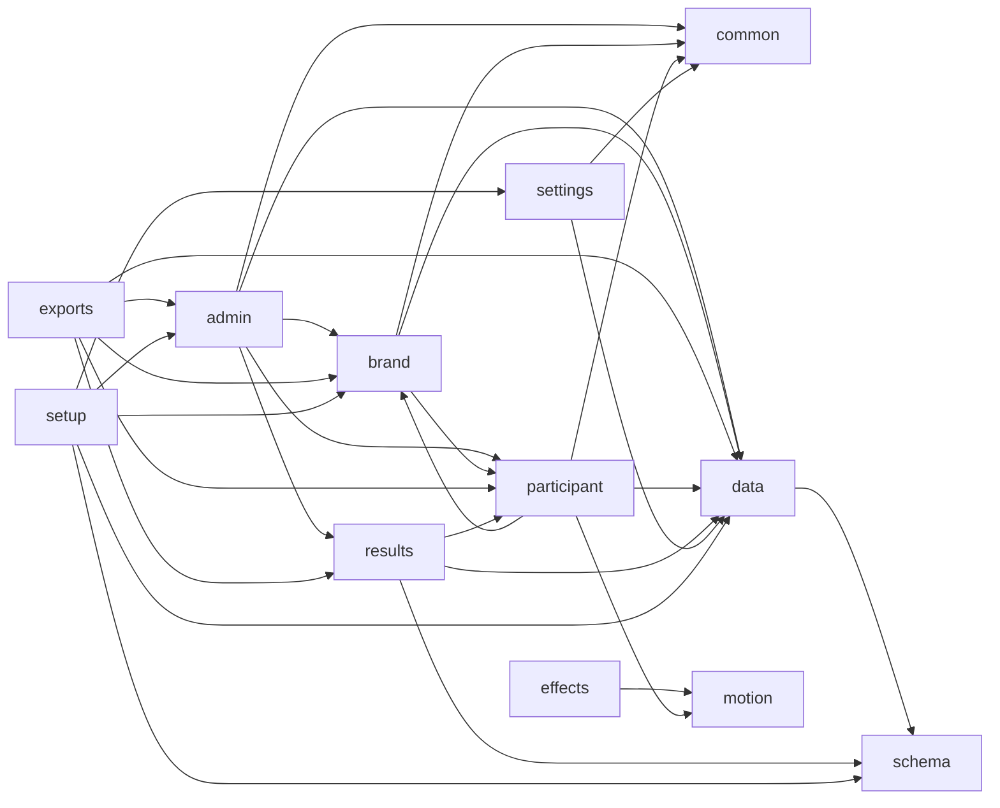

# Module map

<!-- Generated by scripts/build-modules-map.js from the code and the folder purposes written in it. Do not edit by hand: run `npm run docs:modules` (scripts/test-modules-map.js fails when this file is stale). -->

Where the code is and what each part may touch. The folders of `migration/src/lib` are the modules; each file in them starts with a header that
says what it owns, what it reads and writes, and what it must not do (`scripts/test-module-headers.js` holds that). The data flow is
[DATA-FLOW.md](DATA-FLOW.md), the rules of each part [RULES.md](RULES.md).

## How the lib folders depend on each other

An arrow means "imports from", read from the code. What each built page really carries is what `npm run analyze:bundle` lists, by folder; `npm run test:bundle`
holds what the participant page must not carry (the libraries of the admin page, the Results charts, the exports, the modules of Setup).

## The folders

| Folder | What it is for | Files |
|---|---|---:|
| `migration/src/` | The three entries (`main.ts`, `admin-main.ts`, `setup-main.ts`), the three apps (`App.svelte`, `AdminApp.svelte`, `SetupApp.svelte`) and their page-wide CSS. The HTML shells are `migration/index.html`, `admin.html` and `setup.html`. | 8 |
| `migration/src/admin/` | The admin page's screens (Svelte): the five tabs, Brand Studio, dialogs, the Live display, the print sheet, the report buttons. | 34 |
| `migration/src/admin/charts/` | The Results charts, drawn by hand in HTML and SVG (no chart library): the card, bars, the scale, the split bar, words, names, the table view, the tooltip. | 9 |
| `migration/src/assets/report-fonts/` | The Open Sans subset of the leader report (generated by `npm run build:report-fonts`, with its licence). | 1 |
| `migration/src/components/` | The participant page's building blocks (Svelte): the shell, pills, buttons, the hero plate, tiles, the progress bar, the sound switch. | 16 |
| `migration/src/dev/` | The styleguide, `#/styleguide` on the dev server only (absent from builds). | 1 |
| `migration/src/lib/admin/` | The admin page's rules and data: Today, Clients, Content, Guests and QR, Results, the Live display's session, the PIN check. | 18 |
| `migration/src/lib/brand/` | A client's look: deriving a readable theme from a colour, the stored theme, Brand Studio's rules, picture slots, cropping, compressing and naming. | 18 |
| `migration/src/lib/common/` | Shared by the pages: the product name, the heading focus rule, kiosk lock-down, the polling schedule and its one timer, the admin page's address. | 6 |
| `migration/src/lib/data/` | The data layer: dataService.js, the door every page imports, over its parts (core.js holds the state and alone talks to SharePoint REST or, on the local server, its JSON API), and grouping of long id lists into short reads. Every page carries it. | 18 |
| `migration/src/lib/effects/` | Sounds and confetti, behind one door (`effects.ts`): which moment makes which effect, the cues as data, Web Audio, canvas-confetti. | 6 |
| `migration/src/lib/exports/` | The files a leader gets: the leader report (data, counting, layout, PDF writer, fonts) and the Live display's summary pack (PDF, PowerPoint) and summary CSV. | 7 |
| `migration/src/lib/motion/` | The participant screens' motion, behind one door (`motion.ts`): the plan by kind of question and part of a screen, the tokens and shapes (CSS), the level and the governor. | 2 |
| `migration/src/lib/participant/` | The participant page: the boot sequence, the visit, the activities held for the page's life, the pager's rules, saving answers, screen moves. | 13 |
| `migration/src/lib/results/` | Results counted and shown: the tally, the chart model (every number a chart shows), the palette, the figure on paper, names, the takeaways, where a tooltip goes. | 11 |
| `migration/src/lib/schema/` | The lists and columns: `pms-schema.js`, the names every page carries, and `pms-schema-meta.js`, everything else about them (Setup, the tests and the generators only). | 2 |
| `migration/src/lib/settings/` | How a page starts: the browser check, where its settings come from (`pms-config.txt`, the build, its address), which site and lists are its own, and the stop screen. | 8 |
| `migration/src/lib/setup/` | The Setup page's own modules: the plan and Create, Mark the site as ready, the admins, the seed-file import, the sample clients and their pictures, the self-test's probes. | 10 |
| `migration/src/pager/` | The pager: one question per screen, its answers, and an activity's completion screen. | 3 |
| `migration/src/routes/` | The participant page's screens: Welcome, the Activities hub, the quiz route, the finale, "not live", the preview, and the old addresses that redirect. | 9 |
| `migration/src/setup/` | Setup's pieces (Svelte): the copy panel, where the lists are, the plan view, and the sample pictures as data. | 4 |
| `migration/src/unsupported/` | The "needs a recent browser" notice: a page and an ES5 check, put into each HTML shell at build time. | 1 |
| `scripts/` | Node tests (`test-*.js`, run by `npm test` and the `test:*` scripts), the mocked SharePoint (`sharepoint-fake.js`), the oracle, the bundle and request baselines, the generators and the release packager. | 129 |
| `scripts/local-site/` | The local PCOE stand-in (`npm run local:site`), its scenarios and VJR's dummy dataset, the screenshot harness and the measurements. | 11 |
| `scripts/migration-tests/` | The Playwright specs of `npm run test:migration`, and their harnesses (`admin-local.ts`, `polling-support.ts`, `fixtures.ts`). | 70 |
| `scripts/rehearsal-tests/` | The rehearsal of RUNBOOK.md on the mock with a package's own pages (`npm run test:rehearsal`). | 1 |
| `scripts/schema-baseline/` | The schema as it was before Phase 10c-2b, and the scripts that translated the request baselines (each baseline names the one that touched it). | 5 |
| `scripts/styleguide-tests/` | The styleguide's audit (`npm run test:styleguide`). | 1 |
| `server/` | The local stand-in for SharePoint: an Express API over JSON files (`server/data/`, committed seed data), with ETag concurrency and picture uploads. Development and tests only. | 3 |

## `lib/admin/`

The admin page's rules and data: Today, Clients, Content, Guests and QR, Results, the Live display's session, the PIN check.

- **Imports from:** `lib/brand`, `lib/common`, `lib/data`, `lib/participant`, `lib/results`
- **Imported by:** `lib/exports`, `lib/setup`, `src`, `src/admin`
- **Node suites that import it:** `test-admin-content.js`, `test-admin-results.js`, `test-admin-today.js`, `test-brand-studio-view.js`, `test-column-names.js`, `test-duplicates.js`, `test-live-display.js`, `test-live-view.js`, `test-local-site.js`, `test-motion-switch.js`, `test-named-reads.js`, `test-participant-names.js`, `test-results-chart-model.js`, `test-results-wall.js`, `test-review-9a.js`, `test-review-9b.js`, `test-sample-pictures.js`, `test-schema-upgrade.js`, `test-session-delete.js`, `test-setup-admins.js`, `test-sharepoint.js`, `test-text-limits.js`, `test-today-view.js`, `test-ux-12.js`

| Module | What it is (its header) | Exports |
|---|---|---|
| `admin-clients.js` | What the admin's Clients screen decides: the add/edit form's rules, the stored theme a form makes, the list's derived columns, and who may be archived. | 16 exports |
| `admin-content.js` | What the admin's Content and Guests screens decide: which activities belong where, in what order, what a pasted list of names means, what each guest's status is, what the CSV and the print sheet hold. | 37 exports |
| `admin-links.ts` | Links the facilitator hands out, and the QR image of one. | `participantPageUrl`, `qrImage`, `copyText` |
| `admin-pin.js` | The admin page's PIN check (AdminApp.svelte). | `hashPin`, `login` |
| `admin-results.js` | What Admin → Results works out for each iPad of a session: the name it shows, and where it has got to. | 18 exports |
| `admin-today.js` | What the admin's Today screen reads, decides and says. | 17 exports |
| `admin-unlock.js` | What the admin page's PIN screen says when it could not check a PIN (Phase 12, F-02). | `unlockFailureText` |
| `adminData.ts` | One participant's answer to one question, as dataService.readSessionResponses() returns it from either storage shape. | `getSessionResults`, `readSessionResponses`, `restartClientTrack`, `confirmedBy`, `confirmSampleClient`, `saveClientMotion`, `removeEmptyVisit`, `endSession`, `reopenSession`, `answersToQuestions`, `orphanNote`, `loadGuestState`, `refreshGuestState` |
| `brand-studio-view.js` | What Brand Studio works out for itself before it draws: the look its preview is given, a picture's address as the page shows it, the page gradient of its colour strip, whether a typed colour is wrong, the word for each pairing of the contrast check, what each picture slot says, the address that previews the saved look on a device, and what a save says. | `displayUrl`, `lookOf`, `pageGradient`, `colourInvalid`, `contrastResult`, `slotStatus`, `previewAddress`, `savedMessage` |
| `live-session.js` | What the Live display holds and how it keeps up. | `loadLiveStructure`, `readLive` |
| `live-view.js` | What the Live display works out for itself before it draws: the client's look, which question full screen shows and where Previous and Next take it, the type size a window asks for, which keys move it, the heading over the question, the notice of answers that could not be read, and the words of a session in the picker. | `liveBrand`, `shownIndex`, `stepFrom`, `presentScaleFor`, `pagerStep`, `sectionTitleOf`, `unreadableText`, `sessionLabel` |
| `live-wall.js` | The wall display's address (Phase 11a). "Open in a new tab" on the Live display opens the admin page at `#live-display/<sessionId>/wall`, which is the wall: the same results with no participant's name anywhere in the page, no Names switch, and Show answer on each graded question. | `WALL_SUFFIX`, `wallHash`, `wallOfHash`, `wallAddress` |
| `master-brand.ts` | The brand the Master screen and its exports use, with the colours from the client's stored theme when it has one (Brand Studio writes it) and the older PrimaryColor / SecondaryColor fields otherwise, which loadBrand has already put there. | `withStoredColours` |
| `sample-notice.js` | "Sample content: confirm with the client team before real use" (Phase 9b, SAM-2). | `SAMPLE_NOTICE`, `SAMPLE_REPORT_LINE`, `SAMPLE_SOURCE`, `SAMPLE_ORIGINS`, `sampleMark`, `isSampleClient`, `sampleState`, `needsConfirmation`, `confirmedTheme`, `confirmedLine` |
| `session-delete.js` | "Delete session..." on Admin → Results (Phase 16): what deleting a session's data removes, in which order, what it refuses, and the words the screen, the tests and the documents use. | `SESSION_OWNED`, `KEPT`, `DELETE_SESSION`, `countsText`, `deleteSessionWarning`, `changedText`, `progressText`, `stoppedText`, `refusedText`, `deletedText`, `cardCounts`, `planSessionDelete`, `deleteSessionData` |
| `sha256.js` | SHA-256 for the mock PIN check. crypto.subtle only exists in secure contexts (HTTPS or localhost), and the admin iPad reaches this dev server over plain http://<lan-ip>:3000, so a small pure-JS fallback is needed there. | `sha256Hex` |
| `today-view.js` | What the admin's Today screen works out for itself before it draws: the words of its status ("Live since"), of its Go live button and of the reason it is off, of its readiness line, which clients it offers, the order of the other sessions, and how a changed session joins the list. | `sinceText`, `levelCounts`, `readinessSummary`, `goLiveWhy`, `goLiveLabel`, `pickableClients`, `otherSessionsOf`, `upsertSession`, `failureText` |
| `unsaved.ts` | "You have unsaved changes": a screen that holds some (Brand Studio) registers a guard here, and the shell asks it before it switches tab or locks the page. | `setLeaveGuard`, `mayLeave` |

## `lib/brand/`

A client's look: deriving a readable theme from a colour, the stored theme, Brand Studio's rules, picture slots, cropping, compressing and naming.

- **Imports from:** `lib/common`, `lib/data`, `lib/participant`
- **Imported by:** `lib/admin`, `lib/exports`, `lib/participant`, `lib/setup`, `src/admin`, `src/components`, `src/dev`
- **Node suites that import it:** `test-admin-today.js`, `test-brand-storage.js`, `test-brand.js`, `test-live-view.js`, `test-motion-switch.js`, `test-results-palette.js`, `test-review-9b.js`, `test-sample-pictures.js`, `test-seeds.js`, `test-sharepoint.js`, `test-theme.js`

| Module | What it is (its header) | Exports |
|---|---|---|
| `asset-compress.js` | "Compress to the size cap": the finished picture must be at most a slot's size in bytes, ending at exactly the slot's pixel size whenever that is possible. | `QUALITIES`, `SCALE_STEPS`, `CompressError`, `compressToCap` |
| `asset-image.ts` | The browser half of picture handling: decode a chosen file, draw the cropped view to a canvas of exactly the slot's size, and encode it under the size cap. | `PictureError`, `decodeImage`, `renderView`, `encodeCanvas`, `prepareAsset`, `hasTransparency`, `measureLogo` |
| `asset-names.js` | File names for uploaded pictures, and the hash behind them. | `sha256Hex`, `HASH_LENGTH`, `assetFileName`, `fileNameOf`, `isOwnUpload` |
| `asset-specs.js` | The picture slots Brand Studio fills, and what each one accepts (PMS-IMPLEMENTATION-PLAN.md 4.4, in git history at 7347c72). | `KB`, `MAX_INPUT_BYTES`, `MAX_UPSCALE`, `MIN_SCALE_SHARE`, `SLOTS`, `BRAND_SLOTS`, `slotSpec`, `extensionOf`, `formatBytes`, `describeSpec`, `fitScale`, `minimumWidth`, `checkDimensions`, `ACCEPT` |
| `assets.js` | Where a picture's address points: relative to the page's own folder, or to a copy the page carries inline (globalThis.CEC_ASSETS). | `assetLocation`, `assetUrl`, `embeddedAssetUrl` |
| `brand-devices.js` | The screens Brand Studio previews, and the geometry that goes with them. | `DEVICES`, `deviceById`, `fitToWidth`, `visibleShare`, `safeArea` |
| `brand-look.ts` | One client's look as Brand Studio's draft has it: what the participant screens read from today's live experience, here handed in so the real screens can be drawn from a draft (BrandPreviewStage.svelte). |  |
| `brand-sample.js` | What Brand Studio's preview shows a client's look on: made-up, client-neutral content, so a preview reads the same for every client and never shows another client's words. | `SAMPLE_NAME`, `SAMPLE_PILLS`, `SAMPLE_ACTIVITY`, `SAMPLE_FINALE`, `SCENES` |
| `brand-studio.js` | What Brand Studio decides: a client's look as a draft, the checks on it, what a save writes and what the older screens read. | 22 exports |
| `brand.svelte.ts` | The client the participant is looking at, as the screens need it: the name for "Welcome to the {Client} experience." and the hub title, and the logo for the Welcome hero plate. | `clientView` |
| `branding.js` | Per-client branding, applied once at the page root so no screen has to do it. | `DEFAULT_BRAND`, `currentBrand`, `loadBrand`, `applyBrand` |
| `client-theme.js` | A client's stored look (Clients.ThemeJson) turned into what the participant page applies. | `safeImageUrl`, `safeFocus`, `safePlate`, `motionEnabled`, `withMotion`, `resolveClientTheme`, `buildClientTheme`, `reviseClientTheme` |
| `crop-math.js` | The maths behind "Crop and fit": a picture is moved and zoomed inside a frame whose shape is locked to a slot's, and the result is drawn to exactly the slot's size. | `MAX_ZOOM`, `coverScale`, `containScale`, `scaleRange`, `fitView`, `clampView`, `panBy`, `zoomTo`, `sliderOf`, `scaleOf`, `drawPlan`, `keyboardView` |
| `image-sniff.js` | What a picked file really is, from its first bytes (not its name or the type the browser guessed). | `sniffImage`, `isTruncated`, `inspectFile` |
| `legacy-colours.js` | The older colour fields (Clients.PrimaryColor and SecondaryColor) that the Master screen, the exports and the legacy app read, and how they follow a client's stored theme. | `hexOrNull`, `legacyColours`, `masterColours` |
| `retired-logos.js` | A logo address the sample seeds used to carry and no longer do (Phase 9b, SAM-1). | `isRetiredLogo`, `withoutRetiredLogo` |
| `scrim.js` | The dark layer over a client's background picture, worked out rather than guessed. | `WORST_PHOTO`, `SCRIM_COLOUR`, `SOFT_TEXT`, `worstTextContrast`, `minimumScrimAlpha`, `SCRIM_ALPHA` |
| `theme.js` | Palette derivation for the participant theme (PMS-IMPLEMENTATION-PLAN.md, 2.2 and 4.4, in git history at 7347c72). | 18 exports |

## `lib/common/`

Shared by the pages: the product name, the heading focus rule, kiosk lock-down, the polling schedule and its one timer, the admin page's address.

- **Imports from:** nothing of the app
- **Imported by:** `lib/admin`, `lib/brand`, `lib/participant`, `lib/settings`, `src`, `src/admin`, `src/dev`, `src/pager`, `src/routes`
- **Node suites that import it:** `test-participant-storage.js`, `test-polling.js`, `test-results-wall.js`, `test-review-9a.js`

| Module | What it is (its header) | Exports |
|---|---|---|
| `admin-address.js` | Where the facilitator's Live display is, as an address. | `liveDisplayHash`, `liveDisplayOfHash`, `adminAddress` |
| `app-name.ts` | The product name shown to people: page titles, headers, export metadata. | `APP_NAME` |
| `focus.ts` | Moving focus to a heading by script: a new screen, or the next question. | `KEYBOARD_FOCUS`, `focusHeading` |
| `kiosk.ts` | Kiosk lock-down for the pages. | `isKioskMode`, `installKiosk` |
| `page-watch.ts` | The timer of a page that stays open (the participant page's look at what the facilitator did). | `createPageWatcher` |
| `poll-schedule.js` | When a page that stays open looks at the server again. | `POLL`, `nextDelay`, `LIVE_DISPLAY`, `adminDelay`, `modeOf`, `ENDED_NOTICE_ROUTES`, `showsEndedNotice`, `sessionHasEnded` |

## `lib/data/`

The data layer: dataService.js, the door every page imports, over its parts (core.js holds the state and alone talks to SharePoint REST or, on the local server, its JSON API), and grouping of long id lists into short reads. Every page carries it.

- **Imports from:** `lib/schema`
- **Imported by:** `lib/admin`, `lib/brand`, `lib/exports`, `lib/participant`, `lib/results`, `lib/settings`, `lib/setup`, `src`, `src/admin`, `src/pager`, `src/routes`
- **Node suites that import it:** `test-admin-content.js`, `test-admin-today.js`, `test-brand-storage.js`, `test-column-names.js`, `test-data-surface.js`, `test-deploy-settings.js`, `test-duplicates.js`, `test-leader-report-pdf.js`, `test-live-display.js`, `test-local-site.js`, `test-motion-switch.js`, `test-named-reads.js`, `test-participant-names.js`, `test-participant-storage.js`, `test-participant-waits.js`, `test-review-9a.js`, `test-schema-upgrade.js`, `test-seeds.js`, `test-session-delete.js`, `test-sessions.js`, `test-setup-admins.js`, `test-sharepoint.js`

| Module | What it is (its header) | Exports |
|---|---|---|
| `common.js` | What several parts of the data layer share (Phase 17: cut out of dataService.js sections 4, 5, 6 and 8 unchanged): an item from an AppId read, a write to an item a read has already found, a list address with equality filters, every page of a list read, and paced bulk work (runPaced). | `runPaced`, `PACE`, `localFilter`, `spAllRows`, `spItemsAddress`, `spOne`, `spWrite` |
| `content-copy.js` | Content per client and copying activities (dataService.js section 6; Phase 17 cut it out unchanged): an activity's questions and options in the fewest reads, the plan of a copy, copying, duplicating and deleting activities, and adding activities to the live session. | `readActivityContent`, `COPY_SEPARATOR`, `copyIdFor`, `copyTitle`, `planCopy`, `addSectionsToLiveSession`, `copyActivities`, `duplicateActivity`, `deleteActivity` |
| `core.js` | The backend adapter (dataService.js section 1; Phase 17 cut it out of that file unchanged): | 48 exports |
| `dataService.js` | dataService.js: the data layer's one door. | 107 exports |
| `encoding.js` | The schema's lists and columns as the data layer reads and writes them, and the small helpers that hold no state (Phase 17: cut out of dataService.js section 1 and 6 unchanged). | 17 exports |
| `guests.js` | Guests in bulk (dataService.js section 6; Phase 17 cut it out unchanged): adding guests to a session's list and making their QR codes, paced (common.js runPaced), with the name a guest list compares. | `guestNameKey`, `addGuests`, `provisionGuestCodes` |
| `list-titles.js` | Which lists are this copy's (dataService.js section 10; Phase 17 cut it out unchanged): every list's title on this site, and the picture library's, from the page's settings. | `sharePointListTitles` |
| `pictures.js` | Pictures for a client's look (dataService.js section 7; Phase 17 cut it out unchanged): storing a picture under its own name, in the picture library's folder on SharePoint or the local server's uploads folder, and removing one by name. | `uploadClientAsset`, `removeClientAsset` |
| `qr-scan.js` | A first QR scan in few requests, and a visit begun from Welcome (dataService.js section 4; Phase 17 cut it out unchanged but for its five writes of the held scan, which go through core.js's holdScan(), where that state lives). | `openQrScan`, `beginVisit`, `prepareWrites` |
| `read-groups.js` | Reads in groups of 20 ids to an address (Phase 9b), so that no request address grows with what a session holds. | `READ_CHUNK`, `groupsOf`, `sectionQueries` |
| `records.js` | The records (dataService.js section 2; Phase 17 cut it out unchanged): clients, sessions, activities, questions, options, visits, QR codes, the roster and admin users, as plain objects with a string id, and the lists' version check that every page's first read makes (PMS-LST-010 to 012). | 56 exports |
| `removal.js` | Removing a visit that has no answers, and deleting by key (dataService.js section 9; Phase 17 cut it out unchanged): removeEmptyVisit for Results, and the two generic calls of Delete session (listItemKeys, deleteByKey), whose rules are lib/admin/session-delete.js's. | `removeEmptyVisit`, `listItemKeys`, `deleteByKey` |
| `responses.js` | Answers, kept one item per participant (dataService.js section 3; Phase 17 cut it out unchanged): the item's shape and limits, the blind save, the read of a session's answers (and of a damaged item, named instead of stopping), a restart, and the list of a session's visits. | 20 exports |
| `schema-check.js` | The check of a site's lists and columns (dataService.js section 1's end; Phase 17 cut it out unchanged): checkSharePointLists() for Setup's list of lists, checkSharePointSchema() for the admin's Today screen and Setup. | `checkSharePointLists`, `checkSharePointSchema` |
| `self-test.js` | The Setup page's own calls on a real site (dataService.js section 3; Phase 17 cut them out unchanged): a read-only probe, one REST request for lib/setup/provision.js, and the participant self-test, which makes a throwaway answers item, checks the writes and the $batch the participant page relies on, and deletes everything it made. | `probeSharePointRead`, `sendToSharePoint`, `runParticipantSelfTest` |
| `today-clients.js` | The admin's Today and Clients screens (dataService.js section 5; Phase 17 cut it out unchanged): several list reads in one request (readLists, which the content and guest parts use too) and making a session the live one (activateSession). | `readLists`, `activateSession` |
| `today.js` | Today's client (dataService.js section 3; Phase 17 cut it out unchanged): making a client today's (activateClient), what the participant page shows for it (getLiveExperience), an activity's questions, and the stamps of a visit (recordParticipantVisit, noteTrackResumed). | `slugify`, `listClientSections`, `sessionIdFor`, `activateClient`, `getLiveExperience`, `getSessionActivities`, `getClientActivities`, `recordParticipantVisit`, `getSectionQuestions`, `noteTrackResumed`, `inOrder`, `liveExperienceOf` |
| `watch.js` | What a page that stays open reads on a timer (dataService.js section 8; Phase 17 cut it out unchanged): the participant page's one look (readParticipantWatch) and the Live display's feed (readLiveFeed), each one request where the site can batch, saying what it cost. | `readParticipantWatch`, `readLiveFeed` |

## `lib/effects/`

Sounds and confetti, behind one door (`effects.ts`): which moment makes which effect, the cues as data, Web Audio, canvas-confetti.

- **Imports from:** `lib/motion`
- **Imported by:** `src`, `src/components`, `src/dev`, `src/pager`, `src/routes`
- **Node suites that import it:** `test-effects.js`

| Module | What it is (its header) | Exports |
|---|---|---|
| `confetti-plan.js` | How much confetti, where from, in which colours. | `DELOITTE_GREEN`, `NARROW_WIDTH`, `NARROW_SCALE`, `parseColor`, `toHex`, `toHsl`, `isRedish`, `tint`, `buildPalette`, `defaultOrigin`, `originFromRect`, `confettiPlan`, `planDuration`, `CONFETTI_SIZES` |
| `confetti.ts` | The confetti overlay. | `clearConfetti`, `celebrate` |
| `effect-plan.js` | What each moment in the participant flow should do, and how the sound choice is remembered. | `EFFECTS`, `answerEffect`, `SOUND_KEY`, `readChoice`, `writeChoice`, `soundIsOn`, `UNAVAILABLE_TITLE` |
| `effects.ts` | The one door to sound and confetti. | 16 exports |
| `sound-cues.js` | The participant sounds, as DATA. | `CUES`, `CUE_NAMES`, `noteEnd`, `cueEnd`, `toneSignature`, `MAX_VOICES`, `RETRIGGER_MS`, `createVoiceGate` |
| `sound-engine.ts` | Web Audio for the participant cues. | `audioSupported`, `scheduleCue`, `renderCueOffline`, `unlock`, `resumeIfNeeded`, `playCue`, `stopAll`, `setPlaybackSession` |

## `lib/exports/`

The files a leader gets: the leader report (data, counting, layout, PDF writer, fonts) and the Live display's summary pack (PDF, PowerPoint) and summary CSV.

- **Imports from:** `lib/admin`, `lib/brand`, `lib/data`, `lib/participant`, `lib/results`, `src/assets/report-fonts`
- **Imported by:** `src/admin`
- **Node suites that import it:** `test-column-names.js`, `test-export-summary.js`, `test-leader-report-charts.js`, `test-leader-report-glance.js`, `test-leader-report-pdf.js`, `test-live-display.js`, `test-participant-names.js`, `test-results-csv.js`, `test-results-export.js`, `test-results-pack.js`, `test-review-9a.js`, `test-review-9b.js`, `test-sessions.js`

| Module | What it is (its header) | Exports |
|---|---|---|
| `export-stubs-unavailable.js` | What the admin build puts in place of html2canvas, canvg and dompurify (migration/vite.admin.config.ts). jsPDF loads those three only for features this app does not use: doc.html() (a page rendered to PDF), doc.addSvgAsImage() and the HTML sanitising that goes with them. | `sanitize`, `default` |
| `leader-report-data.js` | What the leader report and the participant CSV read for one session, with the calls the admin screens already use (nothing was added to dataService.js): the session; then, side by side in ONE $batch on SharePoint, its activities, its client, its tracks, its visit log (where a staff sign-in name is kept) and its guest roster; then the activities' questions and options (one more batch) beside every answer, through readSessionResponses(), the one reader that sees both ways answers are stored. | `readLeaderReportRecords` |
| `leader-report-layout.js` | The leader report, placed on A4 pages. | `PAGE`, `CONFIDENTIAL`, `SESSION_ENDED`, `SESSION_NOT_ENDED`, `WORDMARK_RATIO`, `HOW_TO_READ`, `layoutLeaderReport` |
| `leader-report-pdf.js` | Draws the leader report's pages (lib/exports/leader-report-layout.js) with jsPDF: rectangles, lines, single lines of text in the embedded Open Sans, the client's logo as a picture, and two shapes that are paths (the tick and cross beside an answer, and the Deloitte wordmark). | `svgPath`, `writeLeaderReportPdf` |
| `leader-report.js` | The leader report and the participant CSV, as numbers and words: who took part, what each person answered first and last, and every count the PDF prints. | 17 exports |
| `report-fonts.js` | Open Sans for the leader report's PDF: the two faces made by scripts/build-report-fonts.py, inflated when a report is made, and read just enough (which characters a face has, and how wide each one is) for the layout to measure text itself. | `MISSING`, `readFace`, `loadReportFonts`, `createMeasure`, `binaryString` |
| `resultsExport.js` | The Live display's files (the summary pack as PDF and PowerPoint, and Summary by activity as CSV). | 15 exports |

## `lib/motion/`

The participant screens' motion, behind one door (`motion.ts`): the plan by kind of question and part of a screen, the tokens and shapes (CSS), the level and the governor.

- **Imports from:** nothing of the app
- **Imported by:** `lib/effects`, `lib/participant`, `src/admin`, `src/components`, `src/pager`, `src/routes`
- **Node suites that import it:** `test-motion-engine.js`, `test-motion-plan.js`

| Module | What it is (its header) | Exports |
|---|---|---|
| `motion-plan.js` | The motion plan of the participant screens (Phase 15): which shape each thing on a screen moves with, for how long, after how much delay and over what distance, as a TABLE keyed by the moment, the kind of question and the part of the screen, never as numbers in a component. | 27 exports |
| `motion.ts` | The one door to motion on the participant screens (Phase 15). | `motionLevel`, `setMotionEnabled`, `setMotionDirection`, `motion`, `movingCount` |

## `lib/participant/`

The participant page: the boot sequence, the visit, the activities held for the page's life, the pager's rules, saving answers, screen moves.

- **Imports from:** `lib/brand`, `lib/common`, `lib/data`, `lib/motion`
- **Imported by:** `lib/admin`, `lib/brand`, `lib/exports`, `lib/results`, `src`, `src/admin`, `src/pager`, `src/routes`
- **Node suites that import it:** `test-duplicates.js`, `test-list-namespace.js`, `test-local-site.js`, `test-pager.js`, `test-participant-storage.js`, `test-participant-waits.js`, `test-review-9a.js`, `test-review-9b.js`

| Module | What it is (its header) | Exports |
|---|---|---|
| `activity-content.js` | The questions and options of today's activities, held for as long as the participant page is open (Phase 10j). | `LOADING_DELAY_MS`, `createActivityContent` |
| `answer-store.js` | One participant's answers on this device, and the saving of them. | `STORAGE_PREFIX`, `SAVE_ATTEMPTS`, `BACKOFF_MS`, `COOL_DOWN_MS`, `MAX_RETRY_AFTER_MS`, `SaveFailedError`, `createAnswerStore` |
| `boot.js` | What the participant page reads before its first screen, and in what order. | `bootParticipant`, `writesAhead` |
| `experience.svelte.ts` | Today's experience as the participant screens need it: is anything live, whose it is, how it looks, what it says, and which activities it has. | `experience`, `activityContent`, `showTheme`, `adoptExperience`, `isStale`, `currentActivities`, `adoptWatch`, `knownActivity`, `knownActivities`, `refreshActivities`, `holdsActivities`, `holdActivityContent`, `loadActivity` |
| `keep-in-view.ts` | A phone or an iPad turned over in the middle of a question. | `keepInView` |
| `navigation.ts` | The participant page's moves between screens (Welcome, the hub, an activity, the finale), through svelte-spa-router's hash routes. | `navigateTo`, `consumeNavigationData` |
| `pager-logic.js` | The rules of the participant flow, with no DOM and no Svelte, so scripts/test-pager.js can exercise them with `node --test`. | 28 exports |
| `participantData.ts` | The one door between the participant screens and answer storage. | 16 exports |
| `roving.ts` | Arrow-key movement inside a group of answer buttons. | `arrowKeys` |
| `session.svelte.ts` | Who this participant page is for: the visit (track) and session it holds, as Svelte state the screens read. setTrack() is called by App.svelte with what the boot sequence found and by Welcome.svelte when a visit begins or a QR code is claimed; clearTrack() when a visit ends or is removed. | `participant`, `setTrack`, `clearTrack`, `offerEarlierVisit`, `takeEarlierVisit` |
| `sign-in.js` | Has the SharePoint sign-in run out? Plain JS with JSDoc and no DOM, so `node --test` imports it. | `isSignedOut`, `loadFailureText` |
| `visit-id.js` | The id of the visit "Click here to begin" makes. | `newVisitId`, `visitIdFor`, `visitBegun` |
| `visit-notice.js` | What a participant page says when the visit it holds is no longer on record (Phase 9b, DI-9): a facilitator removed it from Results (a visit with no answers), or it was cleaned up. | `visitGoneNotice` |

## `lib/results/`

Results counted and shown: the tally, the chart model (every number a chart shows), the palette, the figure on paper, names, the takeaways, where a tooltip goes.

- **Imports from:** `lib/data`, `lib/participant`, `lib/schema`
- **Imported by:** `lib/admin`, `lib/exports`, `src/admin`, `src/admin/charts`
- **Node suites that import it:** `test-column-names.js`, `test-export-summary.js`, `test-leader-report-charts.js`, `test-live-display.js`, `test-live-view.js`, `test-named-reads.js`, `test-participant-names.js`, `test-participant-storage.js`, `test-polling.js`, `test-present-fit.js`, `test-results-chart-fit.js`, `test-results-chart-model.js`, `test-results-csv.js`, `test-results-export.js`, `test-results-pack.js`, `test-review-9b.js`, `test-schema-upgrade.js`, `test-sessions.js`, `test-ux-12.js`

| Module | What it is (its header) | Exports |
|---|---|---|
| `export-summary.js` | What every Results export opens with (Phase 13): for each activity one sentence, its takeaway, and the numbers behind it; for a session the answers and questions in all. | `scoreboardOf`, `summarizeActivity`, `summarizeSession` |
| `participant-names.js` | The one rule that names a participant. | `ownerOf`, `nameParticipants` |
| `present-fit.js` | The full screen's type, a step at a time (Phase 11a-3; until then these lines were inside LiveDisplay.svelte). | `SMALLEST`, `scaleOf`, `nextFit` |
| `results-chart-figure.js` | A Results chart on paper (Phase 11b): what the screen's charts (admin/charts/) draw, as rectangles, lines, ticks and single lines of text in millimetres, from the chart model (lib/results/results-chart-model.js chartOf) and the palette (lib/results/results-palette.js). | `valueOf`, `barRows`, `chartFigure`, `MULTI_CAPTION` |
| `results-chart-model.js` | What a Results chart shows, worked out from the tally and the answers, with no drawing in it (Phase 11a). | 31 exports |
| `results-palette-source.ts` | The Results palette on the admin page (Phase 11b): styles/results-tokens.css itself, imported as text and read by lib/results/results-palette.js, so the files the admin makes (the Live display's PDF and PowerPoint, the leader report) take their colours from the one file the screen does. | `RESULTS_PALETTE` |
| `results-palette.js` | The Results palette for paper (Phase 11b): the colours of styles/results-tokens.css, read from that file's own text, so the Live display's one-page PDF and PowerPoint and the leader report's charts wear exactly what the screen wears, and a change of colour is a change of that one file. | `PALETTE_TOKENS`, `readPalette`, `toneFill`, `rampFill` |
| `results-tally.js` | A session's results tree built from records already in hand: the Live display's own tally, so that its timer reads one feed (dataService.readLiveFeed) and not six requests. | `buildResults`, `STRUCTURE_MAX_AGE_MS`, `structureChanged` |
| `session-results.js` | What the Results screen and the three Live display exports read for ONE session (Phase 9b): the results tree ({ session, tracks, sections: [{ ...section, questions: [{ ...question, responses, respondents, options }] }] }), worked out by the arithmetic the Live display uses (lib/results/results-tally.js buildResults, held to a hand-worked tally by scripts/test-live-display.js on both adapters), plus `unreadable`: the answer items that could not be read and so are not counted (DI-6). | `readSessionResults` |
| `tip-place.js` | Where a Results chart's tooltip goes (Phase 11a-2). | `TIP_GAP`, `TIP_MARGIN`, `around`, `placeTip` |
| `unreadable.js` | What to say when some answer items of a session could not be read (Phase 9b, DI-6). | `UNREADABLE_FIX`, `unreadableNotice`, `namesByVisit`, `wallUnreadableNotice` |

## `lib/schema/`

The lists and columns: `pms-schema.js`, the names every page carries, and `pms-schema-meta.js`, everything else about them (Setup, the tests and the generators only).

- **Imports from:** nothing of the app
- **Imported by:** `lib/data`, `lib/results`, `lib/setup`, `server`
- **Node suites that import it:** `test-bundle-budget.js`, `test-column-names.js`, `test-fake-site.js`, `test-lists-reference.js`, `test-motion-plan.js`, `test-named-reads.js`, `test-provision-prefix.js`, `test-provision.js`, `test-release-docs.js`, `test-request-baseline.js`, `test-schema-upgrade.js`, `test-schema-version.js`, `test-schema.js`, `test-session-delete.js`, `test-setup-admins.js`, `test-sharepoint.js`, `test-shown-names.js`, `test-site-ready.js`, `test-text-limits.js`

| Module | What it is (its header) | Exports |
|---|---|---|
| `pms-schema-meta.js` | Everything about the app's SharePoint lists that the pages themselves do not need: for each list what it is for, who uses it and how fast it grows, and for each column its SharePoint type, whether it must exist, whether it is indexed and unique, the words it may hold, its longest value, its default, what it is for, who reads and writes it, and whether it holds personal data (Phase 10c-2b). | `META`, `RETIRED`, `retiredColumn`, `columnNamesAt`, `LIBRARY_META`, `columnsOf`, `LOCAL_FILE` |
| `pms-schema.js` | The app's SharePoint lists and their columns, as the data layer reads and writes them: | `ID`, `VERSION`, `LIBRARY`, `LISTS`, `selectOf` |

## `lib/settings/`

How a page starts: the browser check, where its settings come from (`pms-config.txt`, the build, its address), which site and lists are its own, and the stop screen.

- **Imports from:** `lib/common`, `lib/data`
- **Imported by:** `lib/setup`, `src`, `src/dev`, `src/setup`
- **Node suites that import it:** `test-deploy-settings.js`, `test-release-docs.js`, `test-review-9a.js`, `test-schema-upgrade.js`, `test-schema-version.js`, `test-settings-file.js`, `test-setup-deployment.js`, `test-site-override.js`

| Module | What it is (its header) | Exports |
|---|---|---|
| `address-check.js` | Is this page on the developer's local server, or on a SharePoint site? Plain JS with JSDoc and no DOM, so `node --test` imports it. | `isLocalAddress` |
| `built-settings.ts` | The settings the build put into this page (Phase 10b): the PMS_ environment variables of scripts/site-override.js, in the shape of pms-config.txt, and `{}` for a build that was given none. | `BUILT`, `BUILD` |
| `deploy-problems.js` | What a page says when it cannot tell which site and lists are its own (Phase 10b). | `PUBLISHER`, `PROBLEM_IDS`, `LISTS_PROBLEM_IDS`, `problem` |
| `deploy-rules.js` | The rules of the settings, in words (Phase 10b). | `siteUrlProblem`, `settingsProblem`, `spelledOut` |
| `deploy-settings.js` | Which SharePoint site and which lists this copy of the app uses (Phase 10b). | `SETTINGS_FILE`, `wrongSetting`, `siteOf`, `listTitles`, `resolveSettings` |
| `settings-file.js` | Reads pms-config.txt, the settings file beside the page (Phase 10b; named .txt since Phase 10g: the first real site would not hand out a .json file from a document library, and did serve a .txt, so the file's name is .txt and its content is still JSON). | `readSettingsFile` |
| `start.ts` | How each of the three pages starts (Phase 10b): find out which site and lists are this copy's, tell the data layer, then mount. | `deployment`, `settingsRead`, `findSettings`, `startPage` |
| `support.ts` | The first import of every entry (main.ts, admin-main.ts, setup-main.ts). | `mounted` |

## `lib/setup/`

The Setup page's own modules: the plan and Create, Mark the site as ready, the admins, the seed-file import, the sample clients and their pictures, the self-test's probes.

- **Imports from:** `lib/admin`, `lib/brand`, `lib/data`, `lib/schema`, `lib/settings`, `src/setup`
- **Imported by:** `src`, `src/dev`
- **Node suites that import it:** `test-admin-content.js`, `test-admin-today.js`, `test-brand-storage.js`, `test-brand.js`, `test-bundle-budget.js`, `test-column-names.js`, `test-duplicates.js`, `test-list-namespace.js`, `test-live-display.js`, `test-named-reads.js`, `test-participant-storage.js`, `test-participant-waits.js`, `test-provision-prefix.js`, `test-provision.js`, `test-review-9b.js`, `test-sample-pictures.js`, `test-schema-upgrade.js`, `test-schema.js`, `test-seeds.js`, `test-session-delete.js`, `test-setup-admins.js`, `test-setup-deployment.js`, `test-sharepoint.js`, `test-site-ready.js`, `test-text-limits.js`

| Module | What it is (its header) | Exports |
|---|---|---|
| `provision.js` | Preparing a site for the app (Phase 10c-3): the plan of what is missing, worked out from the site as it is. | 22 exports |
| `sample-clients.js` | The two sample clients: | `samplePack` |
| `sample-pictures.js` | GENERATED by scripts/build-sample-pictures.js (npm run build:sample-pictures): do not edit by hand. | `SAMPLE_PICTURES`, `SAMPLE_PICTURE_NAMES` |
| `sample-seed.js` | "Seed sample clients", with the clients' pictures (Phase 10f). | `LOCAL_PICTURES`, `UPLOADED`, `ALREADY_THERE`, `pictureAddresses`, `localSamplePack`, `seedSampleClients` |
| `seed.js` | Seeding: puts a pack of clients and their activities into the backend through the data service, so the same code seeds the local server and SharePoint. | `FILLABLE`, `seedPack` |
| `setup-admins.js` | Setup's "Add an admin" (Phase 10c-3): the first facilitator of a new site, and any after. | `ADMIN_PIN`, `newAdminProblem`, `adminNames`, `addAdmin` |
| `setup-checks.js` | What the Setup page adds to its list check and its self-test: what it expects of every column, in full (Phase 10c-2b), two read-only probes of the tenant (Phase 9b, G), a third (Phase 10h: which columns it leaves out of a read that names none) and a fourth (Phase 10i: which columns it will not return by name). | `typeLabel`, `schemaSpecs`, `PROBE_YESNO`, `PROBE_LENGTH`, `PROBE_LENGTHS`, `PROBE_LEFT_OUT`, `PROBE_REFUSED`, `selfTestProbes` |
| `setup-deployment.js` | What Setup says about this copy of the app (Phase 10b). | `folderOf`, `copyRows`, `waysToFix`, `listRows`, `readListAddresses`, `sameListByAddress` |
| `setup-import.js` | Setup's import of a seed file (`npm run export:sharepoint`): content made on another copy of the app, put on this site where it is missing. | `adminsInSeed`, `importSeed` |
| `setupData.ts` | The Setup page's door to the data layer and to the Setup-only modules (the plan and Create, Mark the site as ready, the admins, the seed-file import, the sample clients and the self-test). | 15 exports |

## Pages and their entries

| Page | HTML shell | Entry | App | Vite config |
|---|---|---|---|---|
| Participant (`index.html`) | `migration/index.html` | `migration/src/main.ts` | `migration/src/App.svelte` | `migration/vite.config.ts` |
| Admin (`admin.html`) | `migration/admin.html` | `migration/src/admin-main.ts` | `migration/src/AdminApp.svelte` | `migration/vite.admin.config.ts` |
| Setup (`setup.html`) | `migration/setup.html` | `migration/src/setup-main.ts` | `migration/src/SetupApp.svelte` | `migration/vite.setup.config.ts` |

`npm run build:svelte:release` (`scripts/build-svelte-release.js`) builds the three into one file each with `vite-plugin-singlefile`.
