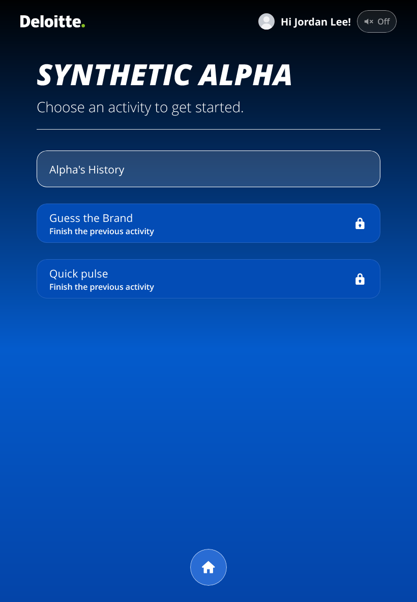
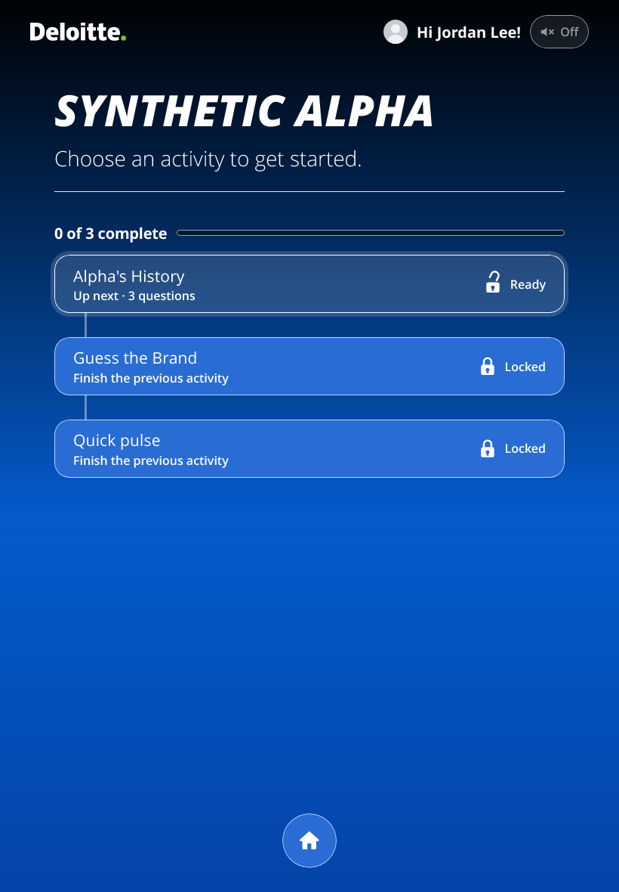
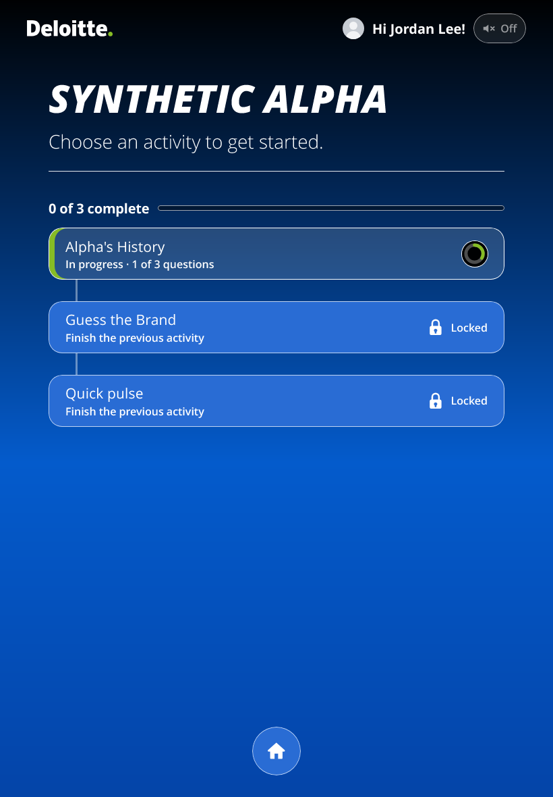
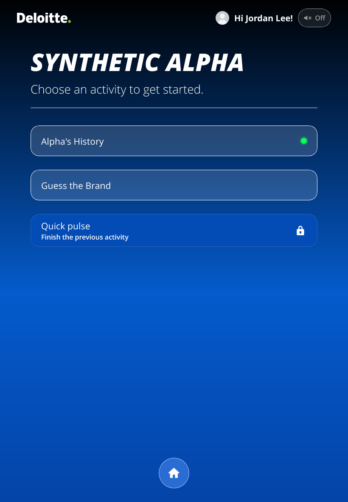
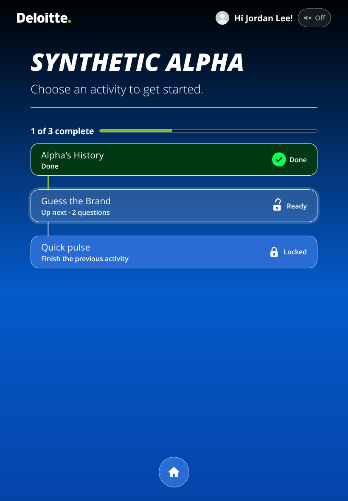
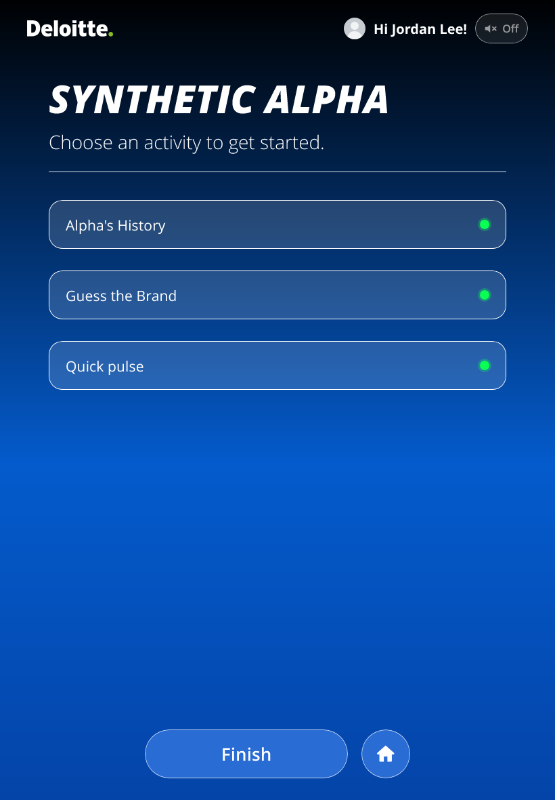
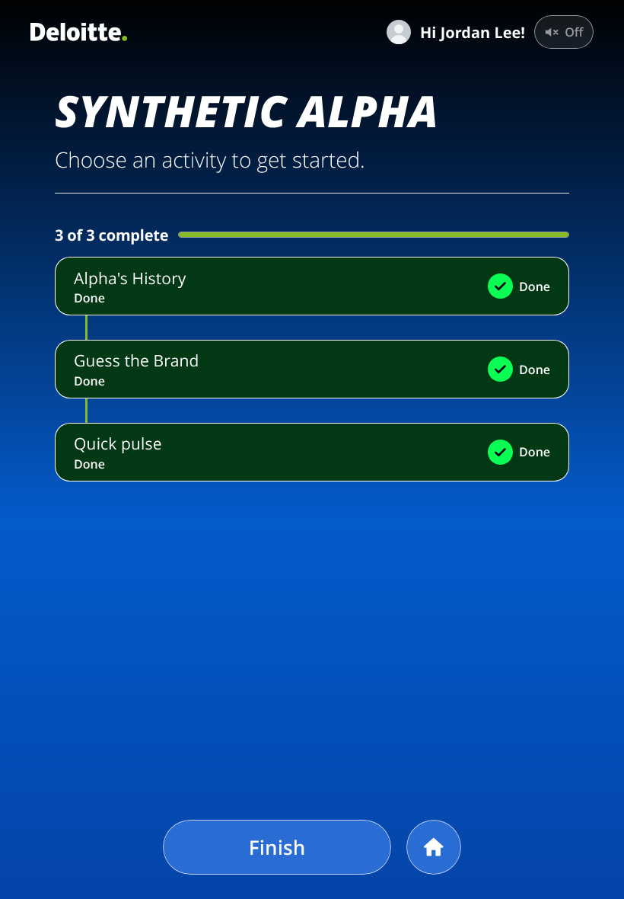

# Prompt 24: the Activities hub: four states, the unlock moment, sound and particles

Branch `pms-24`, made from `7be302a` (the tip of `pms-23`, which holds `pms-20` to `pms-23`; none is pushed). Not pushed.

Nothing about which activity opens, when, or what is saved changes: `activityStates` keeps its lock rule, and a property test over 2,000 random sessions holds the new
states to the old lock decisions. No new list, column, dependency, `pms-config.txt` key, request, colour token or sound file. No Setup run is needed for this prompt.

## What was built

1. **Four states as data** (`lib/participant/pager-logic.js`, `participantData.ts`): `done`, `progress`, `ready`, `locked`, with `answered`, `total` and `next`. The word `default` is gone from the hub.
2. **The look** (`components/ActivityPill.svelte`, `routes/Agenda.svelte`): a word, an icon and a colour for each; the padlock in two parts; the count and bar; the journey line; every state in the accessible name; Brand Studio's preview shows all four.
3. **The moment** (`lib/participant/hub-moment-plan.js`, pure; `Agenda.svelte` carries it out): stamp, journey line, unlock, pulse; all-done and its wave; the locked tap; one polite line.
4. **Four cues**, synthesised (`lib/effects/sound-cues.js`), behind the Sound switch.
5. **Two small sprays** (`lib/effects/confetti-plan.js`, `confetti.ts`) on the one overlay and the one library.

## Where the brief did not match the tree or itself, and what was decided

| Where | What was found | Decided |
|---|---|---|
| The unlock's time | Board 18 has it at 900 ms, 500 ms after the stamp; the brief says 360 ms in three places, one a named test. | 360 ms: stamp 400, journey line 580, unlock 760, pulse 1,150. |
| The 1,400 ms cap | The brief's pulse is 1,200 ms from 1,150 ms, which ends at 2,350 ms. | Every other beat ends inside the cap; the pulse's rings start inside it and fade by themselves. Nothing waits for them. |
| `previous` in `Agenda.svelte` | The hub is a new component each time the guest returns, so a component's `previous` would never see a change. | Held in a module-level map by track, in memory: a reload still plays nothing. |
| Reduce motion on an iPad | The brief's real-site check 2 says "a plain fade", but `resolveLevel` (Phase 8's rule) makes the device's setting `none`. | The rule stands: the change is instant. The fade is what the governor's `reduced` level shows. QA 288 says so. |
| Soft-range test | `test-effects.js` holds every tone at 200 Hz or more and every low-pass at 800 Hz or more; the brief's G3, F3 and 700 Hz fall outside. | An exception for `stamp` and `locked` only; every other cue keeps the old limits. |
| Loudness of G3 and F3 | A low sine cannot reach the others' A-weighted level under the -5 dBFS peak limit. | `stamp` and `locked` each carry a quiet octave and a short hold. Say if the manager hears them as less of a thud. |
| The 6 and 8 ms clicks | `test-effects.js` requires a 40 ms release on every note. | Noise clicks have that release, falling 80 dB, and are heard as a short click. |
| The 24 particle cap | The all-done burst the brief asks for is 120 pieces. | The cap covers the small sparks; the one medium burst is confetti and is outside it. |
| The word "table" in a comment | It added a Tailwind rule to the participant page (`test:bundle` caught it). | Reworded. |
| The manager's screenshots | They are not in the repo. | ASSUMED: Kroger's blue is the seed's `#0060A9`. |
| Admin allowance | The brief names only the participant's. | ASSUMED: at most 6,000 B on the admin page, which carries the hub for Brand Studio's preview. |
| The board's tick | Board 18 plays the existing `pick` tick at the journey line; the brief's cue list does not mention it. | Built, as the board says (`hubJourney`). |

## Before and after

WebKit (the iPad's engine), iPad portrait. `scripts/migration-tests/hub-situations.spec.ts` makes both ways round in Chromium and WebKit into `test-results/hub-situations/`.

| Situation | Before | After |
|---|---|---|
| First visit |  |  |
| One started |  |  |
| One done |  |  |
| All done |  |  |

## The cues as measured (Chromium, `effects-audio.spec.ts`)

A-weighted level while sounding, target about -22 dB, within 2 dB of the others. Peak under -5 dBFS.

| Cue | Peak (dBFS) | Level (dB A) | Audible (s) | Max (s) |
|---|---|---|---|---|
| `stamp` | -5.7 | -23.3 | 0.113 | 0.25 |
| `unlock` | -7.3 | -22.4 | 0.300 | 0.6 |
| `locked` | -5.4 | -23.2 | 0.197 | 0.25 |
| `allDone` | -11.0 | -22.1 | 0.444 | 0.8 |

## Long frames

Chromium, CPU four times slower, a complete-then-return (`hub-states.spec.ts`): 91 frames after the first 8, p50 16.7 ms, p95 16.8 ms, longest 16.8 ms, none over 50 ms. This stand-in is not an iPad: QA 287 is where a person judges it. The hub's paint cost was not measured apart from these frames.

## Page sizes (gzip)

| Page | Before | After | Change | Allowance |
|---|---|---|---|---|
| Participant | 176,809 B | 181,511 B | +4,702 B | 6,000 B (ceiling 450,000 B) |
| Admin | 670,430 B | 674,795 B | +4,365 B | 6,000 B (budget 700,000 B) |

## Gates

| Gate | Before (`pms-23`) | After |
|---|---|---|
| `check:svelte` | 0 errors | 0 errors |
| The hub's quick suites, before the work (pager, effects, motion plan and engine, theme, waits) | 160 of 160 | Followed by the whole of `npm test`, below |
| `npm test` | Not run on `pms-23` in this prompt | 2,064 of 2,064, after the last change |
| `test:bundle` | Prompt 23's figures | Pass, participant +4,702 B |
| `effects-audio.spec.ts`, Chromium | Not run on `pms-23` in this prompt | 25 of 25 |
| `hub-states.spec.ts`, `hub-situations.spec.ts` | New | Pass, Chromium and WebKit (one skip: the frames are Chromium only) |
| Browser subset, two browsers: a11y, keyboard, aria, reflow, contrast, motion, unsupported, effects, flow, participant, clients, brand-studio, devices, focus, alignment, sample-pictures, latency | Only the failures below were compared | 461 passed, 34 failed, 4 skipped; one of the 34 fixed since (below) |
| Full `test:migration`, `test:report:mutations`, `oracle`, `test:charts` | Not run | Not run: left to the final round |

The 34 browser failures:

- **Fixed:** `brand-studio.spec.ts` "lay Welcome and the hub out the same way", in both browsers (2 of the 34). A done pill had no caption and was shorter than the real hub's first pill. It now carries the board's "Done" caption.
- **Also failing on `pms-23`, checked in this prompt:** `contrast.spec.ts` admin (Live display ring, 1.64:1) and `devices.spec.ts` admin at iPhone landscape, in Chromium.
- **Already recorded as faults of this machine or of earlier work, not rerun on `pms-23`:** `reflow.spec.ts` admin at 200% in both browsers, `flow.spec.ts` header, `keyboard.spec.ts` admin and the 25 of `effects-audio.spec.ts` in WebKit on Windows. That last one was 17 tests before the four cues added 8, so **the new cues have not been measured in WebKit here**.
- **Order-dependent, and the same on `pms-23`:** `brand-studio.spec.ts` "an answer tile's picture", Chromium: it fails in a run of the whole file and passes alone, on both builds.

## Proposed, not done

Recorded sounds from an external library (needs licences and a size test); a slow ambient "dust in the spotlight" behind the curtains; a per-client sound or colour setting; haptic taps (iOS does not allow them from a web page); a shared "room progress" ring on the wall; a streak or badge for finishing every activity.

## Open questions for the manager

1. Does "need to complete" mean **started but not finished** (In progress) and "open" mean **not started** (Ready)? This build assumes yes.
2. Should the open padlock show on every Ready activity in an any-order session, or only on the next one? This build shows it on every one.
3. Should sound be on by default? It follows the existing default and the "On" pill, unchanged.
4. **New, from the pictures.** The brief puts locked in `--action`, which on a blue client is brighter than the glass of Ready, so a locked pill can look more active than an open one. The padlock, the word, the caption and Ready's halo tell them apart. Is that the wanted emphasis, or should locked stay darker, as it was?
